<!--
【タイトル候補】
1. 学生なら1Passwordが2年間無料！GitHub Student Developer Pack の特典を、必要性とセキュリティの面から整理した
2. 1Password が学生は2年間無料に：GitHub 学生認証から SSH キー管理・コミット署名まで
3. 「パスワード管理は後回し」な学生開発者へ：1Password 2年間無料特典の使いどころ

【画像について】
- img-00 〜 img-03 は GPT Image 2.5 で生成した解説画像（ウォーターマークなしで再生成済み）
- demo-01 〜 demo-10f は実機スクリーンショット（2026-11-07 / 11-08 撮影）。赤枠は撮影時に入れたもの
- メールアドレスとキーのフィンガープリントは赤塗りで伏せ済み。demo-06a はアドレスバーの URL（サインアップ用コード付き）を黒塗り済み
- demo-10b〜10f はウィンドウ外に写っていた VS Code の断片を切り落とし済み
- 元のスクショは images/_original/ に退避済み（.gitignore 済みで push されない。記事では使わない）
- 画像の URL は https://raw.githubusercontent.com/shahin99991/Qiita-github/main/1password-student-pack/images/<ファイル名> で統一
- 公開前に必ず GitHub へ push して raw URL を有効にすること

【記事内で「未検証」と明記している点】
- SSH 接続の認証（ssh -T git@github.com など）、Git コミット署名の設定、署名つきコミットの Verified 確認（公式ドキュメントの要約）
- op run によるシークレット参照（公式ドキュメントの要約）
- 1Password for Agents は学生特典に含まれるか不明

【公開前チェック】
- [ ] 画像を push して raw URL が開けることを確認する
- [ ] GitHub Education の特典一覧（education.github.com/pack）の 1Password の表記（1年 or 2年）を、公開直前にもう一度確認する
- [ ] 余裕があれば、SSH Agent とコミット署名を実際に試して「未検証」の節を実機ベースに書き換える
- [ ] front matter の ignorePublish を false に戻す
-->

## はじめに

こんにちは！VSCode/GitHub オタクの Microsoft Student Ambassador / GitHub Copilot User Group Japan 運営のロホマン シャヒンです！

:::note
この記事が少しでも参考になったら、**ぜひいいね・共有**をお願いします！
:::

GitHub Student Developer Pack の特典の中で、地味に見落とされがちなのが **1Password** です。2026年10月に、この特典の無料期間が **1年から2年に延びました**。

「パスワード管理ツールって、社会人になってからでいいかな」と思っていた人ほど、このタイミングで一度ちゃんと見てほしいです。学生のうちに「秘密情報をコードやメモ帳に置かない」習慣をつけておくと、あとで本当に楽になります。

この記事では、**公式ページと GitHub Education の更新履歴、海外の動き（GitGuardian のレポートや 1Password の発表）** を読んだうえで、**実際に受け取って、GitHub の SSH キーを作り、デスクトップアプリで SSH Agent を有効にする**ところまでをまとめます。

- 何が無料になったのか、どこまでが対象なのか
- 学生開発者にとって、なぜ必要なのか
- セキュリティ面で何が違うのか（SSH キー・コミット署名・API キー・AI エージェント）
- 受け取りの手順（スクショつき）と、SSH キー作成〜SSH Agent の有効化

対象読者は、GitHub を使っている大学・専門学校などの学生で、パスワード管理をまだちゃんとやっていない方です。

:::note info
この記事の情報は 2026年11月8日 時点のものです。特典の条件は変わることがあるので、受け取る前に必ず公式ページを確認してください。
:::

## 何が無料になったのか

1Password は、パスワードや SSH キー、API トークンなどを **暗号化して保管し、必要なときに自動入力してくれる** パスワードマネージャーです。

公式の学生向けページでは、次のような内容が紹介されています。

- すべてのデバイスで強力なパスワードを生成・保存・自動入力
- 1Password を使っていない相手とも、安全にアイテムを共有
- **1Password Developer Tools**：開発ライフサイクル全体でシークレットを管理

開発者向けの部分は、英語版ページに具体的な説明があります。

- 内蔵の **SSH Agent** で Git / SSH の認証を行い、コミットに署名し、安全な設定で SSH キーを作成
- API アクセストークンを 1Password に保管して、**生体認証でサードパーティの CLI を使う**（シェルプラグイン）
- 1Password for VS Code、op-js、SDK などのオープンソースプロジェクト

### 受け取る前に知っておきたい条件

公式 FAQ から、特に大事なところだけ抜き出します。

- **対象**: GitHub Global Campus（GitHub Education）で学生として申請し、認証された人
- **すでに 1Password を契約している場合**: 引き換え可能。支払い済みの期間は日割りのクレジットとして残り、無料期間のあとに使える
- **利用地域**: 世界中で利用可。引き換え時にデータの保管地域（米国・カナダ・EU）を選ぶ。**選んだあとは変更不可**
- **ファミリーアカウント**: 対象外（個人アカウントのみ）
- **2年間のあと**: この特典は 1回しか使えない。期間が終わると購入が必要になるが、在学中なら 50% の学生割引を申請できる場合がある

:::note warn
⚠️ **データの保管地域は慎重に選んでください。** 引き換え後は移せないと FAQ に明記されています。迷ったら、1Password の「地域を選ぶ」ページを先に読むのがおすすめです。
:::

## なぜ学生開発者に必要なのか

### 学生のうちに増えるもの

学生になると、アカウントが一気に増えます。大学のポータル、学内システム、GitHub、Azure、各種クラウドの無料枠、サークルや研究室のサービス、就活サイト。そこに、授業やハッカソンで使う API キーが加わります。

ここで起きがちなのが、次のような状況です。

- 同じパスワードを使い回している
- API キーを `.env` ではなく、ソースコードに直書きして push してしまう
- SSH の秘密鍵を `~/.ssh` に置いたまま、PC を何台も乗り換える

正直、どれも「自分もやったことある」という人が多いんじゃないでしょうか。私も最初は似たようなものでした。

### 海外のデータが示す「秘密情報の漏えい」

GitGuardian の「State of Secrets Sprawl 2026」では、**2025年だけで約2,865万件（28.65 million）の秘密情報が公開 GitHub のコミットに新たに混入した** と報告されています。前年から 34% の増加で、同社が記録した中で最大の年間増加幅だそうです。

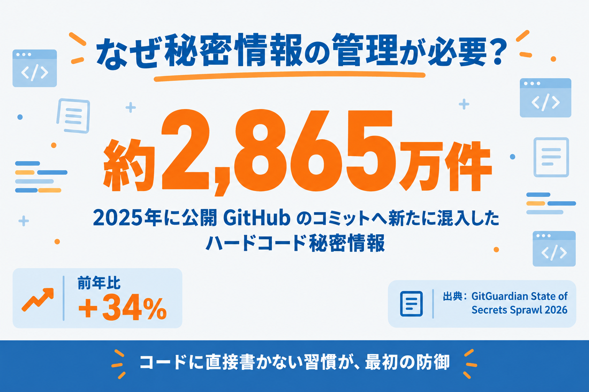

同じレポートでは、次の点も指摘されています。

- AI サービスの認証情報の漏えいが前年比で 81% 増えた
- AI エージェント向けの設定ファイル（MCP の設定など）に、認証情報を直書きするケースが増えている
- 公開 GitHub は 2025年に、アクティブな開発者の 54% が初めてコミットした年でもあった（新しく始めた人が多い）

つまり「初心者が増えて、AI でコードが増えて、秘密情報も一緒に増えた」という流れです。学生はこの層のど真ん中にいます。

だからこそ、**最初から「秘密情報はコードに書かない」仕組みを持っておく** ことが効きます。1Password はその置き場所として使えます。

## セキュリティ面で押さえたいポイント

### 暗号化の考え方

1Password は、データを **端末の中で暗号化してからクラウドに送る**（エンドツーエンド暗号化）設計です。暗号化キーは、アカウントのパスワードと **Secret Key**（アカウント作成時に生成される秘密の値）から導出されます。設計の詳細は、公式の Security Design White Paper が公開されています。Secret Key の扱い（Emergency Kit）については、あとの「受け取り方」の Step 6 でも触れています。

### SSH キーを「ディスクに置かない」

開発者向けの目玉は **SSH Agent** です。公式ドキュメントには、平文の SSH キーをディスクに置いたままにすることや、署名されていない Git コミットが、認証情報の漏えいとサプライチェーンリスクの典型的な原因だと書かれています。

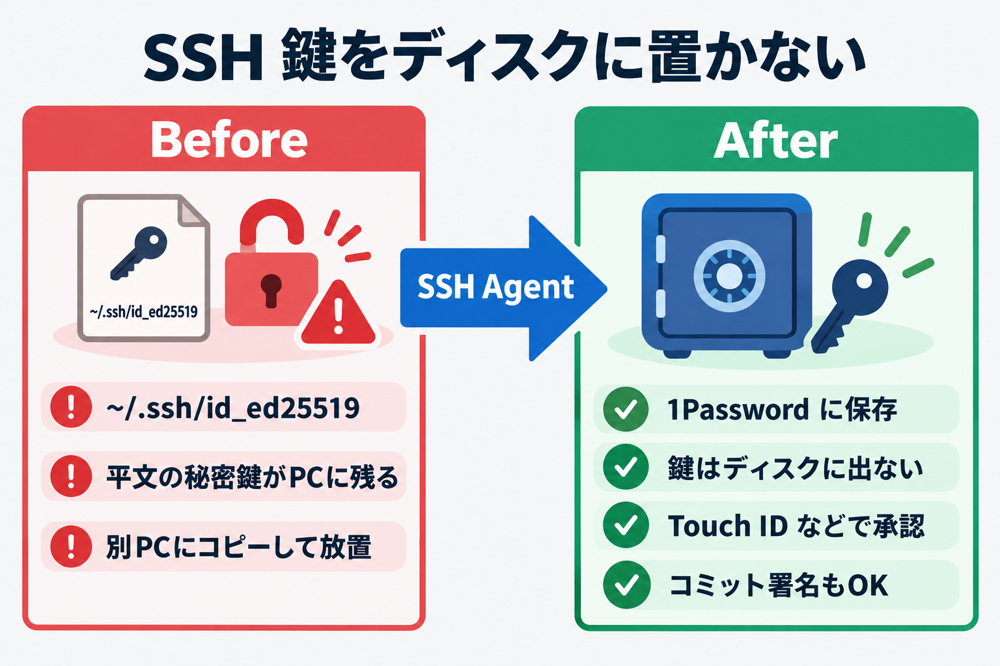

1Password を使うと、次のように変わります。

- 秘密鍵は **1Password に暗号化されたまま保管**され、ディスクには書き出されない
- Git / SSH の操作時に、Touch ID などで **本人が承認** する
- GPG キーを用意しなくても、**SSH キーで Git コミットに署名**できる

コミット署名が大事な理由も、公式ドキュメントが書いています。プッシュ権限を持つ人は、他人になりすましたコミットを作れてしまうからです。署名しておけば、GitHub などで「Verified」と表示され、本人が作った変更だと確認できます。

### API キーを「コードに書かない」

もうひとつが、CLI とシェルプラグインです。たとえば `.env` に生のキーを書く代わりに、1Password への **参照**（`op://...`）を書いておき、実行時だけ値を渡せます。

```bash
# .env には値ではなく 1Password への参照だけを書く
# API_KEY=op://Personal/my-api-key/credential
op run --env-file=.env -- npm start
```

これなら、`.env` を間違えて push しても、漏れるのは参照名だけです。

### AI エージェントとの付き合い方

AI エージェントにコードを書かせる機会が増えると、「エージェントにパスワードをそのまま渡してしまう」という近道が気になってきます。

1Password は 2026年10月22日に **1Password for Agents** を発表しました。プレスリリースによると、エージェントはログイン画面に到達したとき、1Password に対して自分の身元を示し、**人が承認すると、1Password がパスワードを直接フォームに入力する**仕組みです。エージェント自身はパスワードを見ません。

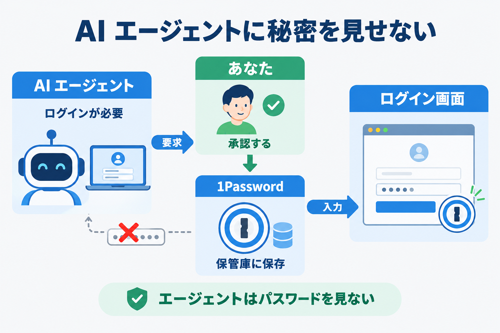

:::note info
💡 **この機能は、学生向け特典に含まれるとは確認できていません。** 1Password for Agents は個人向けエージェントとの連携として発表されたものです。学生向け無料特典で使えるかどうかは、公式ページには書かれていないので、「考え方として知っておく」くらいの位置づけで読んでください。
:::

## 受け取り方（実際にやってみた）

ここからは、私が実際に受け取った手順です。事前に GitHub Education の学生認証を済ませてあるアカウントで進めました。学生認証は GitHub Education 側のルールに従います。学校のメールアドレスや在籍を示す書類で申請する形なので、日本の学校の場合の細かい条件は GitHub Education のヘルプで確認してください。

### Step 1: 学生向けページから GitHub でサインイン

https://1password.com/developers/students を開くと、見出しが **「Get two years of 1Password for free with the GitHub Student Developer Pack」** になっていました。ここで「2年間」が確認できます。**Sign in with GitHub** を押して進みます。

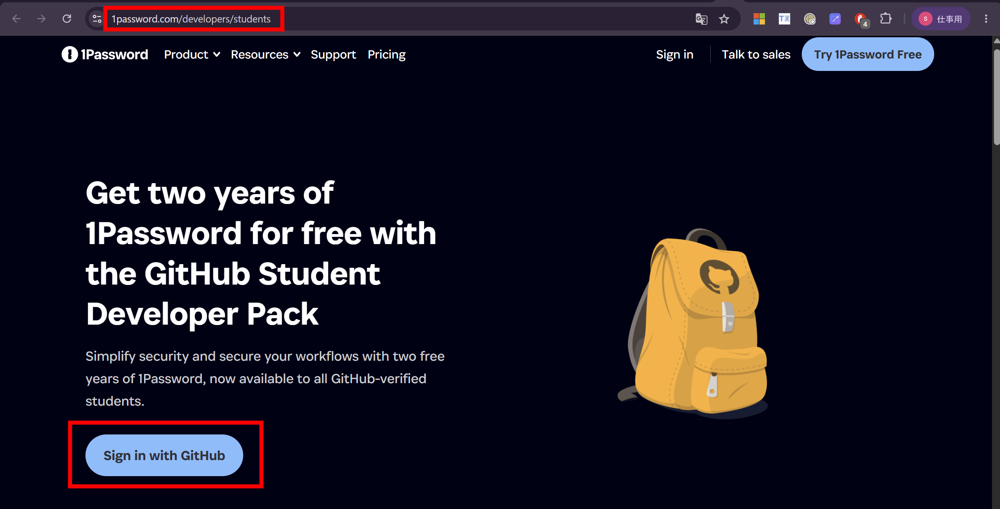

### Step 2: GitHub アカウントを選んで認可する

GitHub 側で、どのアカウントで認可するかを選びます。複数のアカウントでサインインしている場合は、ここで選択画面が出ます。学生認証済みの `shahin99991` で **Continue** を押しました。

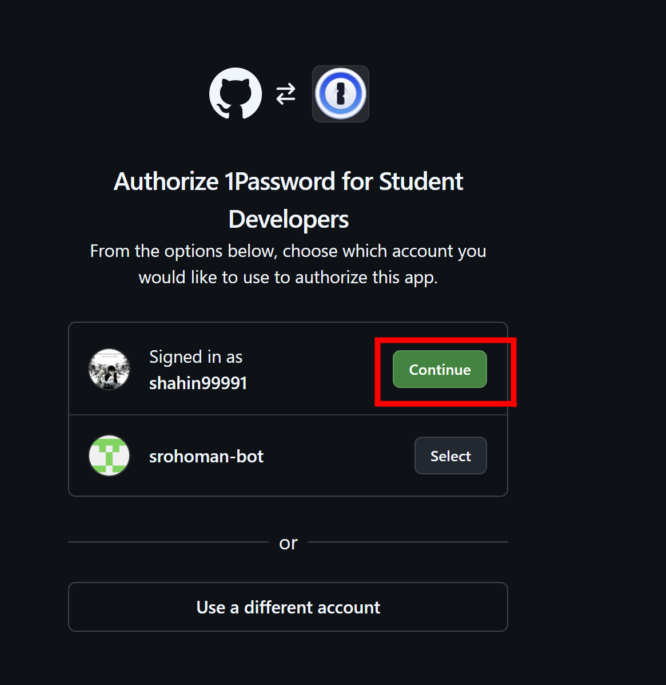

次の画面で **Authorize 1Password** を押します。要求される権限は **Public data only**（公開データへの限定的なアクセス）でした。

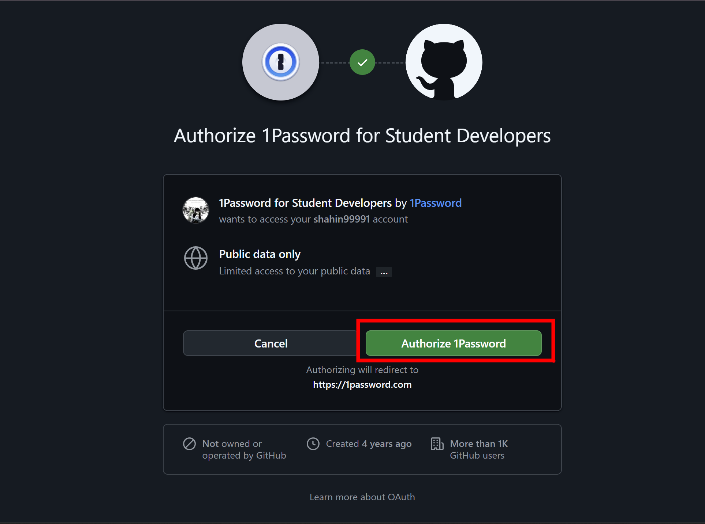

:::note info
💡 **認可の中身を見ておくと安心です。** 認可画面に出る権限が「Public data only」だけなので、非公開リポジトリなどへのアクセスを渡す形ではありませんでした（私が見た画面の範囲での話です）。
:::

### Step 3: データの保管地域を選んで、アカウントを作成

「Just one more step...」の画面で、1Password のデータの保管地域を選びます。選択肢は **US（1password.com）／CA（1password.ca）／EU（1password.eu）** の3つでした。

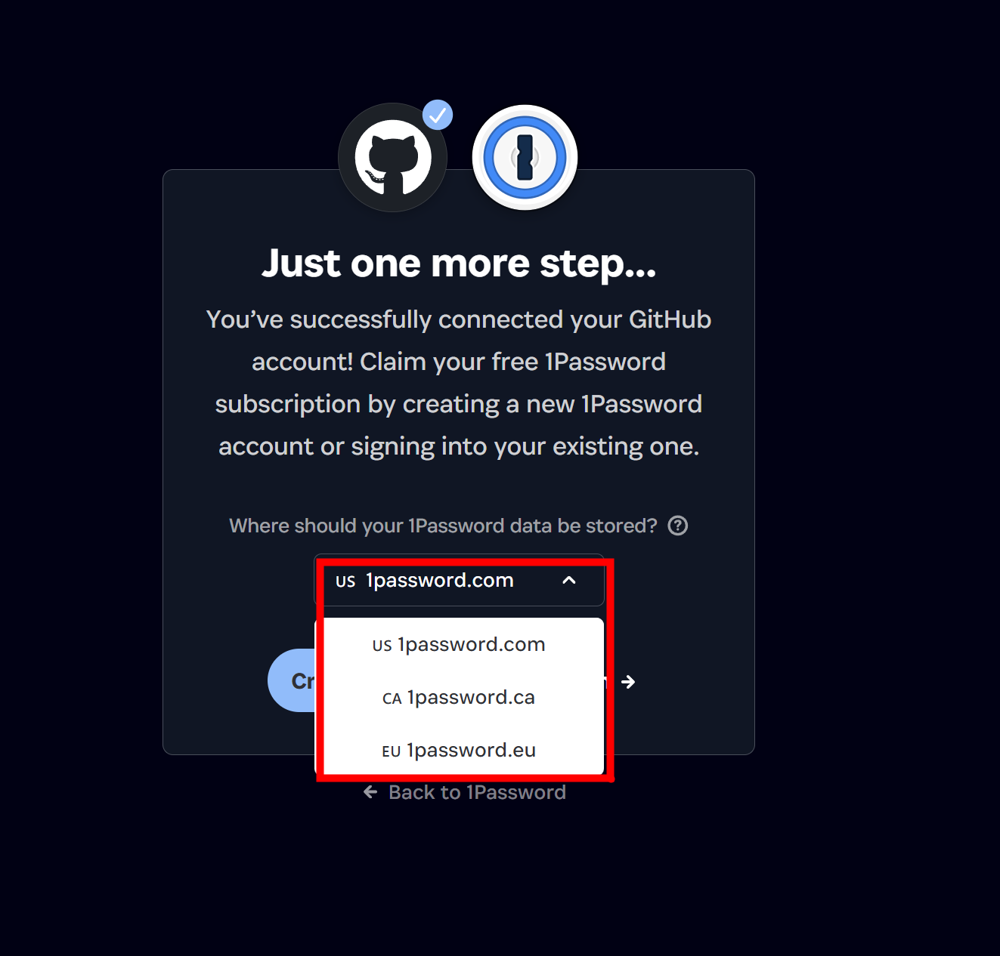

地域を決めたら **Create an account** を押します。すでにアカウントを持っている場合は、隣の **Sign in** から進めます。

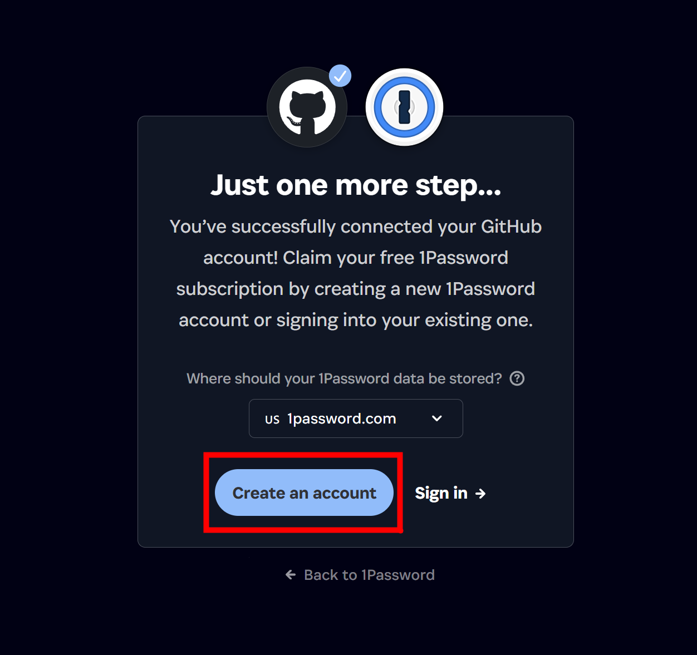

:::note warn
⚠️ **保管地域は慎重に選んでください。** 引き換え後は移せないと FAQ に明記されています。私が見た画面にはこの注意書きが表示されていなかったので、選ぶ前に公式 FAQ を読んでおくのがおすすめです。
:::

### Step 4: 日本語の案内ページで「2年間無料」を確認

アカウント作成の流れに入ると、日本語のページが表示されました。見出しは **「GitHub Student Developer Packで1Passwordを2年間無料で利用しましょう」** です。日本語の引き換え画面でも2年間になっていることが確認できました。

左側の説明には、**CLI、シェルプラグイン、SSH エージェントを含むデベロッパーツールへのアクセスが含まれる**と書かれています。右側では、ブラウザ拡張機能の追加を案内されます。

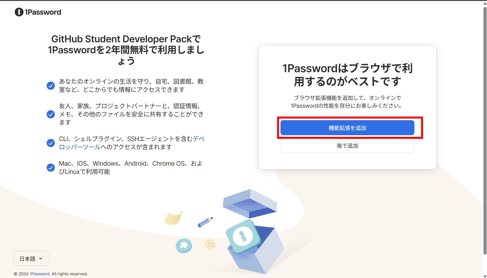

### Step 5: Chrome にブラウザ拡張を追加

**機能拡張を追加** を押すと、Chrome ウェブストアの 1Password 拡張のページが開きます。提供元は AgileBits Inc で、約700万ユーザー、評価は 4.4（3,916件）と表示されていました。**Chrome に追加** を押します。

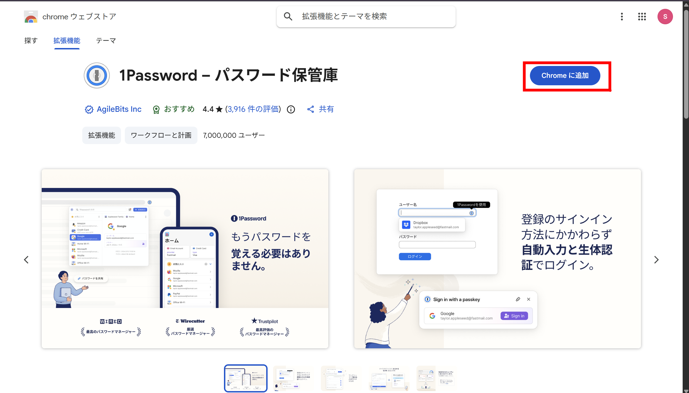

追加の確認ダイアログには、権限として **「すべてのウェブサイト上にある自分の全データの読み取りと変更」** などが並びます。

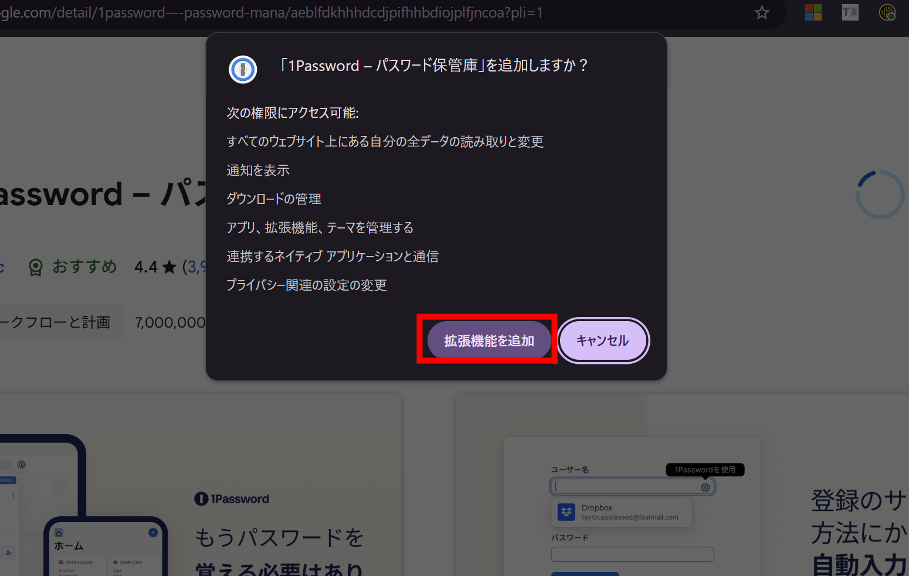

:::note info
💡 **この権限の広さは、パスワードマネージャーの拡張では珍しくありません。** あらゆるサイトのログインフォームを見つけて自動入力するために、全サイトのページを読む権限が必要になるためです。気になる人は、入れる前に提供元と配布元のページ（公式の拡張か）を確認してください。
:::

### Step 6: アカウントを作成する

拡張を追加すると、アカウント作成のページに移ります。画面上部には「機能拡張を追加 → アカウントを作成 → 拡張機能の設定 → パスワードをインポート」という4つのステップが出ていました。氏名とメールアドレスを入力して **次へ** を押します。

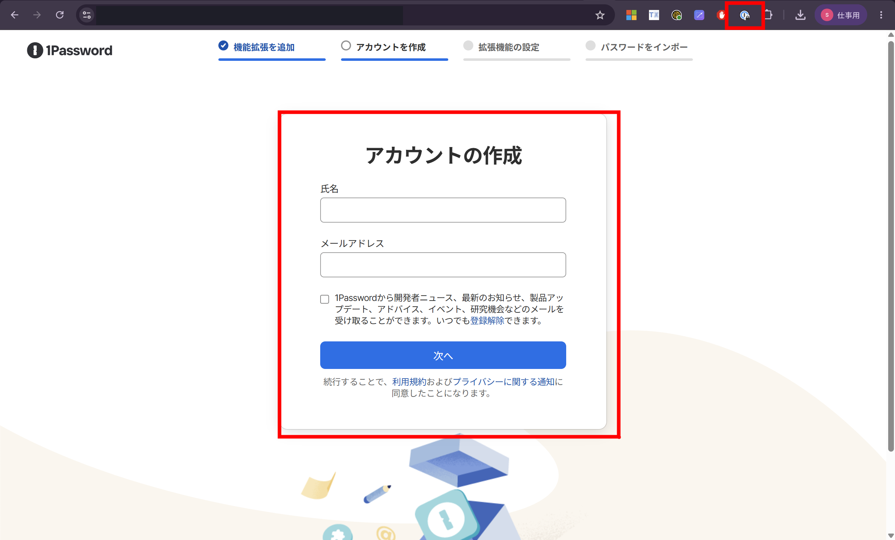

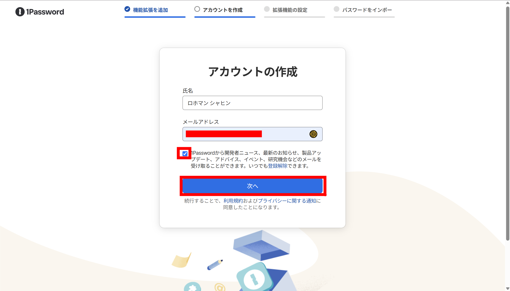

:::note warn
⚠️ **Emergency Kit（Secret Key を含む書類）は必ず保管してください。** パスワードを忘れても、運営側が代わりに復旧できる設計ではありません。このあとのマスターパスワード設定や Emergency Kit の画面は撮影していないので、画面の案内に従って、印刷するか安全な場所に保存しておきましょう。
:::

### Step 7: セットアップを終えて、保管庫を開く

アカウントができると、「セットアップを開始」の画面が出ます。「アカウントを追加」と「ブラウザ拡張のピン留め」にチェックが付き、1Password の使い方を学ぶ練習チュートリアル（2〜3分、何も保存されない）は任意で選べる形でした。

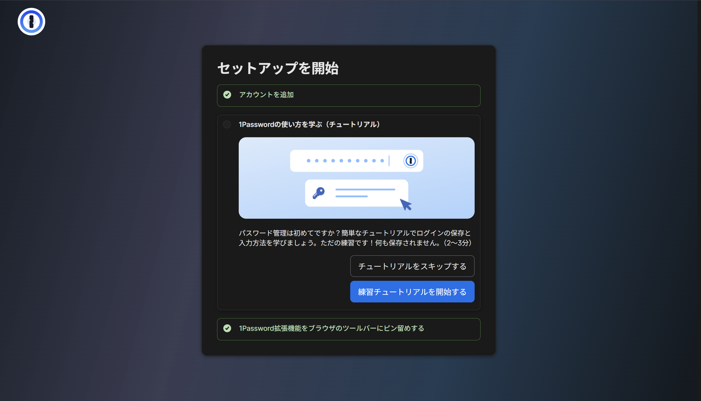

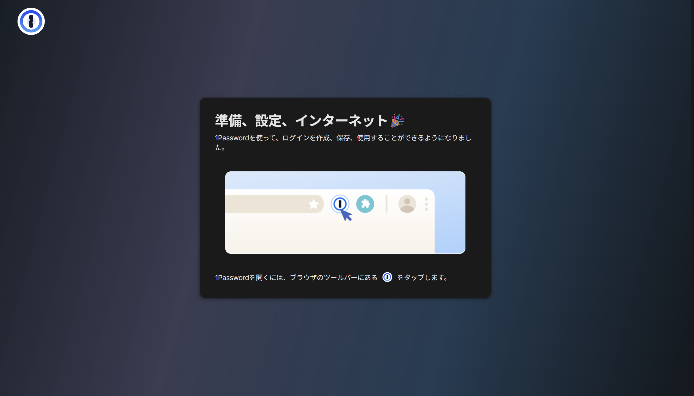

ツールバーの 1Password アイコンを押すと、ブラウザ拡張の中に保管庫が開きます。最初から「1Password アカウント」のログイン情報が入っていて、**「ここからスタート 残り4ステップ」** というガイドも出ていました。

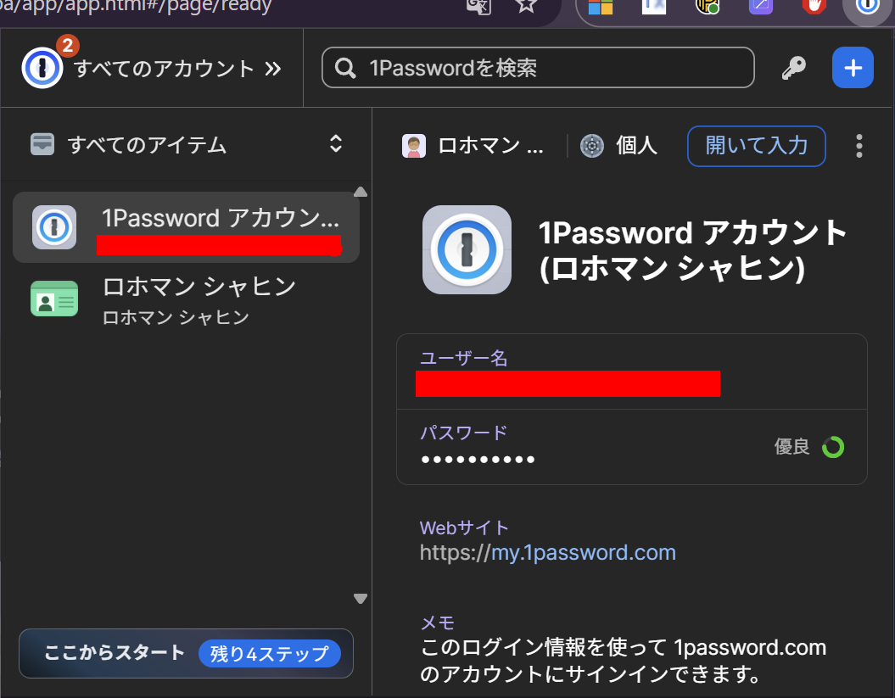

ここまでで、**受け取りは完了**です。次は、この保管庫を使って SSH キーを作ってみます。

## GitHub の画面から SSH キーを作ってみた

受け取った 1Password は、SSH キーの作成から GitHub への登録までをつなげてくれます。**ブラウザ拡張だけで、鍵の生成と公開鍵の貼り付けが終わりました。**

GitHub の [SSH キー登録ページ](https://github.com/settings/ssh/new)（Settings → SSH and GPG keys → New SSH key）を開いて、Title 欄をクリックします。すると 1Password のメニューが出て、**「SSHキーの作成...」** が選べます。

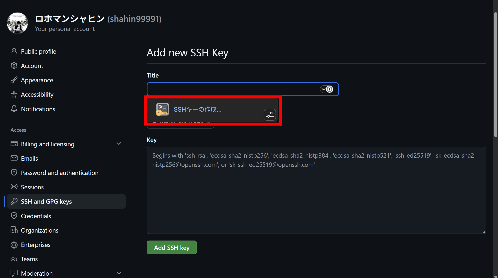

Key 欄からも同じメニューを開けます。この時点の Key type は、デフォルトの **Authentication Key**（認証用）でした。

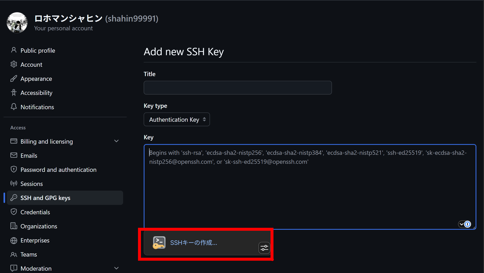

「SSHキーの作成と入力」のダイアログでは、タイトルに `GitHub`、鍵の種類に **Ed25519**（「最速かつ最新の規格」と説明が出ます）を選び、保存先の保管庫（私は「個人」）を指定して **作成と入力** を押します。

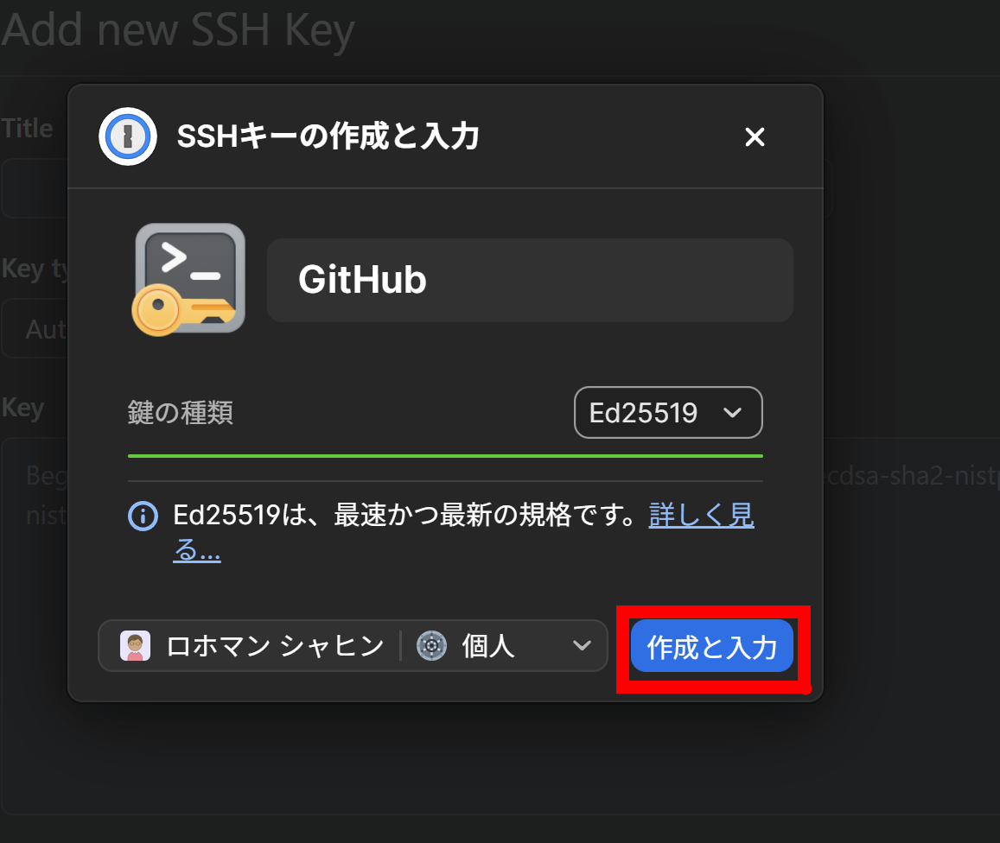

すると、Title と Key の欄に **公開鍵が自動で入力**され、Chrome の通知で **「アイテムが保存されました 『GitHub』は『個人』に保存されました。」** と表示されました。あとは **Add SSH key** を押せば登録できます。

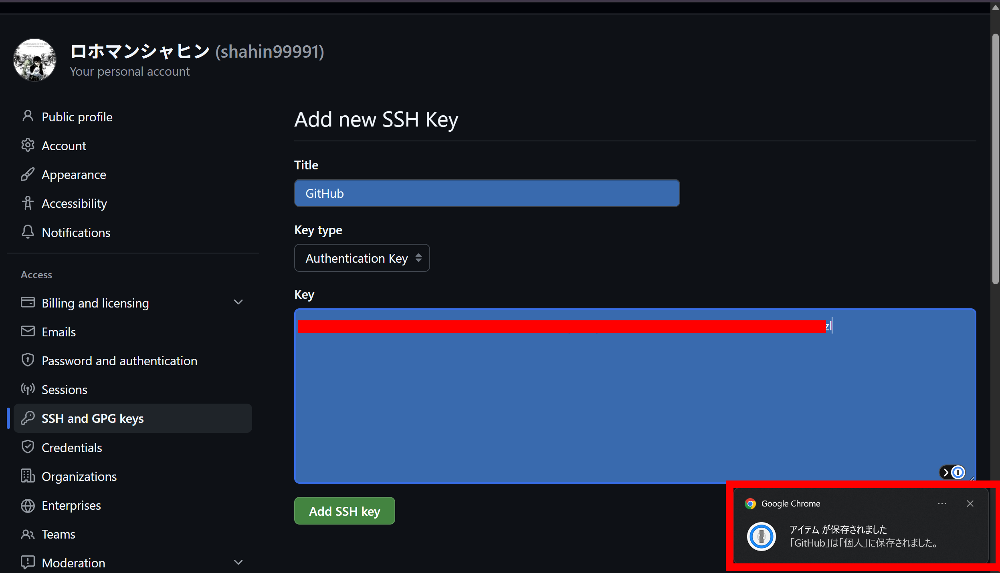

GitHub に登録するのは **公開鍵だけ**で、秘密鍵は 1Password の保管庫に入ります。`ssh-keygen` で鍵を作って `~/.ssh` に置く手順と比べると、**秘密鍵のファイルがそもそも手元に作られない**のが大きな違いです。

:::note info
💡 **ここまでで作ったのは「鍵を保管する」ところまでです。** この鍵を `git push` などで実際に使うには、1Password のデスクトップアプリで SSH Agent を有効にする必要があります。次の節で進めます。
:::

## デスクトップアプリで SSH Agent を有効にする

SSH キーを実際の認証に使うのは、デスクトップアプリ側の **SSH Agent** です。公式ドキュメントでも、デスクトップアプリのインストールが前提になっています。アプリは [1Password のダウンロードページ](https://1password.com/downloads) から入れて、サインインします。

### サインインする

アプリを起動すると、サインインのダイアログが出ます。**1Password.com でサインイン**（ブラウザ経由）、モバイルアプリで QR コードをスキャン、サインイン情報を手で入力、の3つから選べました。

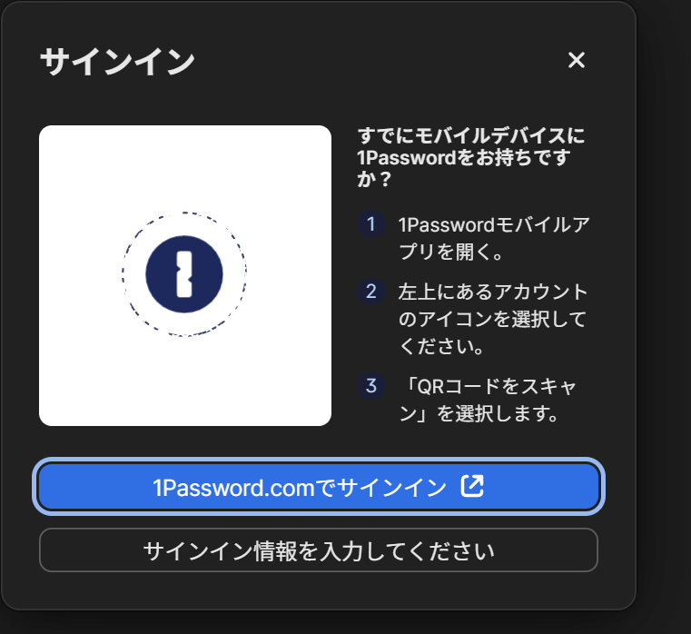

### 「開発者」の画面から SSH エージェントを開く

サインインすると、左のメニューに **「開発者」** があります。開くと、次のカードが並んでいました。

| カード | 画面の説明 |
| ------ | ---------- |
| SSHエージェント | SSH キーの管理、Git コミットへの署名、SSH 接続の認証を行う |
| 環境 | 環境で秘密情報管理を簡素化する |
| CLI | ターミナルから 1Password にアクセスし、シークレットの読み込みやアイテムの管理を行う |
| Watchtower | `.env` ファイルや SSH キーを含む、このデバイスのプレーンテキストに保存されている開発者シークレットを確認し、1Password にインポートする |
| MCP サーバー | ローカルの MCP サーバーを実行し、AI アシスタントが 1Password の開発ツールにアクセスできるようにする |

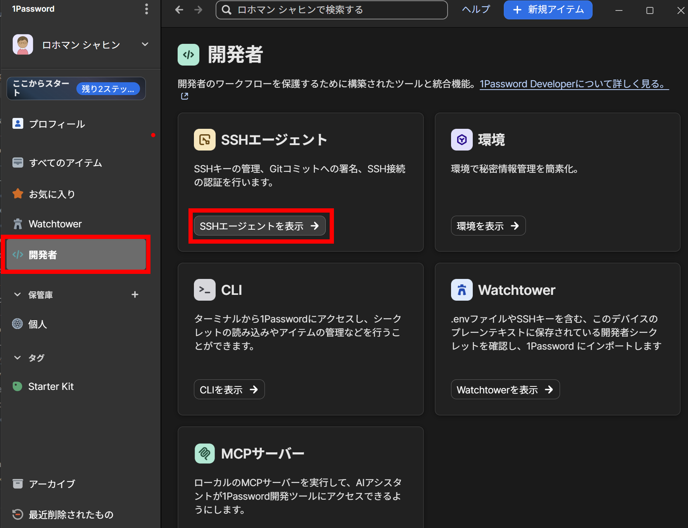

この記事のテーマに近いのは、**Watchtower**（手元に平文で置きっぱなしの `.env` や SSH キーを見つけて、1Password に取り込める）と、**CLI**、**SSH エージェント**です。MCP サーバーのカードもあるので、AI アシスタントとの連携が、デスクトップアプリ側にも用意されていることが分かります。使い方までは、この記事では試していません。

**SSHエージェントを表示** を押して、**SSHエージェントの設定** ボタンを押します。

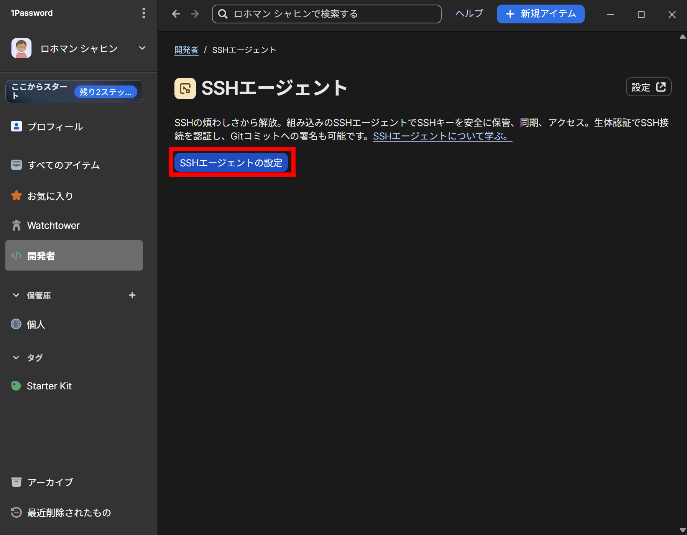

### 設定中に聞かれる2つの確認

設定の途中で、ダイアログが2回出ました。

**1つ目は「1Password が SSH キー名をディスクに保存できるようにしますか？」** です。SSH 接続を認証するときにキーの名前を表示するには、**アイテムのタイトルを、暗号化されていない状態でハードドライブに保存する**必要がある、という説明でした。SSH キーが複数あるときに見分けやすくなります。選択肢は **キー指紋のみを使用** と **キー名の使用** で、私は「キー名の使用」を選びました。

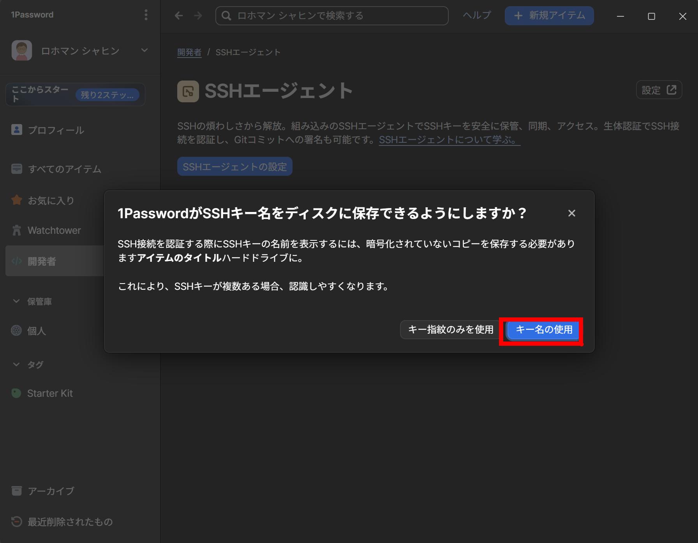

:::note info
💡 **ディスクに保存されるのは「キーの名前」で、秘密鍵ではありません。** ダイアログの説明は、アイテムのタイトルを平文で保存するという内容でした。タイトルに他人に見られたくない情報を入れない、もしくは「キー指紋のみを使用」を選ぶ、という使い分けになります。
:::

**2つ目は「OpenSSH を無効にしていませんか？」** です。1Password の SSH エージェントと競合しないように、OpenSSH の認証エージェントを無効にする必要がある、という確認でした。無効にしてあれば **はい、OpenSSH は無効です** を押して進みます。

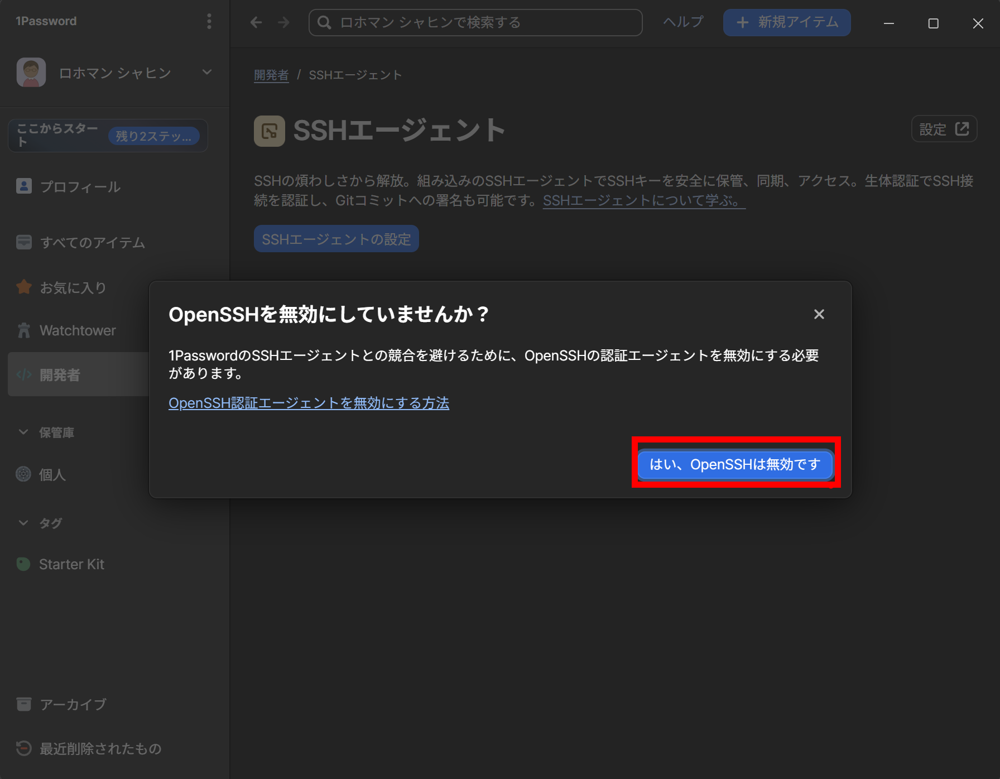

:::note warn
⚠️ **すでに OpenSSH の認証エージェントを使っている人は、先に無効にしてください。** 画面のリンク「OpenSSH認証エージェントを無効にする方法」から手順が見られます。両方が動いていると競合する、というのがダイアログの説明です。
:::

### 「実行中」になって、GitHub の鍵が見える

設定が終わると、SSH エージェントの横に **「実行中」** の表示が付き、画面下に **「SSH エージェントが正常に設定されました。」** と出ました。「利用できるSSHキー」の一覧には、先ほど GitHub の画面から作った **GitHub** のキーが出ています。

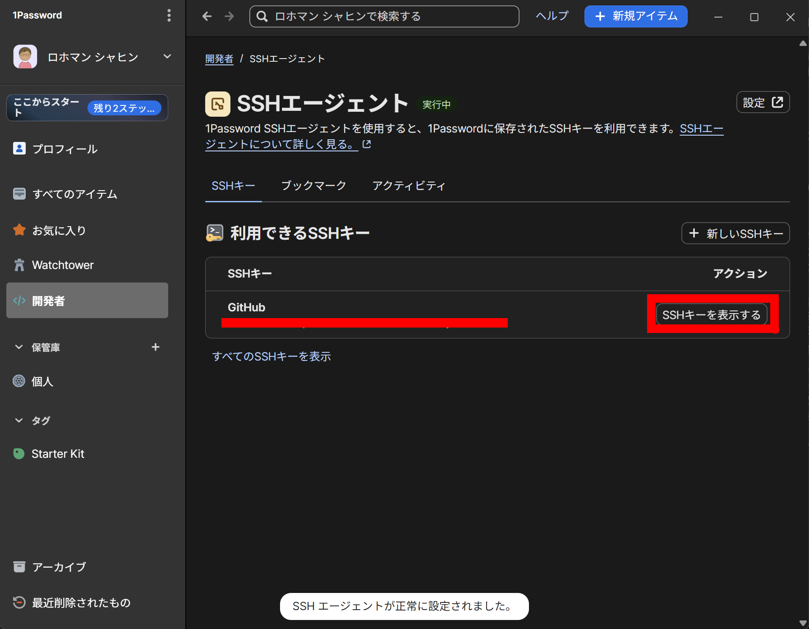

これで、**ブラウザ拡張で作った鍵を、デスクトップアプリの SSH Agent が使える状態**になりました。

## ここから先：Git 認証とコミット署名（公式ドキュメントより）

### SSH クライアントから Agent を使う

SSH Agent を有効にしたら、SSH や Git のクライアントが 1Password の Agent を使うように設定します。macOS / Linux では、`~/.ssh/config` に SSH Agent のソケットを指定します。Windows は名前付きパイプが使われるので、この設定は不要です。

```text:~/.ssh/config
# macOS
Host *
  IdentityAgent "~/Library/Group Containers/2BUA8C4S2C.com.1password/t/agent.sock"

# Linux の場合は次の行を使う
# Host *
#   IdentityAgent ~/.1password/agent.sock
```

### Git コミット署名を設定する

署名設定は、1Password アプリから自動でできます。公式ドキュメントの手順は次のとおりです。

1. 署名に使う SSH キーをアプリで開く
2. メニューから **Configure Commit Signing** を選ぶ
3. **Edit Automatically** を選ぶ（手動なら **Copy Snippet** で `~/.gitconfig` に貼る）

自動設定では、`gpg.format` が `ssh` に、`user.signingkey` が選んだ公開鍵に、`commit.gpgsign` が `true` に設定されます。Git は 2.34 以降が必要です。

次に、GitHub の [SSH キー設定](https://github.com/settings/ssh/new) に公開鍵を登録します。**署名に使う鍵は Key type を `Signing key` にします。** 上の画面の初期値は Authentication Key だったので、署名にも使うなら、Authentication 用とは別に Signing key としても登録する必要があります。

### 署名つきでコミットして確認する

```bash
git commit --allow-empty -m "test: signed commit with 1Password"
git log --show-signature -1
git push
```

コミットのとき、1Password から承認を求められます。push したあと、GitHub のコミット一覧に **Verified** バッジが付いていれば成功です。

## トラブルシューティング

### Q: 特典が「1年」と表示される

**A**: 言語によって、1Password 側のページにまだ古い表記が残っているようです。私が確認した範囲では、英語版の学生向けページと日本語の引き換えページは「2年」でした。GitHub Education の更新履歴でも、2026年10月2日付で2年に更新されています。引き換え時の画面の表示を確認してください。

### Q: すでに 1Password を有料で使っている

**A**: FAQ によると、引き換えは可能で、支払い済みの期間は日割りのクレジットとして残ります。ファミリープランへの適用は対象外なので、個人アカウントかどうかを確認してください。引き換え画面にも、新規作成（Create an account）と既存アカウントでのサインイン（Sign in）の両方の選択肢がありました。

### Q: GitHub の画面で「SSHキーの作成...」が出てこない

**A**: ブラウザ拡張が入っていて、1Password にサインイン済みか確認してください。Title 欄か Key 欄をクリックしたときに、拡張のメニューが出ます。

### Q: SSH Agent の設定中に「OpenSSH を無効にしていませんか？」と聞かれた

**A**: 1Password の SSH エージェントと競合しないように、OpenSSH の認証エージェントを無効にする必要がある、という確認です。ダイアログ内の「OpenSSH認証エージェントを無効にする方法」のリンクから手順を見られます。無効にしたあとで、「はい、OpenSSH は無効です」を押してください。

### Q: 署名つきコミットが Verified にならない（公式ドキュメントより）

**A**: GitHub に登録した公開鍵の **Key type が `Signing key`** になっているか確認してください。`user.email` が GitHub アカウントに登録済みのメールアドレスと一致している必要もあります。

## まとめ

この記事では、次のことを整理しました。

- 1Password の学生向け特典は、**1年から2年に延びた**（GitHub Education の更新履歴：2026年10月2日）。英語版ページと日本語の引き換え画面でも「2年」を確認した
- 対象は GitHub 学生認証済みの人で、**個人アカウントのみ・1回限り**。データの保管地域は選んだら変更できない
- 受け取りは、GitHub でサインイン → 認可（Public data only）→ 保管地域の選択 → ブラウザ拡張の追加 → アカウント作成、の順で進められた
- GitHub の SSH キー登録画面から、**1Password の拡張だけで Ed25519 の鍵を作り、公開鍵を自動入力できた**
- デスクトップアプリの「開発者」から SSH Agent を設定でき、**「実行中」になって GitHub の鍵が一覧に出た**。設定中には「キー名をディスクに保存するか」「OpenSSH を無効にしているか」の確認が出た
- 秘密情報の漏えいは増え続けていて、2025年だけで公開 GitHub に約2,865万件が混入した（GitGuardian）
- SSH 接続・コミット署名、CLI の `op run` は、**秘密鍵をディスクに置かない・API キーを `.env` に直書きしない**ための仕組み（この記事では未検証）

個人的には、SSH キーを作るところで「秘密鍵のファイルが手元に作られない」のが一番おもしろかったです！パスワード管理そのものより、こういう開発者向けの部分こそ、学生のうちに身につけておきたい習慣だと思っています。2年間あるので、実際の Git 認証やコミット署名もじっくり試していきます。

受け取れるのは1回だけなので、引き換えるときは保管地域と Emergency Kit の扱いだけ、落ち着いて進めてください。

## 参考

- [GitHub Student Developer Pack | 1Password（英語版）](https://1password.com/developers/students)
- [GitHub Student Developer Pack | 1Password（日本語版）](https://1password.com/jp/developers/students)
- [Student Developer Pack Partner Changelog（GitHub Education）](https://github.com/github-education-resources/Student-Developer-Pack-Current-Partners-FAQ/blob/main/SDP-changelog.md)
- [GitHub Student Developer Pack（GitHub Education）](https://education.github.com/pack)
- [Secure SSH and Git workflows with 1Password（1Password Developer）](https://www.1password.dev/get-started/secure-ssh-git-workflows)
- [Sign Git commits with SSH（1Password Developer）](https://www.1password.dev/ssh/git-commit-signing)
- [1Password Security Design White Paper](https://agilebits.github.io/security-design/index.html)
- [The State of Secrets Sprawl 2026（GitGuardian）](https://blog.gitguardian.com/the-state-of-secrets-sprawl-2026/)
- [1Password for Agents Launches as the Trust Layer for Personal AI Agents（1Password プレスリリース）](https://1password.com/press/2026/october/1password-for-agents-trust-layer-personal-ai-agents)
- [1Password libera 2 anos grátis para estudantes verificadas no GitHub Education（Menina de UX）](https://www.meninadeux.com/blog/1password-libera-2-anos-gratis-para-estudantes-verificadas-no-github-education)
