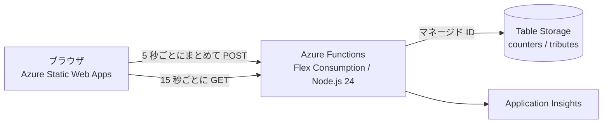

:::note info
追悼式場はこちら: https://wonderful-stone-0f390da0f.4.azurestaticapps.net/
リポジトリ: https://github.com/srohoman-bot/GitHub-Copilot-Harness-
:::

## はじめに

GitHub Copilot を毎日なにかしら触っているShahinです！

先日、GitHub の Changelog で「GitHub Copilot SDK is becoming Microsoft Copilot SDK」という発表が出ました。GitHub Copilot SDK が Microsoft Copilot SDK に変わっていくという話です。Changelog によると、既存ユーザーに今すぐの変更は必要なく、パッケージ名や名前空間は段階的に移行していきます。製品が消えたわけではなく、変わるのは名前です。

でも「GitHub Copilot SDK」という名前は、これからだんだん呼ばれなくなっていきます。そこで、ネタとして追悼式場を作ることにしました。ろうそくを灯せて、F を押せて、弔辞を書ける。しかも全員の数が合算されるサイトです。

この記事では、何を作って、どこでつまずいたかを書いていきます。

:::note warn
このサイトは非公式のファンメイドによるパロディです。GitHub および Microsoft とは関係ありません。
:::

## TL;DR


**何をした？**
画面は Azure Static Web Apps、数の共有は Azure Functions と Table Storage、アイコンは Gemini の画像モデルで作りました。デプロイは `azd` と Bicep で、画面も API も同じコマンドで配備しています。

**試して分かったこと**

| 試したこと | 結果 |
| --- | --- |
| 画面を HTML / CSS / JS だけで作る | ✅ 日本語・英語の切り替えまで入った |
| 画像 16 枚を Gemini で生成 | ✅ アイコン 14 枚は 1 枚 400 KB 台を 256 px に縮めて 6〜12 KB |
| 300 人が同時に書き込む（ローカル） | ✅ 欠落なし（300/300） |
| 同じテストを Azure 上で 1 回目に実行 | ⚠️ 300 件中 35 件が 404 |
| 常時待機 1 台を足して 2 回目を実行 | ✅ 欠落なし（300/300） |
| `azd up` を 1 発で通す | ⚠️ 公開の手前で失敗して `azd deploy` をやり直した |
| GitHub Pages から Static Web Apps へ移す | ✅ HTTP ヘッダーで CSP を返せるようになった。`azd` には空の `package.json` が必要だった |

**対象**: Azure Functions (Flex Consumption)、Node.js 24、Azure Table Storage、2026 年 10 月時点

## 何を作ったか

サイトとリポジトリの URL は、記事の冒頭に載せています。

リポジトリ名には、最初に作ったときの `Harness` が残っています。サイトの中身は SDK の追悼に直しています。最初は GitHub Pages で公開していたのですが、あとで Azure Static Web Apps に移しました（理由は後述）。旧 URL にアクセスすると新しい URL に飛びます。


上の画像は、Static Web Apps に移したあとのトップ画面です。背景は Gemini で作った画像で、墓石の下に全員分の累計が出ています（数字は撮影時点のものです）。雪は Canvas で描いています。

できることは次のとおりです。

- 墓石をつつくと、小ネタのセリフが出る
- ろうそくを灯す、花やお供え物を置く、F キーで敬意を表す、「香典」として 1,000,000 トークンを包む（請求は来ません）
- 弔辞を書く。投稿は全員に公開される
- 上部に「みんなの追悼（累計）」が出て、全員分の数が見える
- 日本語と英語を切り替えられる（既定は日本語）

最後の「全員分の数が見える」を入れた時点で、静的サイトだけでは足りなくなりました。ここから Azure の出番です。

## 構成



| 部品 | 使ったもの | 選んだ理由 |
| --- | --- | --- |
| 画面 | Azure Static Web Apps (Free) | 無料で、HTTP ヘッダーを自分で決められる |
| API | Azure Functions (Flex Consumption) | アクセスが増えたら自動で台数が増え、少ないときはほぼ課金されない |
| データ | Table Storage | 安くて、数と短い文章を置くだけならこれで足りる |
| 認証 | マネージド ID | 接続文字列やキーをどこにも置かずに済む |
| 画像 | Gemini (`gemini-nano-banana-2.1`) | アイコンや背景を自分で描かずに用意できる |

Cosmos DB ならアトミックなインクリメントができます。ただ今回は、安さを優先して Table Storage にして、カウンターの数え方を工夫することにしました（後述）。

## 画面を作る

### 日本語と英語を切り替える

日本語の文字は `index.html` にそのまま書いて、英語は JS 側の辞書に持たせました。ページを開いたときに、日本語の文言を `data-i18n` 属性の付いた要素から拾って保存しておきます。切り替えは、辞書にあれば英語、なければ保存した日本語を `textContent` に入れるだけです。

```js:app.js
const JA = {};
document.querySelectorAll('[data-i18n]').forEach((el) => { JA[el.dataset.i18n] = el.textContent; });

function applyLang(lang) {
  const dict = lang === 'en' ? EN : JA;
  document.querySelectorAll('[data-i18n]').forEach((el) => {
    const v = dict[el.dataset.i18n];
    if (typeof v === 'string') el.textContent = v;
  });
}
```

日本語の辞書を別に書かなくていいので、日本語の文面を直すときに HTML だけ触れば済みます。JS を切っても日本語のサイトとして読めるのも地味にありがたいです。

### セキュリティは最初から入れた

セキュリティは最初から入れる方針にして、次の 4 点を入れました。CSP は、最初の GitHub Pages では HTTP ヘッダーを付けられないので `<meta>` で指定し、あとで Static Web Apps に移してからヘッダーでも返すようにしました（後述）。

```html
<meta http-equiv="Content-Security-Policy" content="default-src 'none'; script-src 'self'; style-src 'self'; img-src 'self' data:; connect-src https://func-api-btxbrjzss7soa.azurewebsites.net; font-src 'none'; media-src 'none'; object-src 'none'; frame-src 'none'; base-uri 'none'; form-action 'none'">
<meta name="referrer" content="no-referrer">
```

- ユーザーが入力した文字は、画面に出すときに `innerHTML` を一切使わず `textContent` だけで入れる
- 入力から制御文字と、文字の並びを逆転させる文字（bidi 文字）を取り除き、長さの上限も付ける
- 外部のスクリプトやフォントは読まない。通信先は自分の API だけ
- 外部リンクには `rel="noopener noreferrer"` を付ける

`<meta>` の CSP では `frame-ancestors` が効きません。最初は、iframe に埋め込まれたら JS で表示を止める形にしていました。この弱点をなくすために、あとで配信先を移しました。

## GitHub Pages から Static Web Apps に移す

公開したあとで、画面の配信先を Azure Static Web Apps (Free) に変えました。理由は 2 つです。

- GitHub Pages はレスポンスヘッダーを設定できません。Static Web Apps なら `staticwebapp.config.json` で CSP（`frame-ancestors` を含む）や HSTS を返せます
- 画面と API を、同じ Bicep と `azd` で管理できます

```json:web/staticwebapp.config.json
{
  "globalHeaders": {
    "Content-Security-Policy": "default-src 'none'; script-src 'self'; style-src 'self'; img-src 'self' data:; connect-src https://func-api-btxbrjzss7soa.azurewebsites.net; font-src 'none'; media-src 'none'; object-src 'none'; frame-src 'none'; frame-ancestors 'none'; base-uri 'none'; form-action 'none'",
    "Strict-Transport-Security": "max-age=31536000; includeSubDomains",
    "X-Content-Type-Options": "nosniff",
    "Referrer-Policy": "no-referrer",
    "Permissions-Policy": "camera=(), microphone=(), geolocation=(), payment=(), usb=()",
    "Cross-Origin-Opener-Policy": "same-origin"
  }
}
```

移したあとに `Invoke-WebRequest` でレスポンスを見て、`Content-Security-Policy`、`Strict-Transport-Security`、`Referrer-Policy`、`Permissions-Policy`、`Cross-Origin-Opener-Policy` が付いていることを確認しました。

リポジトリの構成も変えました。画面のファイルを `web/` に集めて、`azure.yaml` にサービスを 1 つ足しています。

```yaml:azure.yaml
services:
  web:
    project: ./web
    language: js
    host: staticwebapp
    dist: .
  api:
    project: ./api
    language: js
    host: function
```

Bicep には Static Web App を足しました。Function App の許可 Origin は、その既定のホスト名から作ります。

```bicep:infra/resources.bicep
resource web 'Microsoft.Web/staticSites@2023-12-01' = {
  name: 'stapp-${token}'
  location: location
  tags: union(tags, { 'azd-service-name': 'web' })
  sku: { name: 'Free', tier: 'Free' }
  properties: {}
}

var allowedOrigins = join(filter(concat(['https://${web.properties.defaultHostname}'], split(extraOrigins, ',')), o => !empty(o)), ',')
```

これで CORS と、API 側の `ALLOWED_ORIGINS`（書き込みを受ける Origin）が、新しい URL に自動で揃います。

旧 GitHub Pages は、ルートの `index.html` を「移転しました」というリダイレクトページに差し替えて、新しい URL に飛ばしています。

## アイコンを Gemini で作る

絵文字だと味気なかったので、Gemini API の最新モデルでアイコンを作ることにしました。ドキュメントを見ると、2026 年 10 月時点で新規プロジェクトに勧められているのは Nano Banana 2.1 (`gemini-nano-banana-2.1`) でした。API は Interactions API です。

生成スクリプトはこうなりました。キーは環境変数から読むだけで、コードにもリポジトリにも入れていません。

```js:tools/generate-images.mjs
const res = await fetch('https://generativelanguage.googleapis.com/v1beta/interactions', {
  method: 'POST',
  headers: { 'Content-Type': 'application/json', 'x-goog-api-key': process.env.GEMINI_API_KEY },
  body: JSON.stringify({
    model: 'gemini-nano-banana-2.1',
    input: prompt,
    store: false,
    response_format: { type: 'image', mime_type: 'image/jpeg', aspect_ratio: '1:1', image_size: '1K' }
  })
});
```

プロンプトの頭は全アイコンで共通にしました。「光沢のある 3D アプリアイコン風、柔らかい形、被写体は中央に 70 %、背景は濃紺 `#0b1030`、文字なし」というものです。これで 14 枚のアイコンの雰囲気がそろいました。背景と共有用の画像は、1 枚ずつ別のプロンプトで作っています。

つまずいたのは 2 つです。

- **画像が重い**: 1K の JPEG は 1 枚 430〜520 KB ありました。表示サイズは 48〜96 px なので、256 px に縮めて 6〜12 KB まで落としました
- **PNG が指定できない**: `mime_type` に `image/png` を入れたら 400 が返り、`image/jpeg` しか対応していないというメッセージでした。この記事の TL;DR 画像も JPEG です

背景が透過にならないので、アイコンは角丸のタイルとして並べました。

## 数を全員で共有する

ここがこの記事の本題です。

### 要件

「何百人が押しても大丈夫」にしてほしい、というのが条件でした。そこで、同時に 300 人が押しても 1 件も欠けないことを目標にしました。

### カウンターを 32 個に分ける

Table Storage にはアトミックなインクリメントがありません。1 つの行を全員で更新すると、ETag の競合で書き込みがぶつかります。そこで、カウンターを 32 行に分けました。1 行に全種類のカウンター（ろうそく、F、香典、お供え 8 種）を列として持たせています。書き込むときはランダムに 1 行を選び、競合したら別の行でやり直します。読むときは 32 行を足し合わせます。

```js:api/src/lib/store.js
async function addCounts(deltas) {
  const entries = Object.entries(deltas).filter(([k, v]) => FIELDS.includes(k) && v > 0);
  const table = client('counters');
  for (let attempt = 0; attempt < 8; attempt++) {
    const rowKey = String(Math.floor(Math.random() * SHARDS)).padStart(2, '0');
    try {
      let current = null;
      try { current = await table.getEntity('c', rowKey); } catch (e) { if (e.statusCode !== 404) throw e; }
      const row = { partitionKey: 'c', rowKey };
      for (const [k, v] of entries) row[k] = (current ? Number(current[k]) || 0 : 0) + v;
      if (current) await table.updateEntity(row, 'Merge', { etag: current.etag });
      else await table.createEntity(row);
      return;
    } catch (e) {
      if (e.statusCode === 409 || e.statusCode === 412) { await sleep(5 + Math.random() * 35); continue; }
      throw e;
    }
  }
  throw new Error('counter contention');
}
```

1 回のリクエストで書く行は 1 つだけです。複数のカウンターをまとめて 1 行に足せるので、書き込み回数も増えません。

弔辞のほうは別のテーブルに置いて、行キーを「9999999999999 から投稿時刻を引いた値」にしました。昇順に読めば新しい順になるので、先頭から 50 件取るだけで一覧になります。

### 画面側でまとめて送る

クリックのたびに API を呼ぶと、F を連打した人 1 人でリクエストが山ほど出ます。画面の数字はクリックの瞬間に増やして、サーバーへは 5 秒ごとにまとめて送るようにしました。

```js:app.js
function queue(field, idx) {
  if (field === 'flowers') pending.flowers[idx]++; else pending[field]++;
  renderStats();
  scheduleFlush(FLUSH_MS);   // 5000 ms
}
```

300 人が同時にいても、1 人あたり 5 秒に 1 回なので毎秒 60 リクエスト程度です。送信に失敗したら間隔を倍にしながら再送し、ページを閉じるときは `keepalive` 付きで最後に送ります。累計を取りに行くほうは、15 秒ごとに少しずらして GET します。

サーバー側の読み取りは、インスタンスごとに 3 秒だけキャッシュしています。同時に来た読み取りは 1 回の Table Storage 参照にまとめます。

### 荒らし対策は最小限にした

弔辞は全員に公開されます。対策のレベルは「URL と NG ワードを弾くだけ」にしました。

- URL、メールアドレス、電話番号の形、NG ワードを含む投稿は 422 で拒否
- 同じ人の連投は IP ごとの回数制限で止める（IP は保存せず、メモリ上のハッシュだけ使う）
- 書き込み系は、Origin が Static Web Apps の URL（Bicep が自動で設定）のときだけ受け付ける
- 本文は 2 KB まで、`Content-Type` は JSON のみ
- 自分の弔辞だけ、投稿時に返ってくる合言葉で削除できる（保存するのは SHA-256 だけ）

回数制限はインスタンスごとの目安で、厳密な防御ではありません。VPN を使われたら数字は水増しできます。累計は「参考値」と割り切っています。

:::note warn
最初のテストで、弔辞の作成が落ちて焦りました。原因は、テスト用の文面に入れた現在時刻（13 桁の数字）が「電話番号っぽい」と判定されて 422 で弾かれたことでした。数字が長く続く弔辞は今も弾かれます。
:::

## Bicep と azd でデプロイする

インフラはサブスクリプションスコープの Bicep にして、`azd` で配備しました。Function App は Flex Consumption (FC1) です。

```bicep:infra/resources.bicep
functionAppConfig: {
  scaleAndConcurrency: {
    maximumInstanceCount: 40
    instanceMemoryMB: 512
    alwaysReady: [
      { name: 'http', instanceCount: 1 }
    ]
    triggers: { http: { perInstanceConcurrency: 50 } }
  }
  runtime: { name: 'node', version: '24' }
}
```

ストレージは `allowSharedKeyAccess: false` にして、Function App のマネージド ID に 2 つのロール（Storage Blob Data Owner と Storage Table Data Contributor）だけ付けました。SDK 側は `DefaultAzureCredential` を使うだけなので、コードにキーは出てきません。

流れはこの 3 コマンドです。

```bash
azd env new ghch-memorial --subscription <id> --location eastus2 --no-prompt
azd provision --preview --no-prompt   # 変更内容だけ確認する
azd up --no-prompt
```

### `azd up` が途中で止まった

`azd up` は、リソースの作成が終わる前にアプリの配備へ進んでしまい、こう言って失敗しました。

```text
unable to find a resource tagged with 'azd-service-name: api'
```

実際にはリソースグループに Function App がいて、タグも付いていました。パッケージ作成とプロビジョニングを並行で進める動きが原因のようで、`azd deploy` をもう 1 回実行したら通りました。

## 300 人を同時に押させてみる

負荷テスト用のスクリプトを作って、300 件の POST を同時に投げました。1 件ごとにろうそく 1、F 2、お供え 1 を足し、あとで累計の差が期待値と合うかを見ます。送信元 IP は 1 件ごとに偽装した `X-Forwarded-For` で変えています。

| 環境 | 結果 |
| --- | --- |
| ローカル（Azurite） | 300 件すべて 202。ろうそく 300、F 600、お供え 300 で欠落なし |
| Azure（1 回目） | 202 が 265 件、404 が 35 件。受け付けた分の累計は一致（265 / 530 / 265） |
| Azure（2 回目） | 300 件すべて 202。欠落なし。同時 300 の読み取りもすべて 200 |

1 回目の 404 は、インスタンスが立ち上がる前に届いたリクエストだと見ています（原因の切り分けまではしていません）。対策は 2 つ入れました。

1. `alwaysReady` で HTTP 用に常時 1 台を待機させる
2. 画面側の送信を、404 と 408 でも再送の対象にする

常時待機の費用は、見積もりでは月に数ドル程度です。実際の請求額はまだ確認していません。

## ハマりどころ

- **公開前の確認用に localhost を許可した**: ブラウザで動作確認するために、API 側の許可 Origin に `http://localhost:8080` を足しました。確認後に外したので、そのあと localhost のページを開くと「○ オフライン」と出ます。想定どおりの動きです
- **`azd deploy` が Static Web Apps で失敗した**: `web/` に `package.json` がないと `npm install` で止まりました。ビルドは要らないので、名前と `private` だけ書いた空の `package.json` を置くと通りました
- **Static Web Apps のデプロイは時間がかかる**: 最後の「Verifying deployment」だけで 4 分程度かかりました。止まっているわけではありません
- **URL を選べない**: Free プランの既定 URL はランダムな名前です。見やすい URL にしたい場合は独自ドメインを設定する必要があります
- **テーブルを消して作り直す**: テスト中に増えた数字をゼロに戻したくて、テーブルを削除して Bicep で作り直しました。削除直後は同じ名前が使えないことがあるため、リトライ付きで実行しました
- **`azd provision` は変更がないと何もしない**: テーブルを消したあとに `azd provision` を実行しても「No changes」でスキップされました。`az deployment sub create` を直接実行して解決しています

## まとめ

静的サイトに「みんなの数」を足すだけで、Azure の役割がはっきり見えました。Functions で受けて、Table Storage に分割して書く。画面側ではまとめて送る。この 3 つで、300 人同時のテストを通せました。

次にやりたいのは、Application Insights で実際のリクエスト数を見て、アクセスが増えたときの挙動を確認することです。常時待機の 1 台が本当に要るのかも、その数字を見て決めようと思っています。

よかったら、追悼式場に来て F を押していってください！

## 参考

- [GitHub Copilot SDK is becoming Microsoft Copilot SDK - GitHub Changelog](https://github.blog/changelog/2026-10-28-github-copilot-sdk-is-becoming-microsoft-copilot-sdk)
- [Nano Banana image generation - Gemini API](https://ai.google.dev/gemini-api/docs/image-generation)
- [Interactions API - Gemini API](https://ai.google.dev/gemini-api/docs/interactions-overview)
- [Azure Functions の Flex Consumption プラン](https://learn.microsoft.com/azure/azure-functions/flex-consumption-plan)
- [Azure Developer CLI (azd)](https://learn.microsoft.com/azure/developer/azure-developer-cli/)
