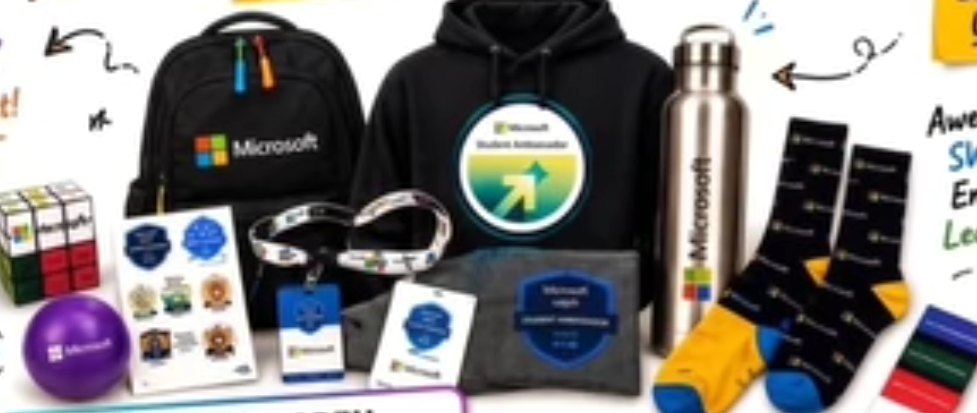

## Swags

Microsoft Student Ambassadorになると、こんな素敵なSwagsももらえます！

:::note info
Swagsは、マイルストーンごとにもらえるものが変わります。Associate用、Senior用のスワッグがあり、上がるほど特典が増えていきます（詳しくは「MSAになる利点」で）。
:::

## Microsoft Student Ambassadors とは

Microsoft Student Ambassadors（以下、MSA）は、Microsoft の技術を学びながら、イベントやSNSで他の学生にも広げていく**学生向けのグローバルコミュニティ**です。

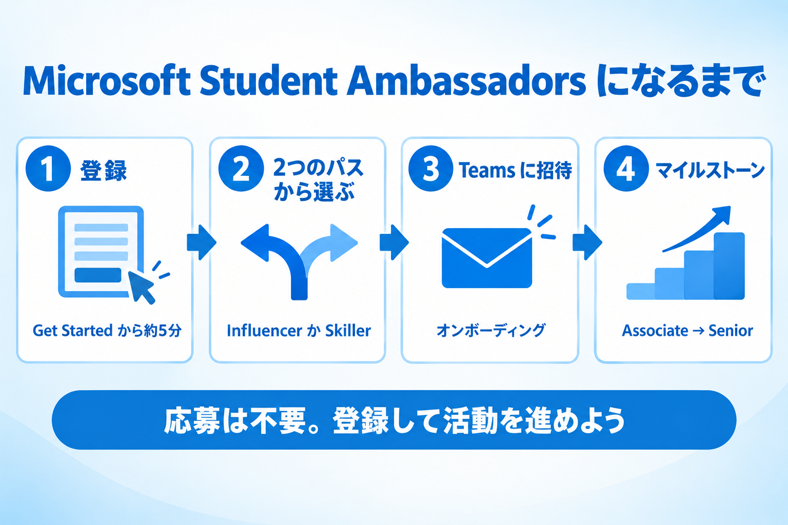

### ランク（マイルストーン）は3段階＋登録メンバー

登録した直後は「登録メンバー」で、そこから3つのマイルストーンを上がっていきます。

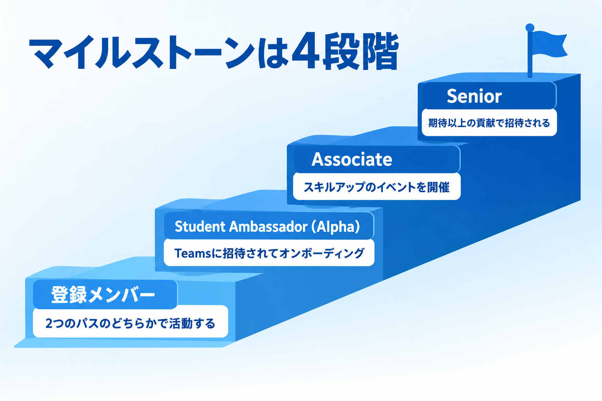

| マイルストーン                         | 上がる条件                                                                                                                          |
| -------------------------------------- | ----------------------------------------------------------------------------------------------------------------------------------- |
| 登録メンバー                           | Microsoft認定資格かApplied Skillsを取得したうえで、2つのパス（Community Influencer か Community Skiller）のどちらかの目標を達成する |
| Student Ambassador（バッジ名は Alpha） | 目標を達成して招待を受け、Teamsに招待されてオンボーディングする                                                                     |
| Associate                              | Student Ambassador自身が開催した、Microsoft技術のスキルアップイベントが承認される                                                   |
| Senior                                 | Associateとして期待以上の貢献をして、プログラムチームから推薦される                                                                 |

### Associate と Senior の条件をもう少し詳しく

**Associate**は、イベントの開催が条件です。公式のハンドブックには、承認されるイベントの条件が細かく書かれています。

- Microsoft Learn のコンテンツに沿った、**スキルアップが目的**のイベントであること（雑談や情報共有だけの会は対象外）
- 全体で30分以上、うち20分以上は Student Ambassador によるMicrosoft技術の解説
- 発表者を除いて**15人以上**が最後まで参加
- 開催から30日以内に、主催者が1回だけ申請する
- 主催した Student Ambassador のイベントだけが対象（Microsoft主催・外部主催のイベント、Learn Plan は対象外）

**Senior**は自分から申請する形ではなく、年2回（1月と7月）の審査で推薦されます。ハンドブックでは、次のような人が対象とされています。

- Student Ambassador になって1年以上
- 半年以内に卒業しない
- プログラム要件をすべて満たし、Teams などのコミュニティにも積極的に関わっている
- Microsoft Learn を使ったイベントや共有を継続している
- プロフィールとLinkedInが整っている

### 続けるための四半期ごとの要件

Student Ambassador になったあとは、**3か月ごと**に次の2つを満たすと、メンバーシップが次の3か月に延長されます。

| 要件                 | 内容                                                                                                                  |
| -------------------- | --------------------------------------------------------------------------------------------------------------------- |
| Community Influencer | 自分のコントリビューターID付きでMicrosoftのコンテンツを共有し、**優先訪問者（Preferred Visitors）を50人**集める |
| Community Skiller    | スキルアップのイベントを**1回**開催する（承認されたもの）                                                       |

両方を満たすと、5,000 Microsoft Rewards ポイントももらえます。満たせなかった四半期は、メンバーシップが延長されません。

なお、優先訪問者は非公開の指標で、細かい算出条件は公開されていません。ハンドブックには、リンクを送りつけるのではなく、興味に合った内容を共有して、読者が自然に増えるのが理想と書かれていました。

## この記事を書いた経緯

私は最近、Associate に昇格しました。次は Senior を目指して、イベントの開催や、これから登録する人のサポートにもっと力を入れていきたいと思っています。

ただ、正直なところ、**いま日本で学生アンバサダーとして動いているのは自分だけ**です。運営に加わるにはMicrosoft Student Ambassadorである必要があるので、もっと日本の学生にMSAを知ってもらいたいし、なる人を増やしたい。そのためには、まず「どうやってなるのか」が分かりやすく伝わっている必要があると考えました。

そこで、自分が登録したときの画面を残しておいたので、順番に並べてまとめることにしました。

## 思っているより簡単です

MSAと聞くと、審査が厳しそう、実績がないと無理そう、と身構える人も多いと思います。でも、入口はかなりシンプルでした。

- **応募・審査は不要**。公式ページにも「No application required」と書かれています
- 登録フォームは**約5分**で終わる。自動保存されるので、途中で閉じても続きから入力できる
- 登録後は、認定資格かApplied Skillsを1つ取ったうえで、2つのパスから自分に合うほうで活動を進める。専攻は問われず、あらゆる学部の学生が対象
- Discordは参加が任意。登録アクティビティは自分のスケジュールで進められる（公式FAQより）

ハードルがあるとすれば、登録後の「活動」です。まず**Microsoft認定資格かApplied Skillsを1つ取得**する必要があり、そのうえで2つのパスのどちらかの目標を達成します。でも、活動はSNSでMicrosoftの学習コンテンツを紹介するところから始められます。

## MSAになる利点

オンボーディングが終わると、次の特典が使えるようになります。

| 段階               | 主な特典                                                                                                                                                 |
| ------------------ | -------------------------------------------------------------------------------------------------------------------------------------------------------- |
| 登録メンバー       | DiscordのMicrosoft学生コミュニティ（任意）、学習リソースやガイダンス                                                                                     |
| Student Ambassador | Microsoft 365、Visual Studio Enterprise、**毎月150ドル分のAzureクレジット**、年1回のCredlyバッジ、Teams（Microsoft 社員やMVPとつながれる）、認定証 |
| Associate          | 上に加えて、Associate用スワッグ、Microsoft認定試験のバウチャーを得られる機会、イベントの資料や宣伝素材の支援、プレリリース版のテスト参加                 |
| Senior             | 上に加えて、Seniorスワッグ、特別イベントに呼ばれる機会、卒業時のMVP推薦の検討                                                                            |

四半期の要件を満たすと、Microsoft Rewards ポイントももらえます。履歴書やLinkedInに書ける実績が増えるのも、大きいと思います。

## MSAになる手順

:::note warn
公式の手順や条件は変更される可能性があります。実際に進めるときは、登録後に送られてくるハンドブックを必ず確認してください。
:::

全体の流れは次の4ステップです。

1. 公式サイトから登録する
2. 2つのパスから選んで活動する（Discordは任意）
3. 目標を達成して、Teamsに招待される（オンボーディング）
4. Associate、Seniorを目指す

### Step 0: 参加条件を確認する

登録フォームの「Privacy and Terms」に、条件が書かれています。

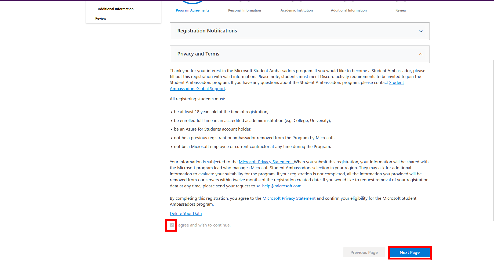

- 登録時に**18歳以上**
- 認定された教育機関に**フルタイムで在籍**
- **Azure for Students** のアカウントを持っている
- 過去にプログラムから除外された登録者・アンバサダーではない
- Microsoft の従業員や契約社員ではない

:::note warn
条件は更新されることがあります。登録するときに、画面と[公式FAQ](https://mvp.microsoft.com/faq?section=student)で最新の内容を確認してください。
:::

Azure for Students はクレジットカードなしで使える学生向けのAzureです。先に作っておくとスムーズです。

### Step 1: 公式サイトで Get Started を押す

[公式ページ](https://mvp.microsoft.com/studentambassadors)の **Get Started** からサインインすると、アカウントページの左メニューに **Student Ambassadors > Registration** が出ます。

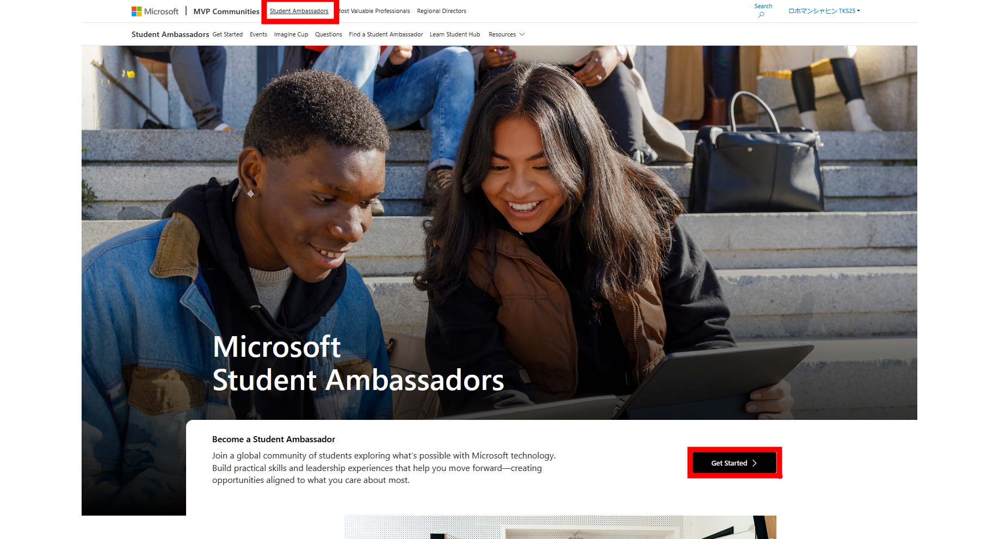

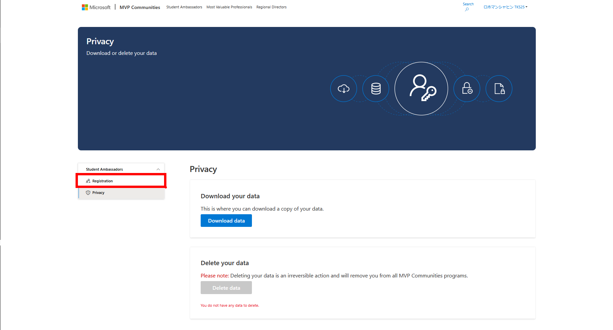

### Step 2: 登録フォーム（5画面）

フォームは「プログラム契約 → 個人情報 → 教育機関 → 追加情報 → レビュー」の順に進みます。

**① プログラム契約**: 登録後にDiscordへ招待されることなどが書かれています。読んで Next を押し、次の画面で同意にチェックを入れます。

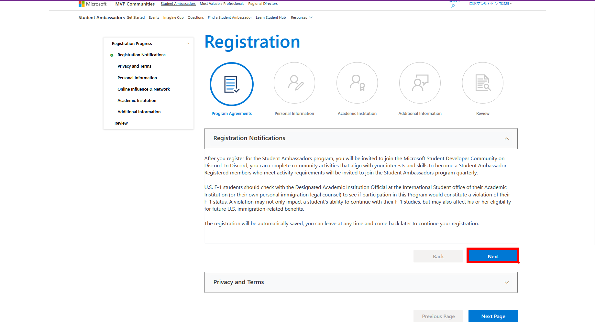

**② 個人情報**: 名前、メール、生年月日、国や地域、得意なプログラミング言語を入力します。続く「オンラインの影響力と人脈」には、SNSのURLを入れます。

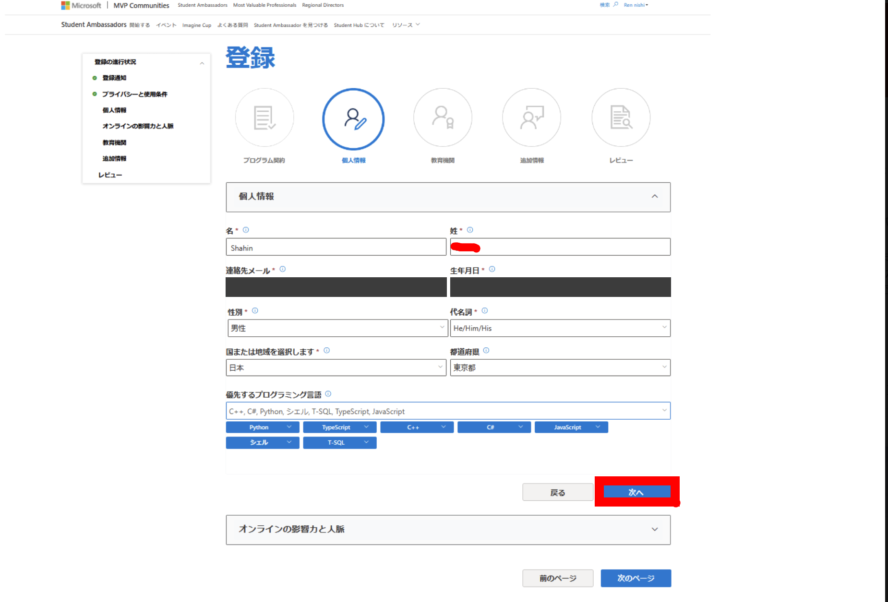

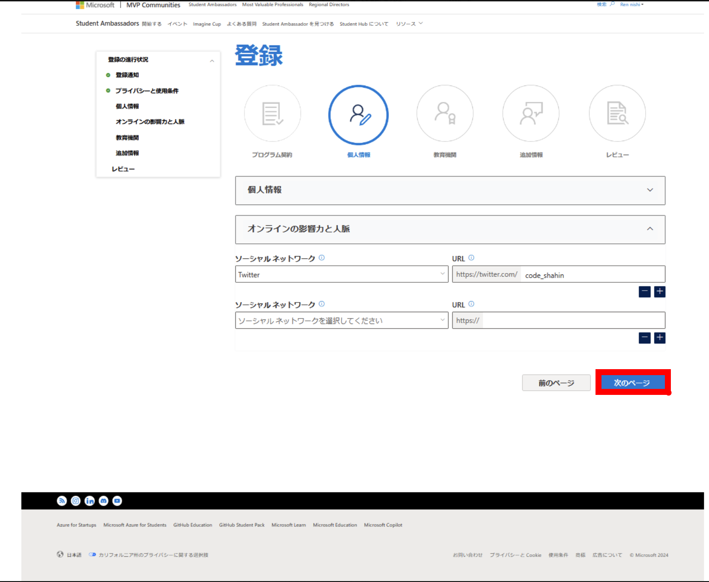

**③ 教育機関**: 国、都道府県、学校名、学位プログラム、学位のレベル、卒業予定日を入力します。

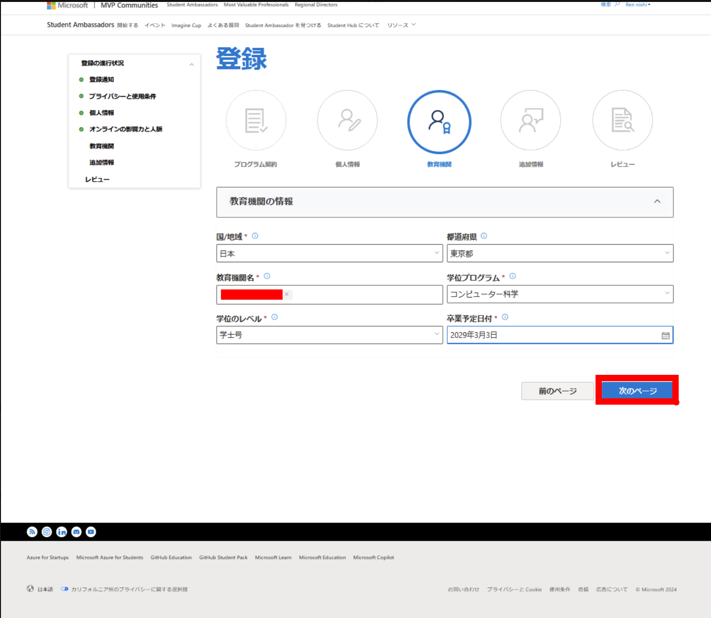

**④ 追加情報**: 興味のある技術を選び、**Microsoft Learn のユーザー名**を入力します。Learnアカウントが必須なので、持っていない人はここで作ります。

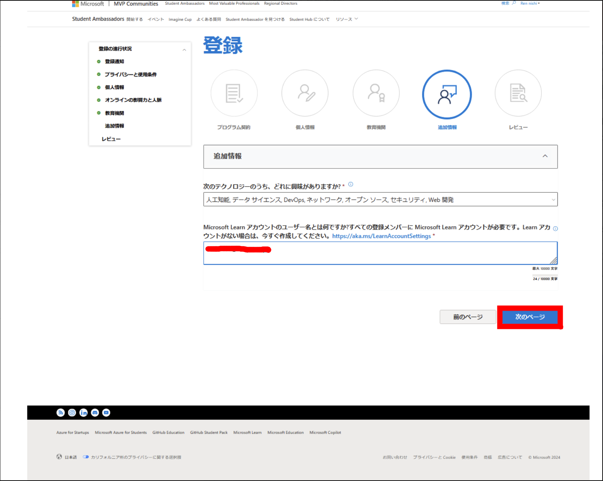

**⑤ レビュー**: 内容を確認して**送信**を押せば、登録は完了です。

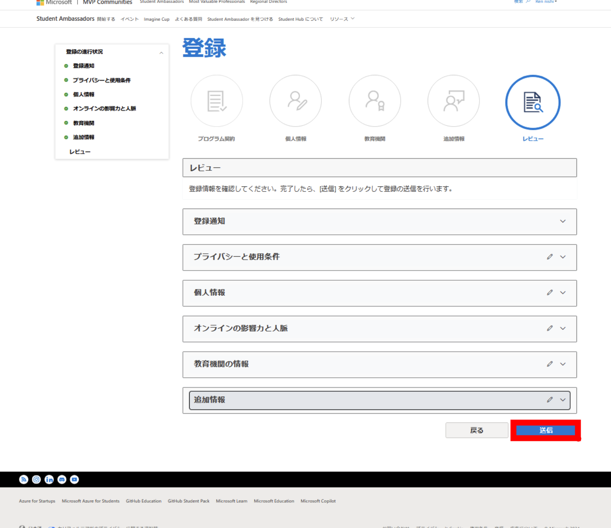

### Step 3: 確認メールを確認する（Discordは任意）

登録すると確認メールが届きます。DiscordのMicrosoft学生コミュニティへ参加するボタンがありますが、**Discordへの参加は任意**です。他の学生と交流したい人は入っておくと楽しいと思います。迷惑メールのフォルダに入ることもあるので、届かないときはそちらも見てみてください。

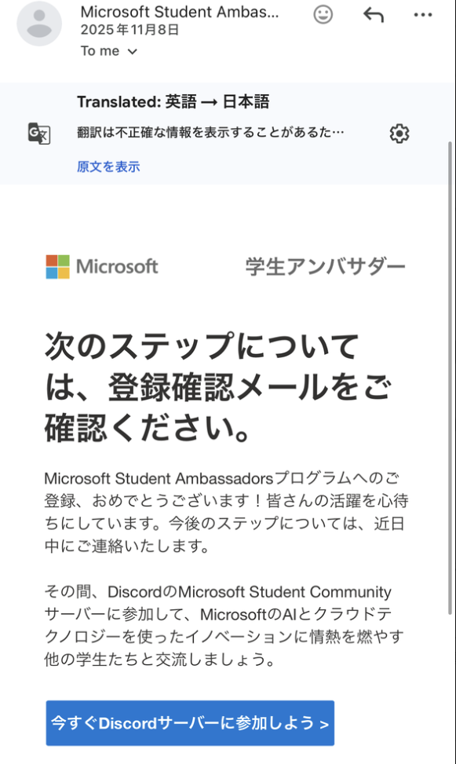

### Step 4: 2つのパスから選んで活動する

Student Ambassador になる方法は、**共通の条件を満たしたうえで、2つのパスのどちらか**で目標を達成する形です。

**共通の条件**: **Microsoft認定資格、またはApplied Skillsを1つ以上取得**していること（オンボーディング前12か月以内）。

次に、自分に合うパスを選びます。**どちらか一方**の目標を達成すれば大丈夫です。

| パス                 | 目的                                                          | 達成する目標                                                                                             | 活動の例                                               |
| -------------------- | ------------------------------------------------------------- | -------------------------------------------------------------------------------------------------------- | ------------------------------------------------------ |
| Community Influencer | Microsoftのコンテンツを共有して、オンラインでの存在感を高める | **優先訪問者（Preferred Visitors）を250人**集める（自分のIDつきのMicrosoftのリンクを踏んでもらう） | ブログ、動画、LinkedInでの投稿など                     |
| Community Skiller    | Microsoftの技術を学ぶ人を増やす                               | **ネットで新しく1,000モジュールの完了**を達成する                                                  | Microsoft Learn のプランを作り、自分のIDつきで共有する |

:::note info
上の目標は、登録メンバーが Student Ambassador になるためのものです。なったあとの四半期ごとの要件（優先訪問者50人＋イベント1回）とは別なので、混ざらないように注意してください。
:::

どちらの場合も、次に届くメールに**コントリビューターID**が書かれています。このIDを使って活動していきます。

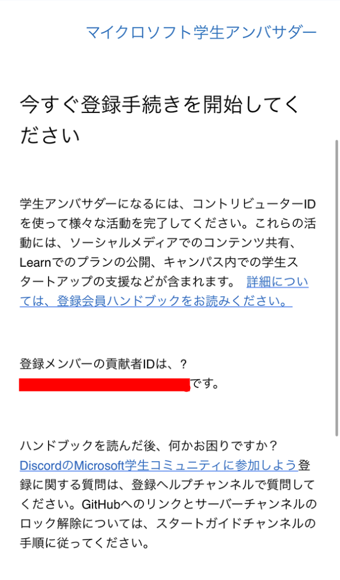

#### Community Influencer: コンテンツを共有する

コンテンツ共有のやり方は、ハンドブックにまとまっています。

1. アカウントページで自分のコントリビューターIDを確認する。形式は `?wt.mc_id=studentamb_######`
2. 共有したいMicrosoftのURLの末尾に、IDを付ける
3. IDつきのURLをSNSなどで共有する。読んでくれた人が「優先訪問者」として集計される

:::note warn
優先訪問者は、**同じ人が何回リンクを踏んでも1カウント**です。クリック数ではなく、人数で数えられます。
:::

注意点が3つあります。

- Microsoft Learn のプロフィールにあるIDとは**別物**。使うのは Student Ambassadors 用のID
- URLに `en-us/` のような言語コードがあれば、先に消す
- URLにすでに `?` があるときは、IDの `?` を `&` に変えて末尾に付ける

対象になるのは `azure.microsoft.com`、`learn.microsoft.com`、`code.visualstudio.com`、`devblogs.microsoft.com` など、ハンドブックに載っているURLだけです。ID付けを自動化するMVP製の拡張機能もあります。

集計は、毎週土曜日に「コミュニティインフルエンサー活動の合計」というメールで届きます。実際に届いた優先訪問者総数の推移は、1人 → 65人 → 399人とこんな感じで増えていきます。

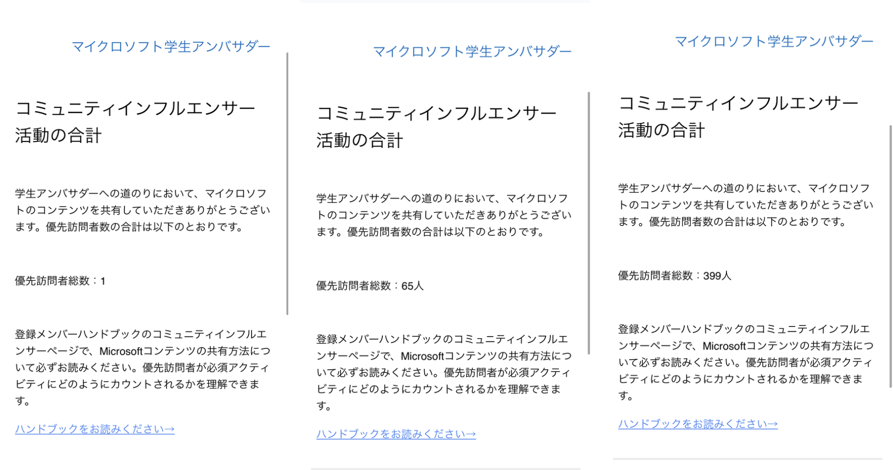

#### Community Skiller: Learn のプランで学習を広める

こちらは、Microsoft Learn のプランを使って、他の人にMicrosoftの技術を学んでもらうパスです。ハンドブックには、プランの作り方がこう書かれています。

1. 既存のLearnのコレクションを選ぶか、新しく作る
2. コレクションのページで、**プランとして保存**する
3. プランのリンクの末尾に自分のコントリビューターIDを付けて、共有する

Learn のプランは、Influencer の優先訪問者数には**カウントされません**。プランでの活動は、こちらのSkillerのパスで進めます。

### Step 5: Teamsに招待されて、オンボーディングする

目標を達成すると、オンボーディングの案内が届き、**Teamsに招待されます**。オンボーディングは**四半期ごと（3か月ごと）**で、登録画面にも「条件を満たしたメンバーは四半期ごとに招待される」と書かれています。タイミングの目安は**1月・4月・7月・10月**です。そのため、目標を達成してから案内が届くまでに、少し待つことがあります。最初のメールは「オンボーディング招待状は明日届きます」で、`@studentambassadors.com` のアカウントでTeamsにサインインする準備の話です。アカウントの準備には、**オンボーディング完了後から最大24時間**かかることがあります。

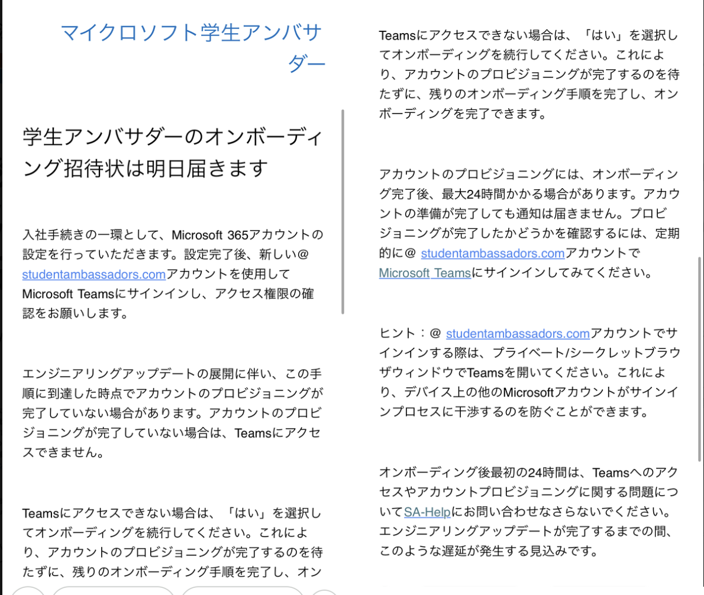

- Teamsに入れないときは、「はい」を選んでオンボーディングを先に進めてよい
- `@studentambassadors.com` でサインインするときは、プライベート（シークレット）ウィンドウを使う
- オンボーディング後の最初の24時間は、アカウントの問題でSA-Helpに問い合わせない

次のメール「参加招待を受け入れてください」では、登録時のメールでポータルにログインし、規約と行動規範に同意してプロフィールを更新します。そのあと、学生アンバサダー用のメールアドレスでTeamsにサインインします。

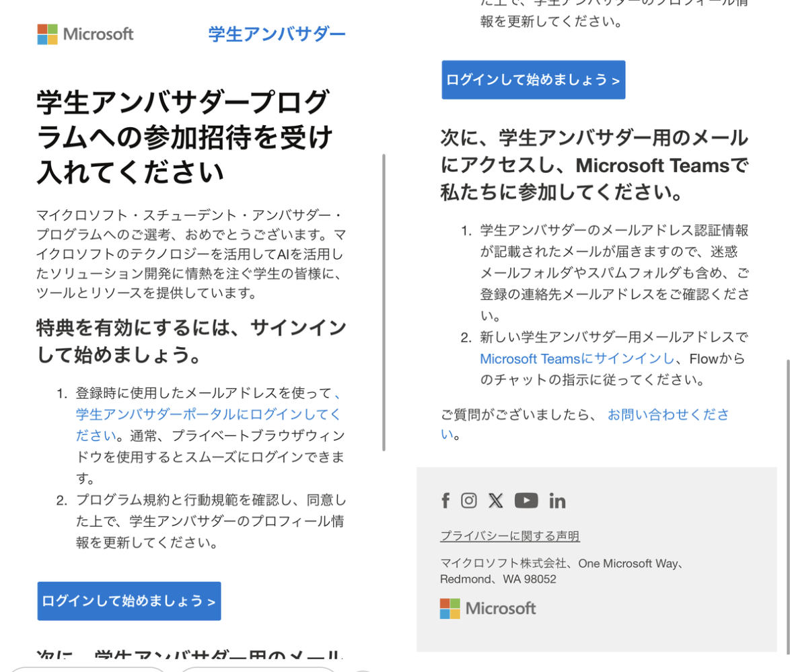

最後に Microsoft 365 アカウントの案内が届くので、**90日間有効な一時パスワード**をリセットしてログインします。

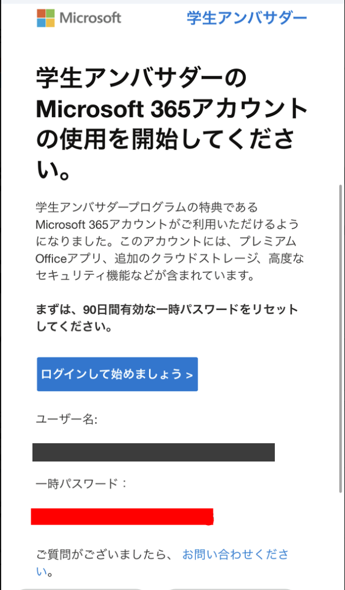

これで Student Ambassador のスタート地点に立てました！ここから先は、前半で書いたとおり、イベントを開催すれば Associate、貢献を続ければ Senior を目指せます。

これらのステップアップの手順などは、メールやDiscordにあるハンドブックで確認できるので、ぜひご確認ください。

:::note warn
この記事は、2026年11月時点の私の経験と公式情報をもとにまとめています。公式の手順や条件は変更される可能性があります。**登録後に送られてくるハンドブックを、必ず確認するようにしてください。**
:::

## 一緒にMicrosoft Student Ambassadorになりましょう！

運営に加わるには、Microsoft Student Ambassadorであることが条件です。なので、まずは一緒にMSAになって、楽しくコミュニティを盛り上げていきましょう！

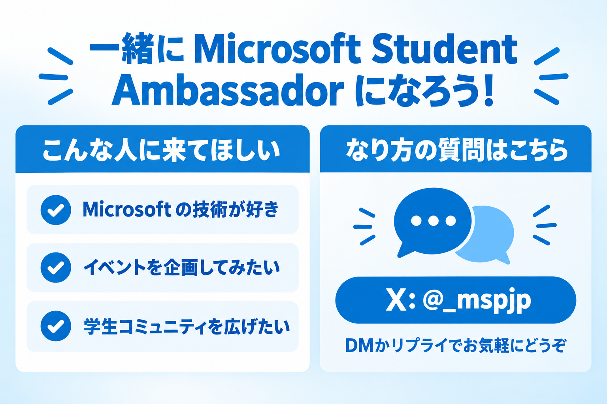

なり方について質問等があれば、**Xの [@_mspjp](https://x.com/_mspjp) まで**お気軽にどうぞ。

そして、すでにMicrosoft Student Ambassadorになった方は、日本のコミュニティで一緒に活動していきたいので、**Xのアカウント（[@_mspjp](https://x.com/_mspjp)）まで連絡をください！**

もしくは、個人DMでも質問や相談を受け付けています。気軽にDMしてください！（[@code_shahin](https://x.com/code_shahin)）

## 参考

- [Microsoft Student Ambassadors（公式）](https://mvp.microsoft.com/studentambassadors)
- [Student Ambassador Milestones（公式）](https://mvp.microsoft.com/studentambassadors/milestones)
- [Student Ambassadors FAQ（公式）](https://mvp.microsoft.com/faq?section=student)
- [Become a Student Ambassador - Microsoft Learn Student Hub](https://learn.microsoft.com/en-us/training/student-hub/become-a-student-ambassador)
