<!--
【タイトル候補】
1. リモートのエージェントが起動した dev server を手元でプレビュー：VS Code 1.145 の Remote browser proxy を試した
2. ポート転送いらずでリモートの Web アプリを確認：Agents ウィンドウの統合ブラウザが「ホスト経由」になった
3. SSH 先のエージェントが作った画面を、手元の VS Code で見て直す：1.145 の Remote agents 入門

【画像について】
- img-00 〜 img-03 は GPT Image 2.5 で生成した解説画像（生成済み）
- demo-01 〜 demo-07 は実機スクリーンショット（2026-11-06 撮影。Azure VM に SSH 接続した環境）
- 元のスクショは images/_original/ に退避済み（記事では使わない）
- 画像の URL は https://raw.githubusercontent.com/shahin99991/Qiita-github/main/vscode-1-145-remote-browser-proxy/images/<ファイル名> で統一
- 公開前に必ず GitHub へ push して raw URL を有効にすること

【公開前チェック】
- [ ] images/_original/ を push しない（または .gitignore で除外する）
- [ ] 「Comment on Elements」「モバイル幅の確認」「切断時の挙動」は未検証。記事内でも「未検証」と明記している
- [ ] front matter の ignorePublish を false に戻す
-->

## はじめに

最近 Microsoft Student Ambassador の Associate に昇格したロホマン シャヒンです！

:::note
この記事が少しでも参考になったら、**ぜひいいね・共有**をお願いします。
間違っている箇所や「ここが分かりにくかった」という指摘は、やさしくコメントいただけると助かります！
:::

2026年11月4日に **VS Code 1.145** がリリースされました。リリースノートの冒頭には、こんな一文があります。

> This week, your remote agent sessions feel a bit more local.
>
> （出典: [Visual Studio Code 1.145](https://code.visualstudio.com/updates/v1_145)）

「リモートのエージェントセッションが、少しローカルっぽくなる」という話です。cron 対応の Automations や Verbosity の切り替えも気になるんですが、私が一番「これ、地味に効くな」と思ったのは **リモートのエージェントが起動した dev server を、手元の Agents ウィンドウでそのままプレビューできるようになった** ことでした。

この記事では、公式ドキュメント、GitHub の issue、海外のニュース記事や解説を読み込んで仕組みと条件を整理したうえで、**Azure に検証用の Linux VM を立てて、SSH 接続したリモートホストで実際に動かした結果**をまとめます。後半では、Preview 機能として知っておきたい制限とセキュリティの注意点も書いています。

対象読者は、VS Code の Agents ウィンドウを触ったことがあって、SSH や Dev Tunnels などのリモート環境でエージェントを動かしたい（または動かしている）方です。**Preview 機能なので、今後仕様が変わる可能性があります。**

## TL;DR

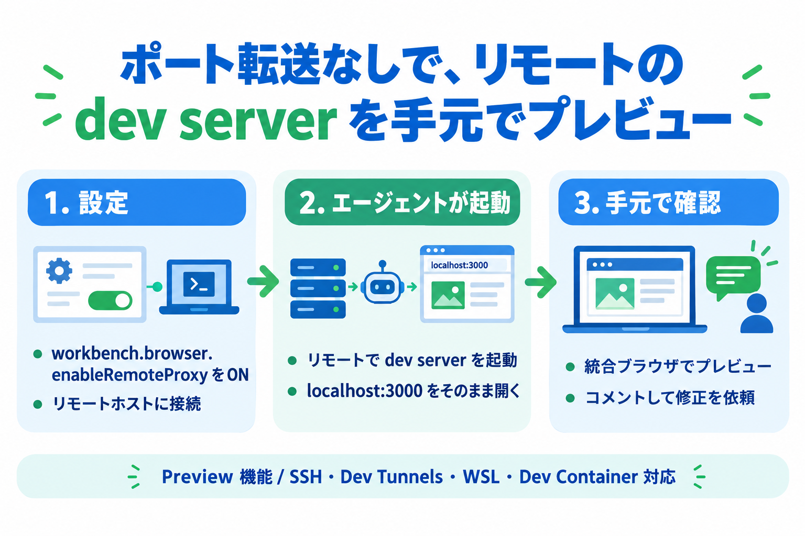

**何が起きた？**
VS Code 1.145 で、Agents ウィンドウの統合ブラウザが **リモートエージェントホスト経由で通信できる** ようになりました。リモートでエージェントが起動した dev server を、ポート転送なしで手元のウィンドウに開けます。

**実際に試して分かったこと**（Azure VM + SSH で検証）

| 試したこと                                                     | 結果                                                                                                   |
| -------------------------------------------------------------- | ------------------------------------------------------------------------------------------------------ |
| `workbench.browser.enableRemoteProxy` をオンにして SSH で接続  | ✅ Agents ウィンドウから VM に接続し、リモートのフォルダーでセッションを開始できた                     |
| エージェントに Express アプリを作って起動してもらう            | ✅ 約 2 分、9 ステップで完了。ファイル 3 つ（+95 行）                                                  |
| リモートの `localhost:3000` を統合ブラウザで開く               | ✅ ポート転送の設定なしで、サインアップ画面が手元のウィンドウに表示された                              |
| エージェントがそのページを操作して動作確認                     | ✅ Playwright で入力エラー・正常登録・重複登録の 3 ケースを確認。ページは自動で「Sharing with Agent」になった |
| 要素コメントでの修正依頼、モバイル幅での確認、切断時の挙動     | ⚠️ 今回は未検証（公式ドキュメントの内容を紹介するだけにとどめている）                                 |

**押さえておきたい条件**

| 項目             | 内容                                                                                  |
| ---------------- | ------------------------------------------------------------------------------------- |
| 有効化           | `workbench.browser.enableRemoteProxy` をオンにする（Experimental 表示の Preview 機能） |
| 対応する接続     | SSH / Dev Tunnels / WSL / Dev Containers（今回は SSH だけ確認）                        |
| バージョン       | クライアントとリモートホストの**両方**が対応バージョンである必要がある                |
| Cloud セッション | 対象外（Cloud sandbox や VS Code 以外のエージェントホストは未サポート）               |

**対象**: VS Code 1.145 以降の Agents ウィンドウ。リモートホストに VS Code の Agent Host が動いていること。

## これまで何が面倒だったのか

リモートでエージェントに Web アプリを作らせると、だいたいこうなります。

1. リモートで `npm run dev` などの dev server が起動する
2. 手元のブラウザで見るために、ポートを転送する
3. 転送先のポート番号がずれて、エージェントが伝えた URL と違う
4. やっと開く

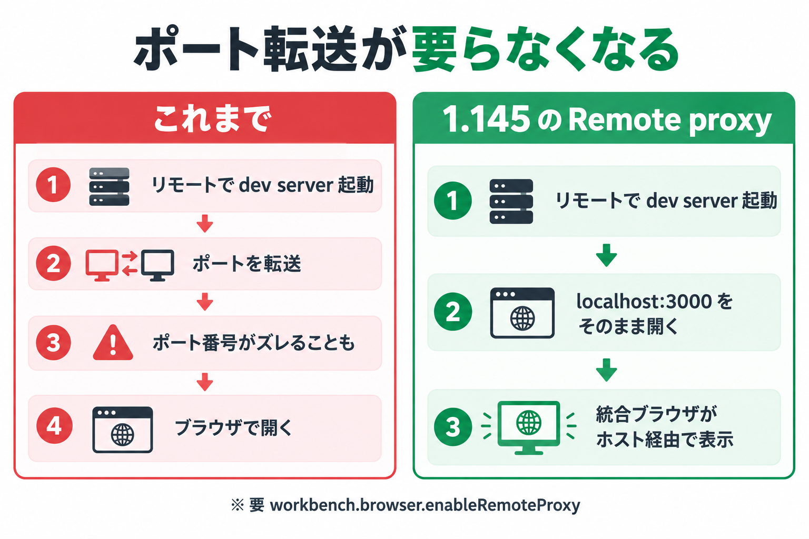

この「ポート番号のずれ」は、エージェントにとっても面倒な点でした。1.125 のリリースノートには、転送済みポートをエージェントが要求したとき URL を書き換えてエージェントに通知する、という対応が入っています。ただし、これはあくまで対症療法で、Remote workspace（SSH / Dev Container / WSL / Codespaces）向けの話でした。

同じ 1.125 では、統合ブラウザの通信をリモート接続経由で流す `workbench.browser.enableRemoteProxy` が Preview として入っています。そして、**Agents ウィンドウでリモートのエージェントホストにつないだセッションは、このプロキシの対象外** でした。

実際、microsoft/vscode には「Agents ウィンドウのセッションが接続しているリモート AHP ホストでも、統合ブラウザの通信をプロキシしてほしい」という issue（[#331926](https://github.com/microsoft/vscode/issues/331926)）が上がっていました。リモートホストでサービスを起動したのに、ポートを別途公開 / 転送しないと統合ブラウザで開けない、という内容です。1.145 は、この要望に応える形のリリースだと言えます。

## 仕組み：統合ブラウザの通信がホスト経由になる

仕組みはシンプルです。

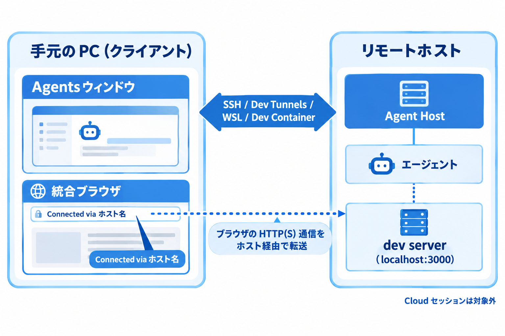

Agents ウィンドウの統合ブラウザのタブが、**セッションのリモートエージェントホストのネットワーク** を使います。だから `http://localhost:3000` のような元の URL をそのまま開いても、手元の `localhost` ではなく、リモートホスト側の `localhost` に届きます。

背景にあるのが、8月に公開された [Agent Host のアーキテクチャ解説](https://code.visualstudio.com/blogs/2026/08/26/agent-host-architecture) で紹介されている考え方です。Agent Host は「セッションを持つ専用プロセス」で、ローカルでは VS Code のユーティリティプロセスとして、リモートではスタンドアロンのサーバーとして動きます。クライアント（エディターや Agents ウィンドウ）とホストが分かれているから、リモートセッションが成り立ちます。今回のブラウザ対応は、その「分かれたホスト」の側に通信の出口を置いた形ですね。

アドレスバーには、プロキシが有効なときにリモートを示すインジケーターが出ます（リリースノートのスクリーンショットでは `Connected via ホスト名` のような表示でした）。「このタブはどこのネットワークで見ているのか」が一目で分かるのはありがたいです。

## 検証環境：Azure に Linux VM を立てた

リモートホストは、今回この検証のために **Azure に Linux VM を 1 台立てて**用意しました。使い終わったらリソースグループごと削除する前提の、使い捨て環境です。

| 項目             | 内容                                                                                          |
| ---------------- | --------------------------------------------------------------------------------------------- |
| リージョン       | Japan East                                                                                    |
| OS               | Ubuntu 24.04 LTS                                                                              |
| サイズ           | `Standard_B2ats_v2`（2 vCPU / 約 1GB メモリ。最安クラス）                                     |
| 認証             | SSH キー（パスワード認証なし）                                                                |
| ネットワーク     | 受信は SSH（22 番）のみ。送信元は自分のグローバル IP だけに制限                               |
| 追加でやったこと | スワップ 2GB、Node.js 18 / npm / git を導入。作業フォルダー `~/demo-signup-app` を作成        |

メモリが 1GB 弱しかないので、VS Code のリモートサーバーとエージェントが動くか少し不安だったんですが、今回の小さな Express アプリなら問題なく動きました。スワップを足しておいたのが効いたのかもしれません。

作成は Azure CLI で、次のような流れです（キーとリソース名は検証用のものです）。

```bash
az group create -n rg-vscode145-demo -l japaneast

az vm create -g rg-vscode145-demo -n vm-vscode145-demo -l japaneast \
  --image Ubuntu2404 --size Standard_B2ats_v2 \
  --admin-username azureuser --ssh-key-values ~/.ssh/id_ed25519_azdemo.pub \
  --authentication-type ssh --public-ip-sku Standard --nsg-rule NONE

# SSH は自分の IP からだけ許可する
az network nsg rule create -g rg-vscode145-demo --nsg-name vm-vscode145-demoNSG \
  -n allow-ssh-myip --priority 100 --access Allow --direction Inbound \
  --protocol Tcp --destination-port-ranges 22 --source-address-prefixes <自分のIP>/32
```

ローカルの `~/.ssh/config`（Windows なら `C:\Users\<ユーザー名>\.ssh\config`）に、接続先を登録しておきます。

```text:~/.ssh/config
Host vscode145-demo
    HostName <VM のパブリック IP>
    User azureuser
    IdentityFile ~/.ssh/id_ed25519_azdemo
    IdentitiesOnly yes
```

:::note warn
`--nsg-rule NONE` で作って、SSH のルールを後から自分の IP 限定で足すようにしています。VM を作るときの既定のままだと、SSH が全世界に開いてしまうためです。検証が終わったら、次のコマンドで一式を削除します。

```bash
az group delete -n rg-vscode145-demo --yes --no-wait
```
:::

## 設定と使い方

### 1. 前提を確認する

- クライアントの VS Code が 1.145 以降
- リモートホスト側の VS Code（Agent Host）も対応バージョン
- Agents ウィンドウでリモートホストに接続できる状態（SSH / Dev Tunnels / WSL / Dev Containers）

リモートホストの接続方法は、公式の [Run and manage remote agent sessions](https://code.visualstudio.com/docs/agents/run/remote-agent-sessions) にまとまっています。

### 2. 設定をオンにする

設定で `workbench.browser.enableRemoteProxy` を有効にします。設定の説明文には「リモートワークスペースと、**リモートエージェントホスト上のエージェントセッション**のブラウザ通信を、リモート接続経由でプロキシする」と書かれています（Experimental 表示です）。

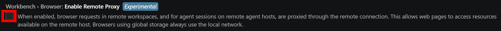

チェックを入れてオンにします。

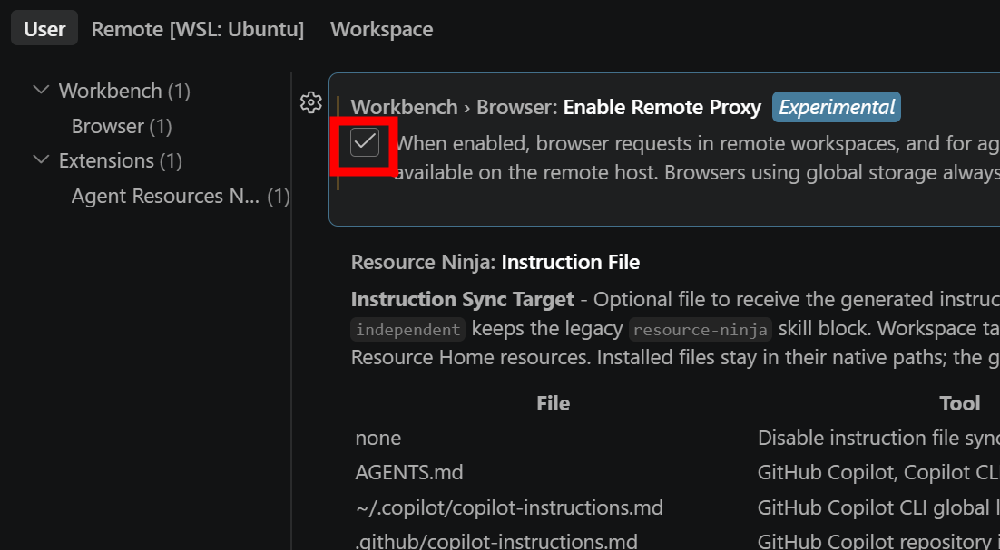

`workbench.browser.dataStorage` は `default` のままにしておきます。`global` ストレージのタブは常にローカルのネットワークを使うので、プロキシされません。

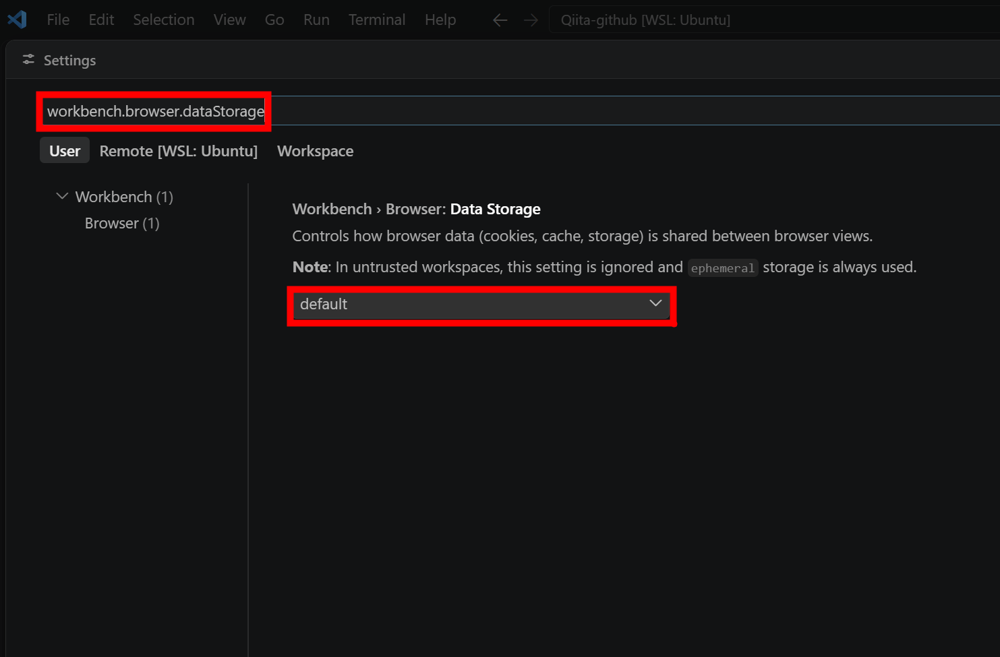

`settings.json` に直接書く場合は、こうなります。

```json:settings.json
{
  "workbench.browser.enableRemoteProxy": true
}
```

### 3. リモートホストに接続してセッションを始める

Agents ウィンドウで新しいセッションを作り、入力欄の左にある接続先（初期値は **This Computer**）を開きます。**GitHub Environments / Dev Tunnels / WSL / SSH** と並んでいるので、**SSH...** を選びます。

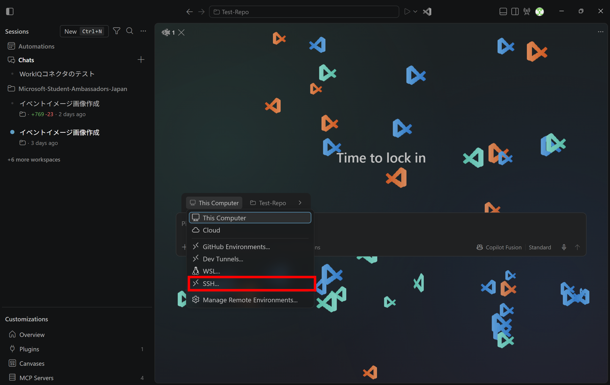

`~/.ssh/config` に書いたホストが一覧に出るので、`vscode145-demo` を選びます。

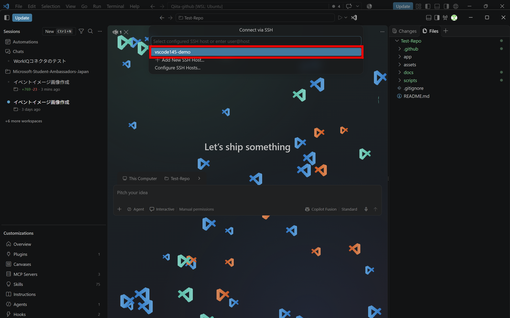

接続すると、VM 側に必要なサーバーが入ります。続けて、リモートのフォルダー（`/home/azureuser/demo-signup-app`）を選びます。

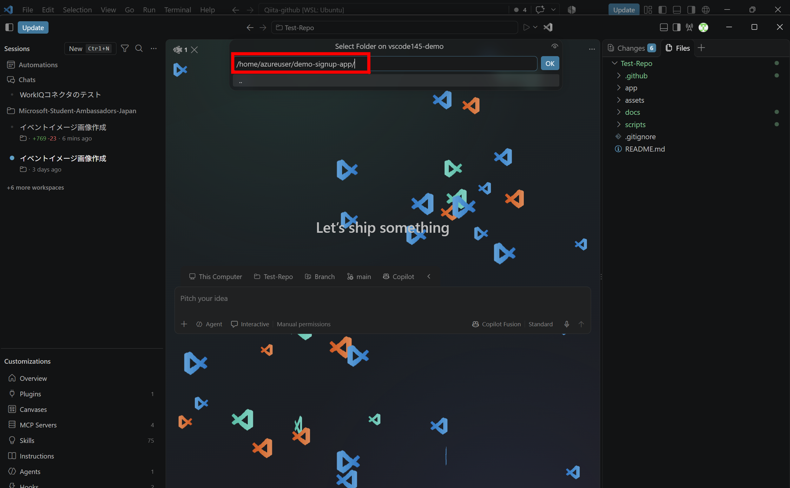

### 4. エージェントに dev server を起動してもらう

公式ドキュメントにあるプロンプトの例（英語）が、そのまま使えます。

```text
Start the app on this session's remote host, open its localhost URL in the integrated browser, and test the sign-up flow. Fix any issues and verify the result.
```

私は日本語で、アプリを作るところから頼みました。

```text
このセッションのリモートホストで、サインアップフォーム付きの小さな Web アプリ（Node.js + Express）を作って起動してください。localhost の URL を統合ブラウザで開いて、サインアップのフローを確認し、問題があれば直して、結果を検証してください。
```

接続先が `vscode145-demo`、フォルダーが `demo-signup-app` になっているのが、入力欄の上で確認できます。

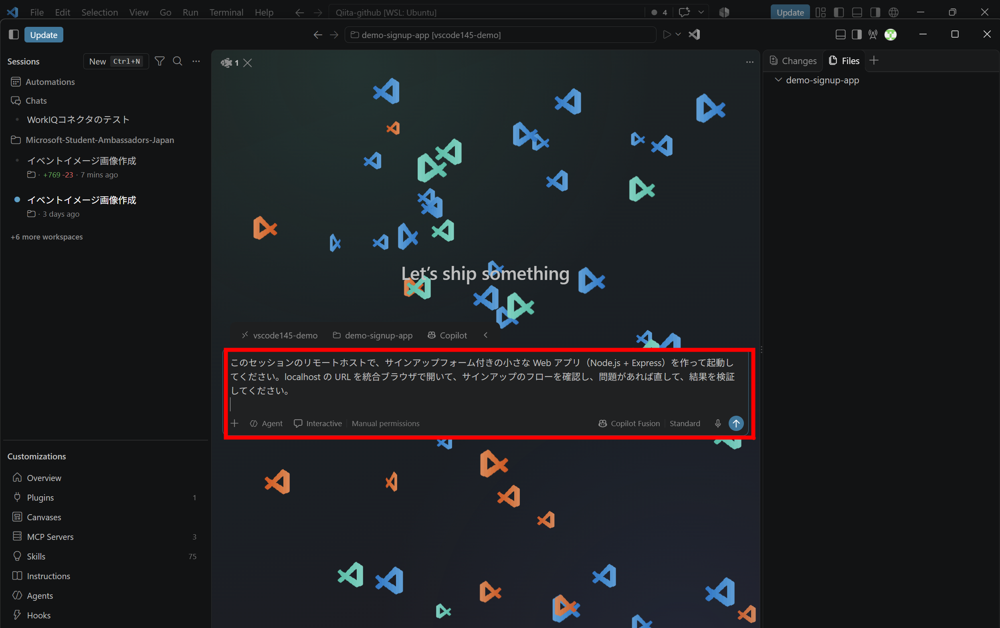

エージェントは、まず VM の中で `ls` と `node -v` を実行して環境を調べて、ファイルを作り、`npm install` して、サーバーを起動します。Copilot Fusion が「中程度の複雑さ」と判断して Claude Sonnet 5.5 を選んでいたのも、地味に面白かったです。

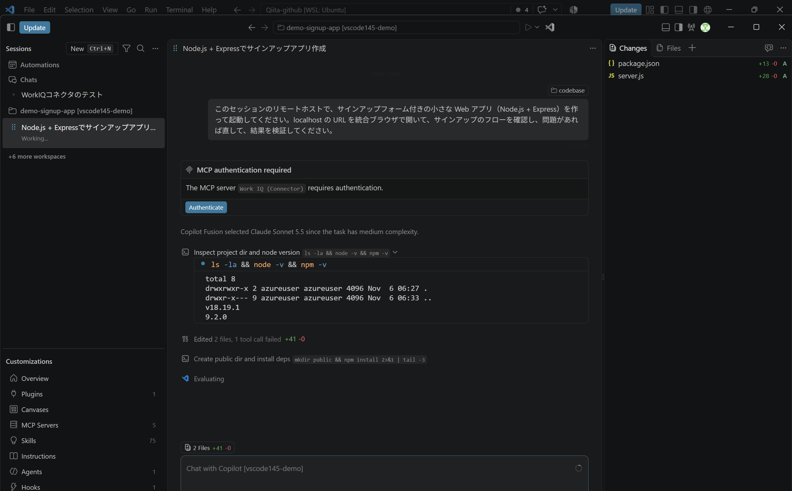

:::note info
この画面には「Work IQ (Connector) の認証が必要」という表示も出ていますが、私の環境の別の MCP コネクタの話で、今回の検証とは関係ありません。
:::

### 5. 統合ブラウザで開いて確認する

サーバーが起動すると、エージェントが**リモートの `http://localhost:3000`** を統合ブラウザで開きます。右側のタブに「Sign up」が表示されました。**手元の PC には、このアプリはありません。** 画面は VM のネットワーク経由で届いています。ポート転送の設定は、一度もしていません。

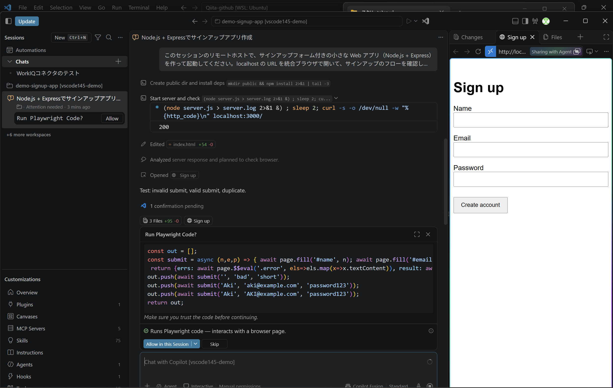

アドレスバーの左端に、青い「><」のリモートのアイコンが出ています。「このタブはリモートのネットワークで見ている」ことを示すインジケーターだと思います（公式のリリースノートの画像では、`Connected via ホスト名` と表示されていました）。

ちなみに、この画面では「**Run Playwright Code?**」という確認が出ています。権限モードを Manual permissions にしていたので、エージェントがブラウザを操作するコードを実行する前に、毎回確認が入る形です。今回は、フォームに入力して送信するだけのコードだと確認してから許可しました。

## エージェントがリモートのページを操作して確認する

許可すると、エージェントは統合ブラウザのページに対して、次の 3 ケースを自分で試しました。

1. 空の名前・不正なメール・短いパスワードで送信（入力エラーが出るか）
2. 正しい内容で登録（成功するか）
3. 同じメールアドレスで、大文字小文字を変えて再登録（重複を検出できるか）

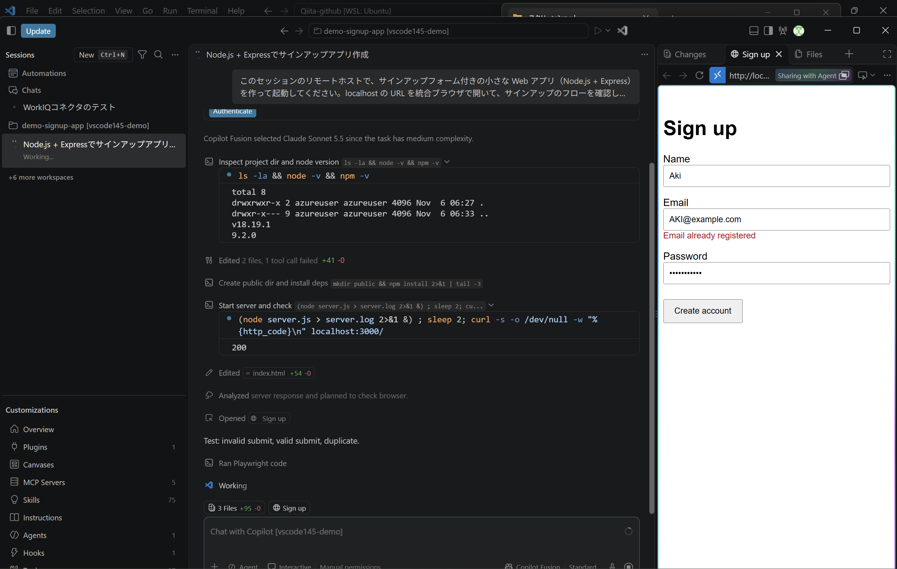

`AKI@example.com` の再登録で「Email already registered」が出ている画面です。ページの右上に **Sharing with Agent** と表示されています。エージェントが開いたページは、自動でエージェントと共有された状態になるようです。

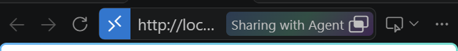

最終的に、エージェントは 9 ステップ・約 2 分で作業を終えて、結果を報告してくれました。

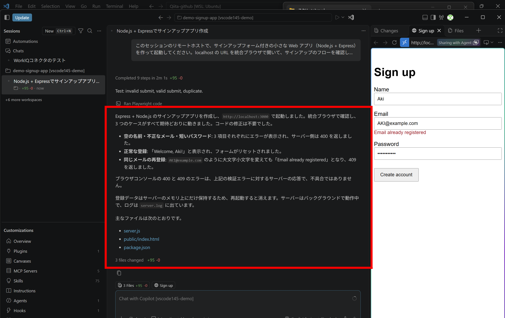

報告の要点はこんな内容でした。

- 3 つのケースがすべて期待どおりに動いた。**コードの修正は不要だった**
- ブラウザコンソールに出ている 400 と 409 は、検証エラーに対するサーバーの応答で、不具合ではない
- 登録データはサーバーのメモリ上にだけ保持されるので、再起動すると消える
- 変更は 3 ファイル（`server.js` / `public/index.html` / `package.json`、+95 行）

正直なところ、エージェントが最初から問題なく作れてしまったので、「問題を見つけて直す」ところまでは見られませんでした。ただ、**リモートのアプリの画面を、エージェント自身が手元側のブラウザ経由で操作して検証する**流れは、期待どおりに動きました。

## プレビューして、コメントして、直してもらう（公式ドキュメントの内容）

:::note warn
この節は、今回は実機で試していません。公式ドキュメントの内容を整理したものです。
:::

プレビューできるだけでも便利ですが、本領はここからだと思っています。公式ドキュメントでは、統合ブラウザで次のような「ページに対するフィードバック」を渡せると説明されています。

- **ページ要素**: 描画された要素を選んで、HTML / CSS（と任意でスクリーンショット）を添付
- **要素へのコメント**: 複数の要素を選んで、それぞれに変更依頼を付ける
- **スクリーンショット**: 表示領域・選択範囲・ページ全体
- **コンソールログ**: ランタイムエラーなどを添付

ローカルセッションでは前からできたことですが、1.145 でリモートセッションでも同じ流れが使えるはずです。

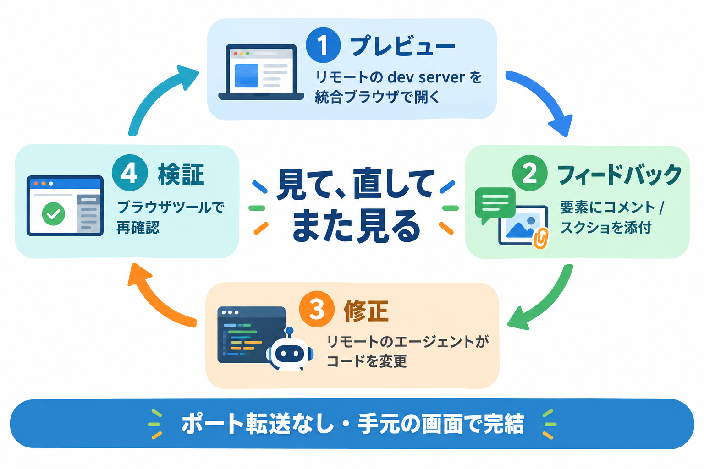

公式ドキュメントの手順はこんな感じです。

1. 統合ブラウザでアプリを開く
2. **Add to Chat** のドロップダウンから **Comment on Elements** を選ぶ
3. ナビゲーションを選んで「狭い画面ではメニューボタンにまとめる」などとコメントする
4. フォームを選んで「入力欄をそろえて、エラーを各入力欄の下に出す」とコメントする
5. チャット欄で全体の指示を足して送信する
6. 「デスクトップとモバイルの表示幅で結果を確認して」と頼む

自分で開いたタブをエージェントに見せたいときは、ブラウザのツールバーの **Share with Agent** を使います。ログイン済みの状態やブラウザの状態をそのまま使えます。もう一度押すと、共有をすぐ取り消せます。なお、エージェントが自分で開いたページは、サインイン状態を引き継がない分離されたセッションで動きます。認証が必要な画面を見せたいときは、自分で開いて共有する流れになります。

## 知っておきたい挙動と制限

ドキュメントを読んで、実際に使う前に押さえておきたい点を表にしました（今回の検証で確認できたのは「リモートのページを表示できること」と「エージェントが開いたページが共有状態になること」で、残りはドキュメントの記述です）。

| 項目                         | 内容                                                                                                                         |
| ---------------------------- | ---------------------------------------------------------------------------------------------------------------------------- |
| 対応バージョン               | クライアントとリモートホストの両方が対応している必要がある。ホストが未対応だと、インジケーターにその旨が出る                 |
| Cloud セッション             | 対象外。Cloud sandbox や VS Code 以外のエージェントホストは未サポート                                                        |
| 切断時                       | ホストが切断されるとインジケーターが切断状態を示し、**ローカルのネットワークにはフォールバックしない**。再接続して再読み込み |
| タブの帰属                   | セッションを切り替えても、タブは元のホストを保つ。エージェントが開いたページは、別のセッションを表示中でもそのエージェントのホストを使う |
| Cookie / localStorage        | 自分で開いたタブ（default ストレージ）は、同じプロジェクトフォルダー + ホストの間で保持される。エージェントが開いたページはチャットごとのメモリ上のストレージ |
| `file://`                    | プロキシされない（Remote workspace の場合と同じ）                                                                            |
| 設定を切ったとき             | 新しく開いたタブからローカルのネットワークを使う                                                                             |

ちなみに、機能テスト用の issue（[#345466](https://github.com/microsoft/vscode/issues/345466)）には、HTTP と HTTPS で別のプロキシ経路を試すことや、存在しないポートに繋いだときにブラウザが固まらず失敗すること、WebSocket（ライブ更新やホットリロード）を試すことなどがテスト項目として並んでいました。Preview なので、動かない構成に当たったら、ホストの種類を添えて issue を出すのがよさそうです。

## セキュリティで気をつけたいこと

リモートのエージェントホストは、手元から**かなり強い権限で**操作できるものです。公式の [Security](https://code.visualstudio.com/docs/agents/run/security) には、次の趣旨の注意があります。

- **Dev Tunnels は必ず認証を必須にする。** 匿名アクセスを許可すると、URL を知った誰かがマシンに到達してエージェントセッションを開始できてしまう。自動承認のモードと組み合わさると、あなたの資格情報で AI が支援するコマンドを実行されるリスクがある
- SSH なら SSH の資格情報、トンネルならトンネルのアカウントを守る
- 接続したクライアントは、そのホストのセッション・ツール・ワークスペースに対して**信頼されたオーナー相当のアクセス**を得る（GitHub Environments の場合）
- 接続を切っても、ホストで実行中のタスクは止まらない。止めたいときはセッションでタスクを停止する

:::note warn
ブラウザの共有（Share with Agent）も、ログイン済みのタブをエージェントに見せる操作です。機密情報が表示されているタブは共有しないようにしましょう。Autopilot モードでは、未共有のタブへのアクセス要求が自動で拒否されます。
:::

## 海外の情報・反応

公開直後ということもあって、まとまった体験記はまだ多くありません。確認できた範囲で整理します。

- **Visual Studio Magazine**（2026/11/04）は、1.145 を「リモートエージェントのワークフローを広げ、cron の Automations を足したリリース」と紹介しています。注目点として、リモート dev server のプレビュー、エージェントの変更の検証、別ブラウザに切り替えないままフィードバックを返せることを挙げています
- **VS Code の issue トラッカー**では、先ほどの #331926 のように、リモートの AHP ホストで統合ブラウザを使いたいという要望が機能の出発点になっていました。実装のテストも issue で公開されていて、開発の様子を追えます
- 他のコーディングエージェントでも、リモートで動かす場合の定番は「SSH + tmux でセッションを維持する」「ポートを転送して手元のブラウザで見る」です。たとえば Claude Code の SSH 運用ガイドでは、tmux でセッションを接続切れから守る方法などが紹介されています。「エージェントはコードの近くで動かす」のが正解でも、**画面の確認は手元で**という部分が運用の悩みどころで、ここを IDE が吸収してくれるのが VS Code 1.145 の面白いところだと感じました

## おまけ：Remote canvases とサイドバーへのピン留め

同じ Remote agents の項目に、**Remote canvases（Preview）** も入っています。リモートのエージェントホスト上で動く Canvas を、手元の Agents ウィンドウで使えるようになります。有効にするには `chat.canvases.enabled` と `workbench.browser.enableRemoteProxy` の**両方**をオンにします。

設定画面で `chat.canvases.enabled` を検索すると、説明文にこう書かれています。

> Sessions on remote agent hosts also require Workbench › Browser: Enable Remote Proxy, so canvas pages load through the agent host's network.
> （リモートエージェントホスト上のセッションでは、Canvas のページがエージェントホストのネットワーク経由で読み込まれるよう、Enable Remote Proxy も必要）

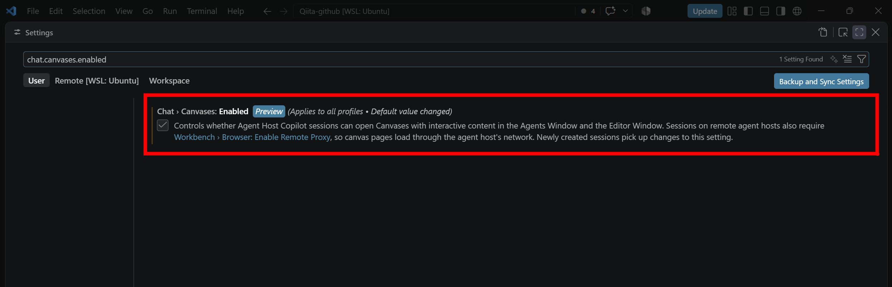

つまり、**Canvas のページも、さっきの統合ブラウザと同じプロキシの仕組みで読み込まれる**ということですね。`workbench.browser.enableRemoteProxy` で検索すると 2 つの設定が並んで出るので、両方にチェックが入っていることを確認しておきましょう。

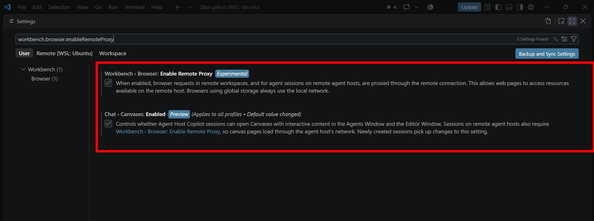


また、よく使う Canvas は、開いた状態で **Add to Sidebar** を押すと左のサイドバーにピン留めできます。Canvas を日常的に使う人は、地味に便利そうです。

## まとめ

- VS Code 1.145 の **Remote browser proxy（Preview）** で、Agents ウィンドウの統合ブラウザがリモートエージェントホスト経由で通信できる
- `workbench.browser.enableRemoteProxy` をオンにして、SSH / Dev Tunnels / WSL / Dev Container のセッションで使う
- **Azure の Linux VM に SSH 接続して実際に動かしたところ**、ポート転送なしでリモートの `localhost:3000` が手元のウィンドウに表示され、エージェントがそのページを操作して動作確認まで終えた
- 要素コメントでの修正依頼、モバイル幅での確認、切断時の挙動は今回は**未検証**（公式ドキュメントの内容を紹介しただけ）
- クライアントとホストの**両方が対応バージョン**であること、**Cloud セッションは対象外**であること、**切断時にローカルへフォールバックしない**ことは押さえておく
- Dev Tunnels は必ず認証付きで使い、検証用の VM は SSH の送信元を絞って、終わったら削除する

「エージェントはリモートで動かしたいけど、画面確認のためにポート転送を設定するのが面倒で、ローカルで動かしていた」という方には、試す価値があると思います。次は Comment on Elements での修正依頼と、切断時の挙動も試してみる予定です。ぜひ手元の環境でも試してみてください！

## 参考

- [Visual Studio Code 1.145 リリースノート](https://code.visualstudio.com/updates/v1_145)
- [Visual Studio Code 1.125 リリースノート（Integrated Browser のリモート対応）](https://code.visualstudio.com/updates/v1_125)
- [Run and manage remote agent sessions](https://code.visualstudio.com/docs/agents/run/remote-agent-sessions)
- [Use browser tools with agents（Test apps on remote agent hosts）](https://code.visualstudio.com/docs/agents/run/browser-tools)
- [Integrated browser（Browse over remote connections）](https://code.visualstudio.com/docs/debugtest/integrated-browser)
- [Security（Agents ウィンドウ）](https://code.visualstudio.com/docs/agents/run/security)
- [Introducing the Agent Host for persistent, portable agent sessions](https://code.visualstudio.com/blogs/2026/08/26/agent-host-architecture)
- [VS Code 1.145 Expands Remote Agent Workflows, Adds Cron Automations -- Visual Studio Magazine](https://visualstudiomagazine.com/articles/2026/11/04/vs-code-1-145-expands-remote-agent-workflows-adds-cron-automations.aspx)
- [microsoft/vscode#331926 Integrated browser remote proxy should support remote AHP hosts in Agents window](https://github.com/microsoft/vscode/issues/331926)
- [microsoft/vscode#345466 Test: Remote Browsing in Agents Window](https://github.com/microsoft/vscode/issues/345466)
- [Claude Code over SSH: remote servers and tmux sessions（Continuum）](https://continuumcode.ai/guides/claude-code-ssh-remote/)
