## はじめに

こんにちは！VSCode/GitHubオタクのMicrosoft Student Ambassador/Github Copilot User Group Japan運営のロホマン シャヒンです！

:::note
この記事が少しでも参考になったら、**ぜひいいね・共有**をお願いします。
間違っている箇所や「ここが分かりにくかった」という指摘は、やさしくコメントいただけると助かります！
:::

2026年11月25日に **VS Code 1.148** がリリースされました。リリースノートの冒頭には、こんな一文があります。

> Give a task its own Dev Container, and reclaim disk space from old worktrees without switching windows.
>
> （出典: [Visual Studio Code 1.148](https://code.visualstudio.com/updates/v1_148)）

「タスクごとに、専用の Dev Container を渡す」。これが今回の記事のテーマです。

エージェントにコマンドを自由に打たせたいけど、自分の PC でそのまま動かすのは、ちょっと怖いですよね。かといって、承認ダイアログを毎回押していたら、エージェントに任せる意味が薄くなります。

1.148 では、この悩みに効きそうな機能が2つ入りました。どちらも **Experimental** です。

- **Create Dev Containers**: 設定ファイルを書かずに、エージェント用の Ubuntu コンテナを作る。エージェント自身に「隔離環境で試して」と頼んで、作らせることもできる
- **Sandbox profiles**: サンドボックスの設定に名前をつけて、リモートホストごとに割り当てる

この記事では、公式ドキュメントと、microsoft/vscode の Issue（テスト計画も含む）、海外のセキュリティ系の記事を読んで、**何が隔離されて、何が隔離されないのか**を整理しました。対象読者は、Agents ウィンドウでエージェントを動かしていて、リモートホストや Docker も少し触ったことがある方です。

:::note warn
この記事の手順は、公式ドキュメントと Issue のテスト計画をもとに組み立てています。Experimental の機能なので、設定名や画面の文言は今後変わる可能性があります。
:::

なお、同じ 1.148 のスリープ防止・Worktree cleanup・Inbox は、別の記事にまとめています（公開したらここにリンクを入れます）。

## TL;DR

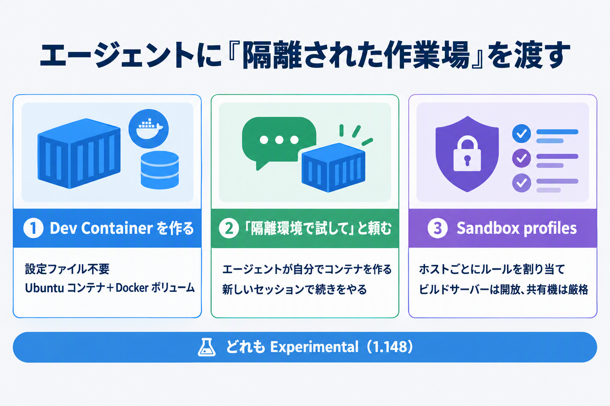

**何が起きた？**
VS Code 1.148（2026/11/25）で、エージェントに「隔離された作業場」を渡す手段が2つ増えました。設定ファイルなしで作れる Dev Container と、ホストごとに割り当てられる Sandbox profiles です。

**押さえておきたいポイント**

| 項目 | 内容 |
| ---- | ---- |
| Create Dev Container | ✅ 設定ファイル不要。Ubuntu コンテナで、中に Agent Host が入り、ファイルは Docker ボリュームに置かれる（Experimental） |
| 作る場所 | ✅ この PC、または接続済みの SSH ホスト / WSL / Dev Tunnel。**どれも Docker が必要** |
| handoff | ✅ 「隔離環境で試して」と頼むと、エージェントがコンテナを作って、中の新しいセッションで続きをやる（Experimental） |
| handoff で渡るもの | ⚠️ **タスクの要約だけ**。元の会話の全文も、元のプロジェクトのファイルも渡らない |
| Sandbox profiles | ✅ サンドボックス設定に名前をつけて、リモートホストごとに割り当てる。割り当てはリモート側に保存され、どの端末から繋いでも同じ（Experimental） |
| 組織のポリシー | ✅ 常に優先。プロファイルで、管理者が有効にしたサンドボックスを無効にはできない |
| 注意 | ⚠️ Sandbox は **Copilot harness のみ**。Claude や Codex のセッションには効かない |
| 注意 | ⚠️ プロファイルの **Allow Sandbox Bypass がオンだと、許可外のドメインに届いた**（私の環境）。オフにしたら、CONNECT が 403 で拒否された |
| 注意 | ⚠️ Dev Container の中でサンドボックスを使うと、VS Code がコンテナの隔離を**ゆるめる** Docker オプションを足す |

**対象**: VS Code 1.148 以降の Agents ウィンドウ、Docker のある環境。リモート側の VS Code Server も最新が必要です。

## 前提：「隔離」には3種類ある

最初に、言葉をそろえておきます。エージェント周りで「隔離」と言うと、実は別々の3つの話が混ざりがちです。

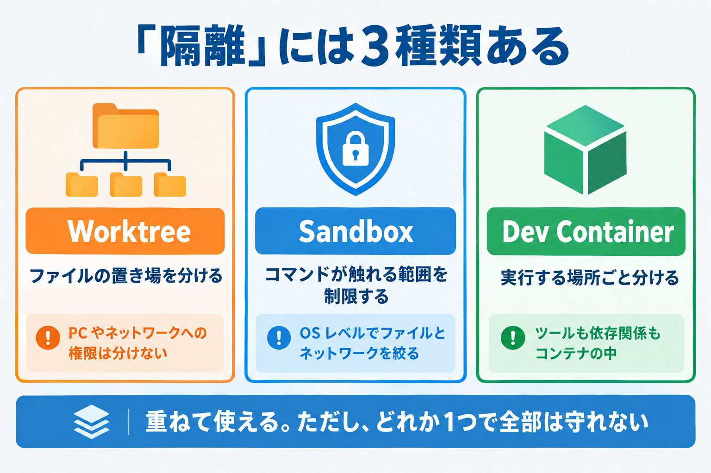

| 種類 | 何を分ける？ | 分けないもの |
| ---- | ------------ | ------------ |
| **Worktree** | ファイルの置き場（別ディレクトリ・別ブランチ） | PC やネットワーク、外部サービスへのアクセス権 |
| **Sandbox** | コマンドが触れるファイルとネットワーク（OS レベル） | 実行ユーザー。VM でもアカウント境界でもない |
| **Dev Container** | 実行する場所そのもの（コンテナ） | コンテナに渡した認証情報やネットワーク |

どれも、公式ドキュメントにはっきり書かれています。

- Worktree について: 「Worktrees isolate working files, not the agent's access to your machine or external services.」（[Use the Agents window](https://code.visualstudio.com/docs/agents/run/agents-window)）
- Sandbox について: サンドボックス化されたプロセスも、実行マシン上の**あなたのアカウント**で動く。VM でもユーザーアカウントの境界でもなく、エンドポイントセキュリティの代わりにもならない（[Sandbox Copilot agent sessions](https://code.visualstudio.com/docs/agents/run/agent-sandboxing)）

つまり、「どれか1つを使えば安全」ではなく、**何を守りたいかで選ぶ**ものです。1.148 の2つの新機能は、その選択肢を増やすものだと思います。

## ① Dev Container の作り方は2通りある

まず、整理が必要なポイントがあります。Agents ウィンドウの Dev Container には、**2種類**あります。

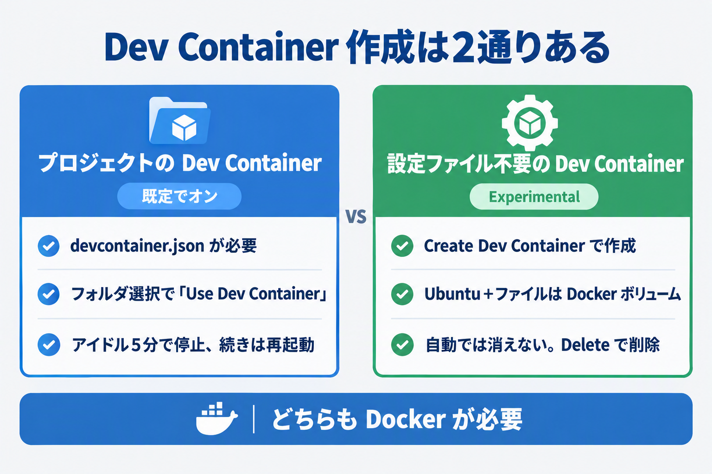

### A. プロジェクトの Dev Container（既存。既定でオン）

リポジトリに `.devcontainer/devcontainer.json` がある場合は、そのコンテナでエージェントを動かせます。これは 1.148 の新機能ではなく、`chat.agentHost.devContainer.enabled`（既定 `true`）で有効になっています。

1. Docker を起動しておく（CLI が `PATH` にあること）
2. **New Session** を押す
3. ワークスペースのピッカーで、対象フォルダのメニューを開いて **Use Dev Container** を選ぶ
4. ワークスペース名に **- Dev Container** が付く。ハーネスを選んで、依頼を送る

公式ドキュメントによると、動作はこうなります。

- Dev Container セッションは、**コンテナ内のワークスペースを直接編集する**。**New Worktree は使えない**
- アイドル状態のコンテナは、**5分で停止**する（`chat.agentHost.devContainer.idleTimeout`、既定 `300` 秒。`0` で自動停止なし）。セッションを続けると再起動する
- 起動に失敗したら、ワークスペース用の **Dev Container** 出力チャンネルを見る

### B. 設定ファイル不要の Dev Container（1.148 の新機能。Experimental）

こちらが今回の目玉です。`devcontainer.json` も、プロジェクトのフォルダも要りません。

- **Ubuntu コンテナ**で、中に **Agent Host** が入っている
- ファイルは**Docker ボリューム**に置かれる
- この PC、または、接続済みの **SSH ホスト / WSL / Dev Tunnel** に作れる（どれも Docker が必要）

有効にする設定は、これです。

```json
{
  "chat.agentHost.devContainer.environments.enabled": true
}
```

この設定は既定で `false` です。あわせて、`chat.agentHost.devContainer.enabled` と `chat.remoteAgentHostsEnabled` が有効（どちらも既定でオン）である必要があります。

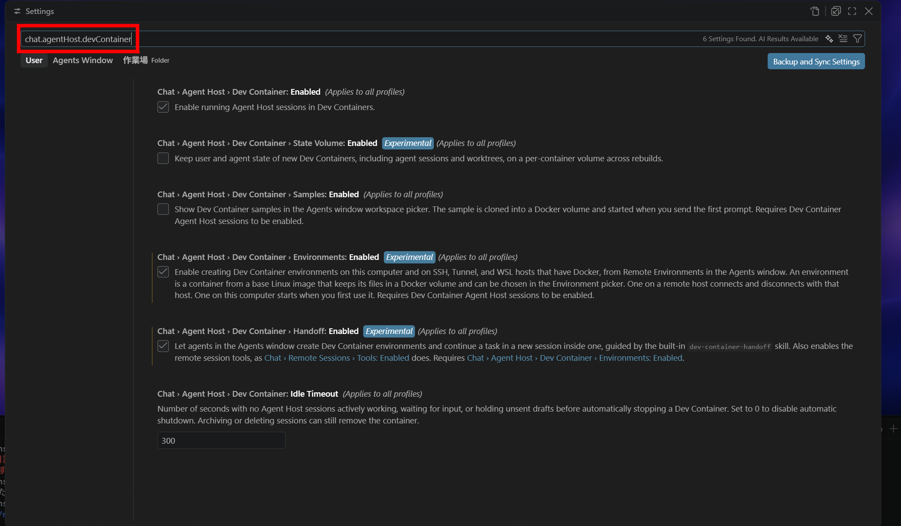

設定画面で `chat.agentHost.devContainer` と検索すると、関連の設定がまとめて出ます。handoff の設定は、`handoff.enabled` で検索すると1件だけ出ます。チェックを入れるだけです。

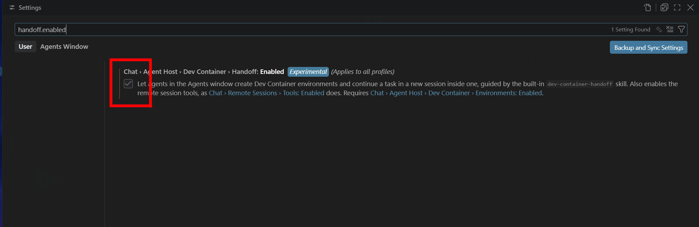

作り方は、コマンドパレットから始めます。

1. **Agents: Manage Remote Environments** を実行する
2. 検索欄の **Filter** メニューで、**Group By > Type** を選ぶ。**Dev Containers** のグループが出る
3. そのグループの **Create Dev Container** を押す（聞かれたら **This Computer** か、接続済みのホストを選ぶ）
4. コンテナが接続されたら、**New Session** を押して、**Environment** ピッカーでそのコンテナを選ぶ
5. ハーネスを選んで、依頼を送る

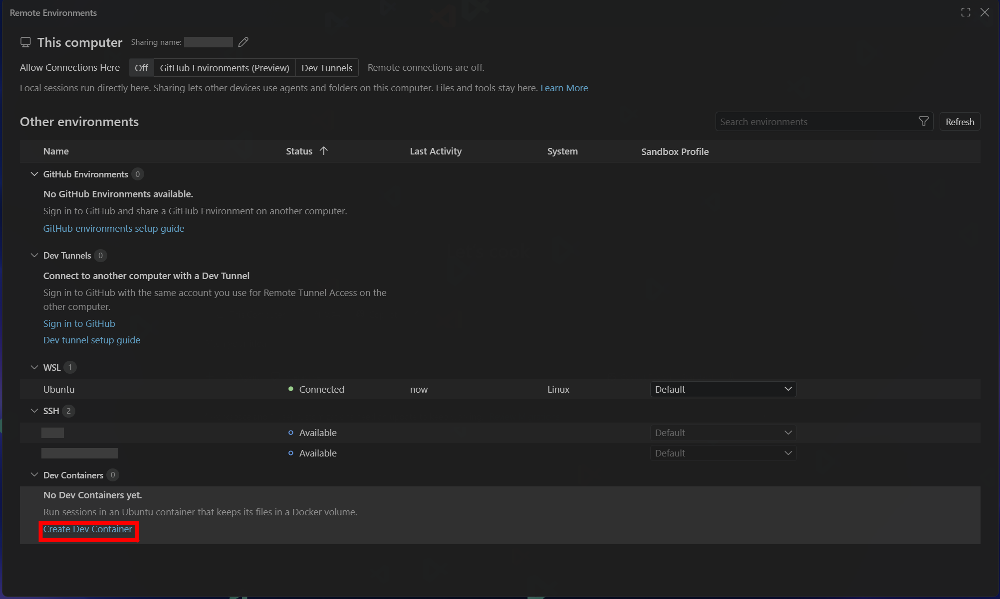

:::note info
ローカルの Docker に作るときは、**先に Group By > Type にしないと、Dev Containers グループとその作成ボタンが出ません**。これは、テスト計画（[#349554](https://github.com/microsoft/vscode/issues/349554)）に「現在の設計の既知の制限」と書かれています。
:::

接続済みのホスト（SSH / WSL など）に作るなら、そのホストの行の **More Actions** から **Create Dev Container** を選べます。WSL の場合は、Docker が**ディストリビューションの中**で使える必要があります。

作ると、Dev Containers のグループに `Dev Container Ubuntu` という行が増えます。

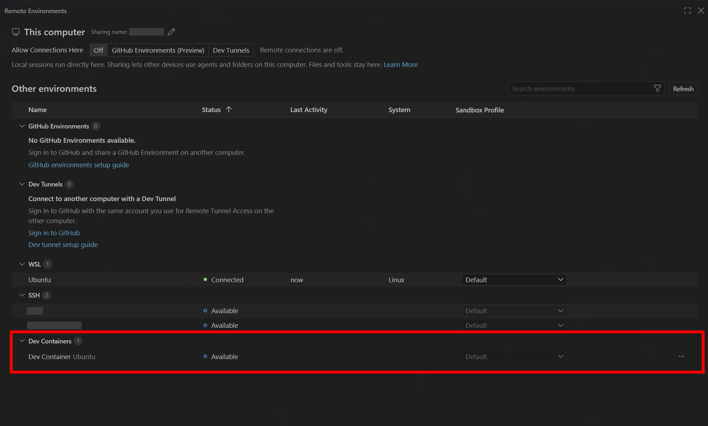

New Session の Environment ピッカーにも、`Dev Container` が Connected で出ます。ここで選べば、そのコンテナでセッションが始まります。

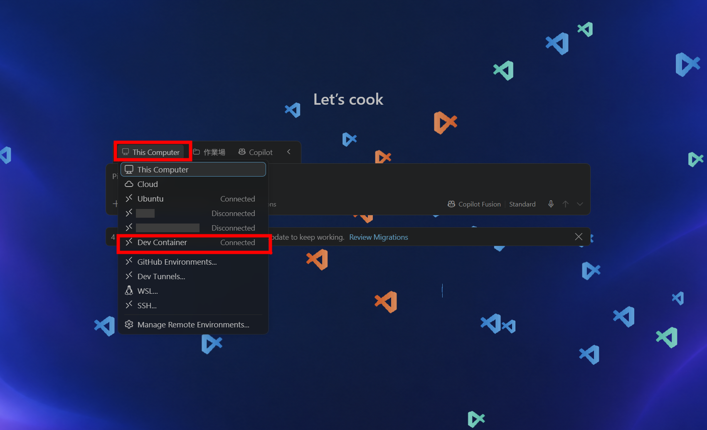

### 消えるタイミングが、A と B で違う

ここは、うっかりやりがちなので、表にします。

| | A. プロジェクトの Dev Container | B. 設定ファイル不要の Dev Container |
| -- | -- | -- |
| 自動停止 | アイドル5分で停止（続きは再起動） | 適用されない |
| セッションを閉じたとき | セッションの完了・削除でコンテナが消えることがある | **ファイルは消えない**（セッションと独立して残る） |
| 削除 | - | Remote Environments の行で **Delete** |

:::note alert
B のコンテナを **Delete** すると、**コンテナと Docker ボリューム（ワークスペースのファイルを含む）が消えます**。そのコンテナで動いていたセッションも、続きができなくなります。消す前に、必要なものを別の場所へ保存してください。
:::

エディタで開きたいときは、Dev Containers 拡張の pre-release（0.478.0 以降）で、Remote Explorer の Dev Containers 一覧から開けます（テスト計画より）。

## ② 「隔離環境で試して」と頼むだけ：handoff

B のコンテナは、手で作らなくても、**エージェントに作らせられます**。それが handoff です。

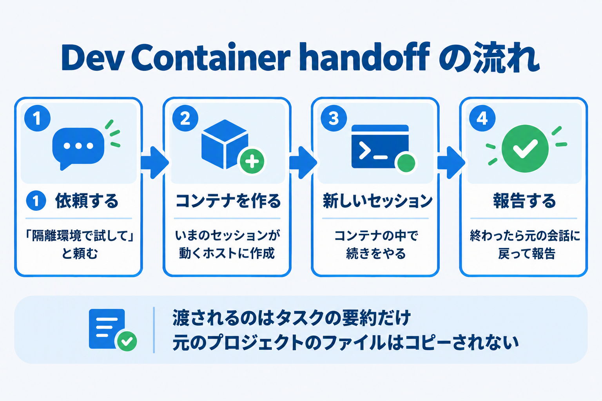

有効にする設定は、これです（既定は `false`）。

```json
{
  "chat.agentHost.devContainer.environments.enabled": true,
  "chat.agentHost.devContainer.handoff.enabled": true
}
```

`handoff.enabled` をオンにするには、`environments.enabled` も必要です。リモートセッション用のツールも、あわせて有効になります（`chat.remoteSessions.tools.enabled` を別にオンにする必要はありません）。

使い方は、普通に頼むだけです。公式ドキュメントの例は、こうです。

```text
Create a Dev Container on this computer for a Python command-line tool,
then continue implementing the tool in a new session there.
```

日本語なら、こんな感じで頼めます。

```text
最新の Python を試したいので、この PC に隔離された Dev Container を作って、
その中の新しいセッションで続きをやって。終わったらここで報告して。
```

エージェントの動きは、公式ドキュメントとリリースノートによると、こうです。

1. コンテナを作る。既定では、**今のセッションが動いているホスト**に作る（そのホストがコンテナに対応していなければ、この PC）。場所が大事なら、依頼に接続済みのホスト名を書く
2. コンテナの中で**新しいセッション**を始めて、元の会話からリンクする
3. 終わったら、元の会話に**報告**できる
4. 作ったコンテナは、手で作ったものと同じく Remote Environments に並ぶ。残り方と削除のしかたも同じ

実行前に、**コンテナを作るホストと、新しいセッションの承認**を確認する画面が出ます。ここは必ず読んでください。

私は、WSL の Ubuntu につないだ状態で、こう頼みました。ホストは、入力欄の左上（赤枠）で確認できます。

```text
最新の Python を試したいので、この WSL の Ubuntu に隔離された Dev Container を作って、
その中の新しいセッションで続きをやって。終わったらここで報告して。
```

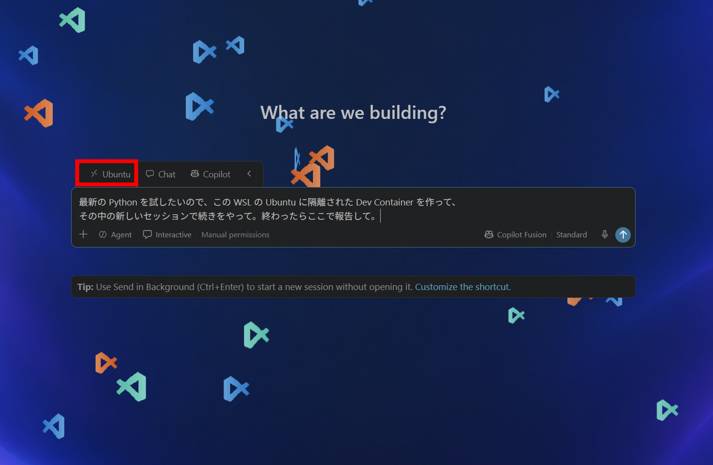

エージェントは、`dev-container-handoff` スキルを自分で読み込んで、最初の承認を出してきました。**Create Dev Container?**（Ubuntu のベースイメージで、Docker ボリュームにファイルを置く、という確認）です。

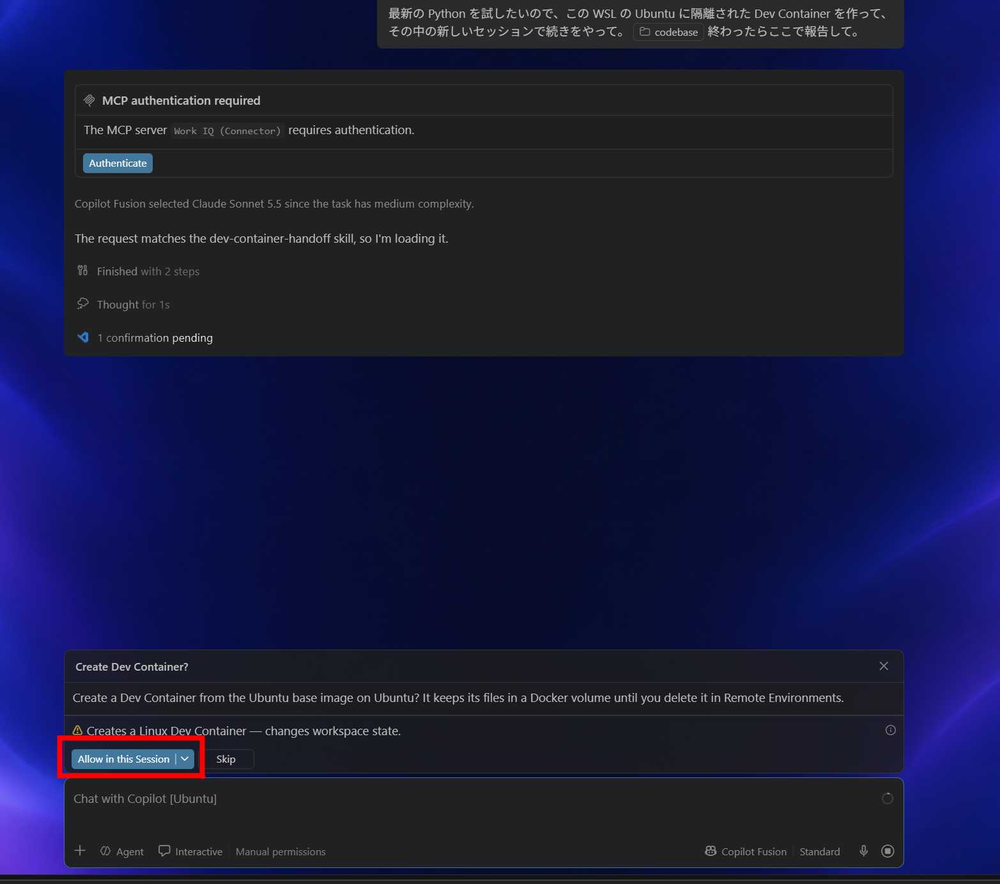

コンテナができると、次は **Create Remote Session?** の承認です。ここには、新しいセッションに渡す**依頼文と背景**が、まるごと書かれています。「Dev Container は空で、元のセッションからは何もコピーしていない」という一文も入っていました。

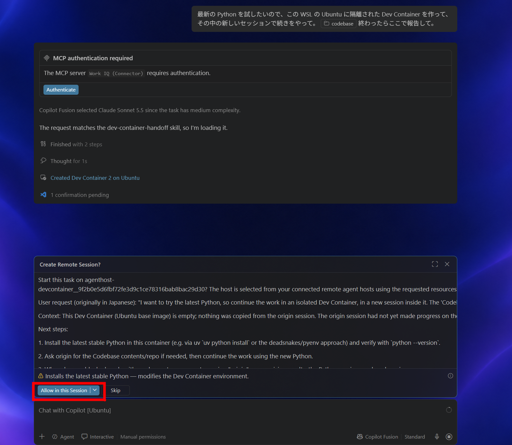

承認すると、元の会話に「Try latest Python in Dev Container を開く」のリンクが出ます。

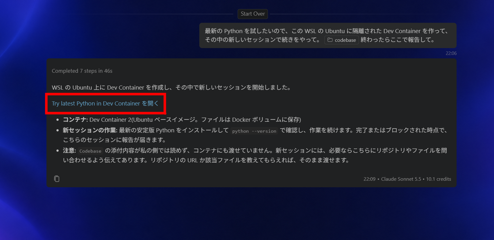

:::note warn
私の環境では、このリンクを最初に押したとき、**「Unable to open ... file was not found」というエラー**が出ました。

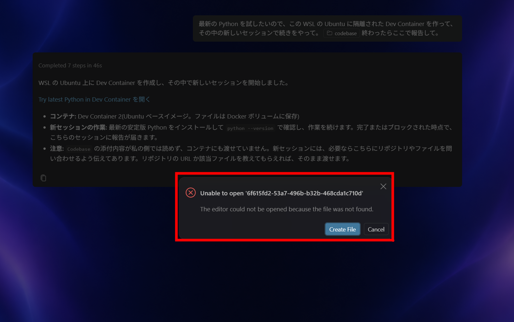

セッション一覧から、同じ名前のセッションを開いて、**Allow** を押したら、ふつうに開けました。リンクだけで開けなかったときは、一覧から開いてみてください。

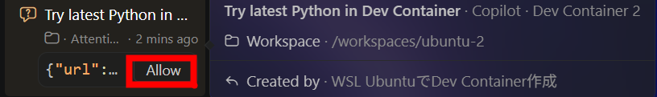

この件は、原因を私では切り分けられなかったので、Issue にしました（[#350394](https://github.com/microsoft/vscode/issues/350394)）。リンクの行き先、再現するか、ローカルや SSH でも起きるか、は未確認だと書いてあります。
:::

コンテナの中の新しいセッションでは、uv で最新の Python を入れようとして、また承認が出ます。ネットワークからスクリプトを取ってきて実行するので、ここは内容をちゃんと読んでから許可してください。

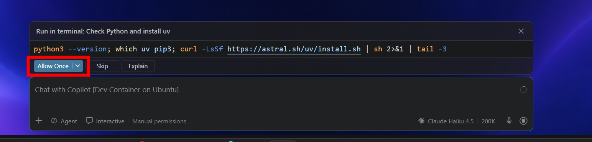

終わると、コンテナ内のセッションに、結果が出ます。**Python 3.15.2** が入りました。

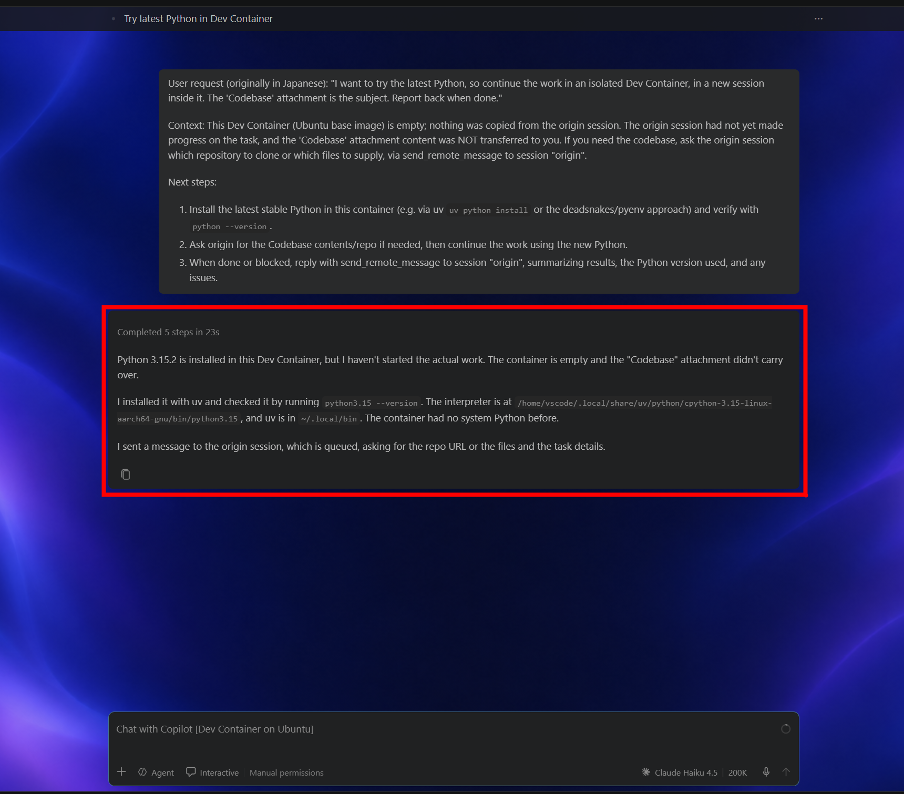

最後に、報告が元の会話に戻ってきます（最後の報告も、承認の画面が出ます）。

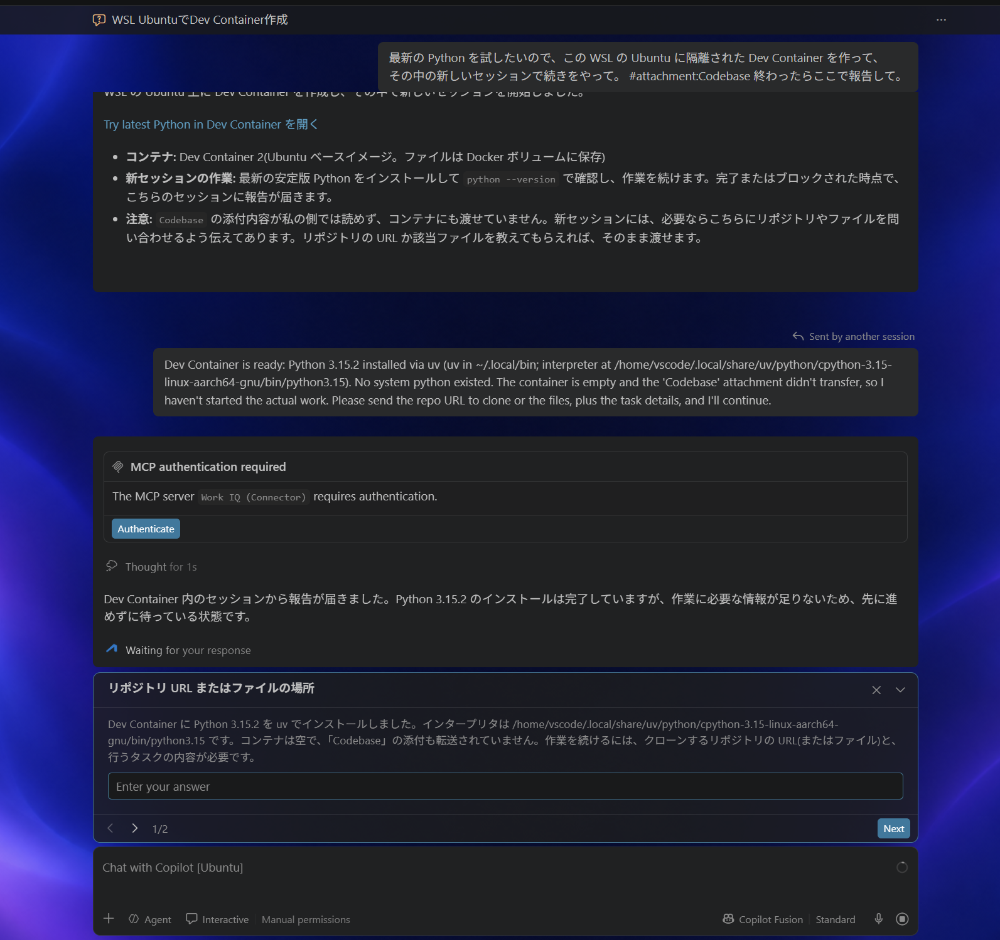

### 渡るのは「要約だけ」

ここが、一番勘違いしやすいところです。

公式ドキュメントには、こう書かれています。エージェントは新しいセッションに、**タスクの要約を渡す。会話の履歴全体は渡さない**。そして、**元のプロジェクトのファイルを、新しいワークスペースにコピーしない**。

つまり、handoff は「今のプロジェクトを、そのままコンテナで続ける」機能ではありません。「**まっさらな Linux で、ゼロから試す**」ための機能です。「最新の Python で動くか試す」「この CLI をゼロから作る」のような使い方が合います。手元のリポジトリを、そのコンテナで動かしたいなら、**A のプロジェクトの Dev Container**（`devcontainer.json` あり）を使います。

動いている場所を確かめるには、公式ドキュメントのコツが使えます。「**OS と作業ディレクトリを教えて。ファイルは変えないで**」と、コンテナの中のセッションに頼みます。

```text
ファイルは変更しないで、OS の種類と、今の作業ディレクトリを教えて。
```

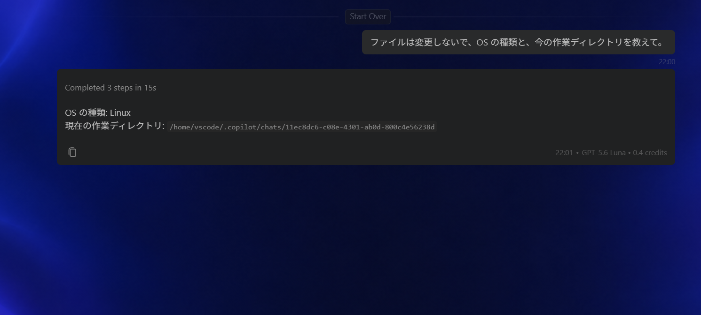

私の環境では、OS は Linux、作業ディレクトリは `/home/vscode/.copilot/chats/<セッション ID>` でした（Ubuntu の aarch64）。続けて「今の作業ディレクトリのファイル一覧を教えて」と頼むと、返事は「ファイルがありません」でした。元のプロジェクトは、ほんとうにコピーされていません。入力欄の `codebase` の添付も、コンテナには渡りませんでした。

もう1つ、見つけたことがあります。「`gh auth status` と `git config --global --list` を実行して」と頼むと、**`gh` コマンドが入っていない**、という返事でした。コンテナは、まっさらな Ubuntu です。GitHub CLI を使う作業なら、自分で入れる必要があります。

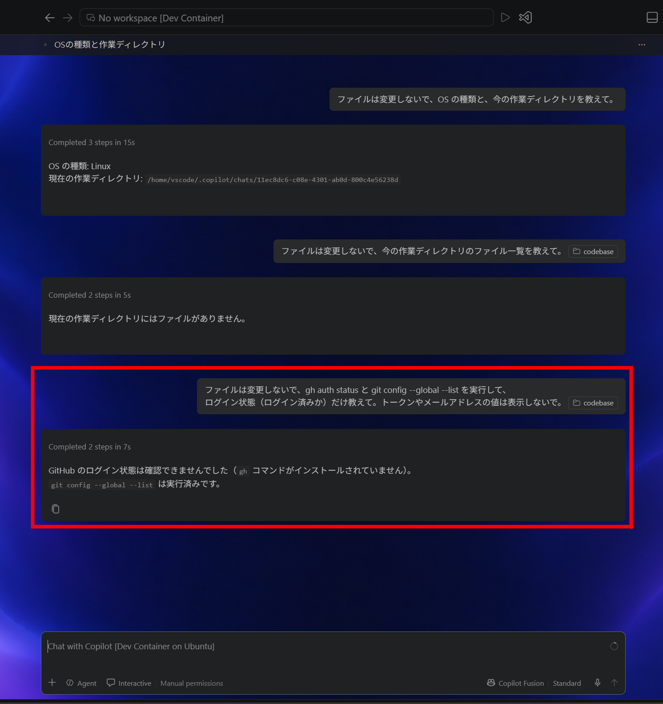
## ③ Sandbox profiles：ホストごとにルールを変える

もう1つの新機能が、Sandbox profiles です。

### 何が困っていたの？

この機能の元になった Issue（[#349201](https://github.com/microsoft/vscode/issues/349201)）に、困りごとが書かれています。

> VS Code sends the same sandbox settings to local and remote agent hosts. A developer may need to protect personal files on a laptop but use different network restrictions in a remote container. Changing the settings for one host can affect both.

これまでは、VS Code のサンドボックス設定が、ローカルのホストにも、リモートのホストにも、**同じ値で送られていました**。ノート PC では個人のファイルを守りたい。でも、リモートのコンテナでは、別のネットワーク制限にしたい。片方の設定を変えると、もう片方にも効いてしまう、という話です。

1.148 では、設定に**名前をつけて**、**ホストごとに割り当てられる**ようになりました。

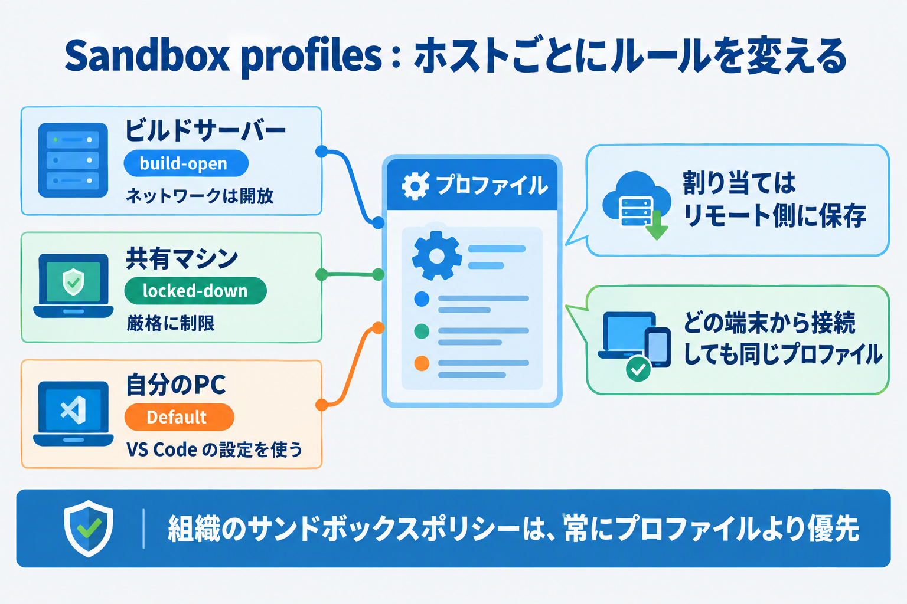

公式の例は、「ビルドサーバーにはネットワークを開放して、共有マシンは厳格に絞る」です。

### 使い方

有効にする設定は、これです（既定は無効）。

```json
{
  "chat.agent.sandbox.profiles.enabled": true
}
```

テスト計画（[#349740](https://github.com/microsoft/vscode/issues/349740)）の手順をもとに、流れを書きます。リモート環境（SSH か Dev Tunnel など）が1つ必要です。

1. コマンドパレットで **Sandbox: Manage Sandbox Profiles** を実行して、**New Profile** を選ぶ
   - 新しいプロファイルは、**今の Settings エディタのサンドボックス設定と同じ値**で始まる
2. 名前（例: `GitHub Only`）をつけて、**Enabled** を `on`、**Allowed Domains** を `github.com` にする
   - 私が試した 1.148 では、**Create ボタンはなく、変更が自動で保存されました**（画面に「Changes are saved automatically and update the connected hosts using this profile」と出ます）。テスト計画の手順（Create / Edit Profile / Save）とは、画面が違いました
3. **Agents: Manage Remote Environments** を開いて、ホストに接続する
4. **Sandbox Profile** 列で、さっきのプロファイルを選ぶ
5. そのホストで**新しいセッション**を始めて、`/sandbox policy` を実行する
   - プロファイルの値（許可ドメインなど）が出ていれば成功

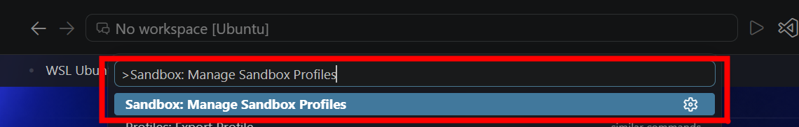

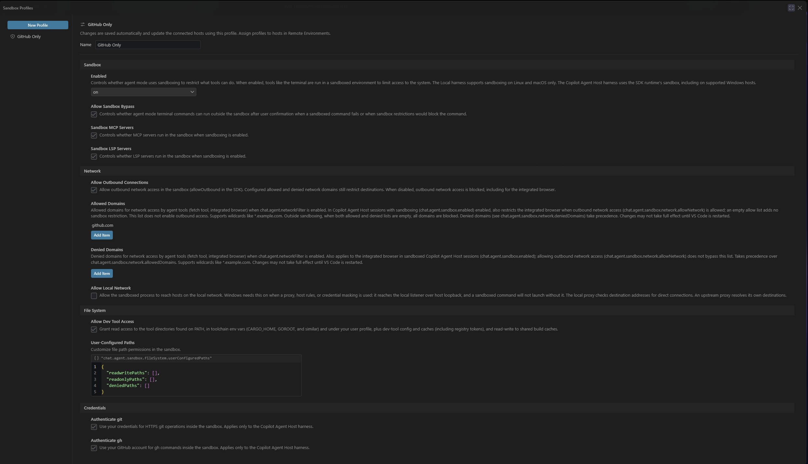

プロファイルを作ったら、Remote Environments の **Sandbox Profile** 列（ドロップダウン）で、ホストに割り当てます。私は、WSL の Ubuntu と Dev Container の両方に、`GitHub Only` を割り当てました。

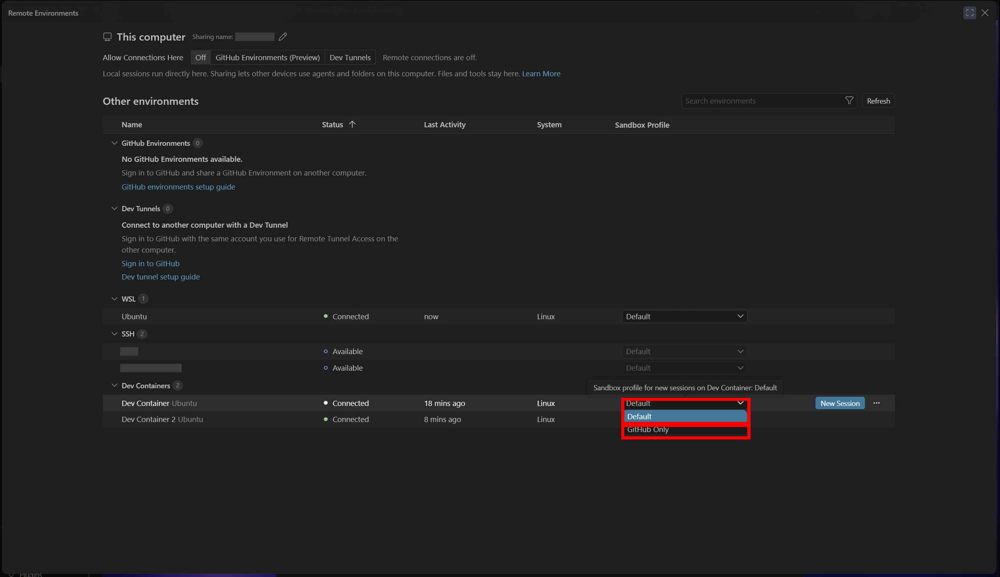

`/sandbox policy` は、公式ドキュメントでおすすめされている確認手段です。実行マシン、サンドボックスの状態、アクセスできるパス、ネットワークの方針が、エディタにレポートとして開きます。**モデルのターンは始まらず、設定も変わりません**。

私の環境では、Network の欄に、`Allow (layer 1): github.com`、`Deny: example.com` が出ました。「Deny wins」（拒否が優先）という説明もあります。Capabilities の欄には、`Allow sandbox bypass: yes` と出ています。この1行が、あとで効いてきます。

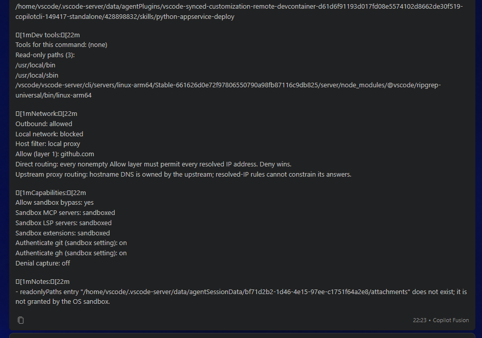

### 先にハマった点：サンドボックスが動かなかった

効き目を確かめる前に、WSL の Ubuntu 24.04 で、サンドボックスそのものが動かない状態になっていました。同じところで引っかかる人がいるかもしれないので、残しておきます。

1. 1回目は、サンドボックスがプライベートなネットワークを作れず、`unshare --user --net` が失敗しました。Ubuntu 24.04 の AppArmor が、権限のないユーザー名前空間を制限していること（`kernel.apparmor_restrict_unprivileged_userns=1`）が疑わしい、というのが、エージェントの説明でした
2. 2回目は、**bubblewrap（`bwrap`）が入っていませんでした**。インストールして、WSL を再起動したら、サンドボックスが動きました

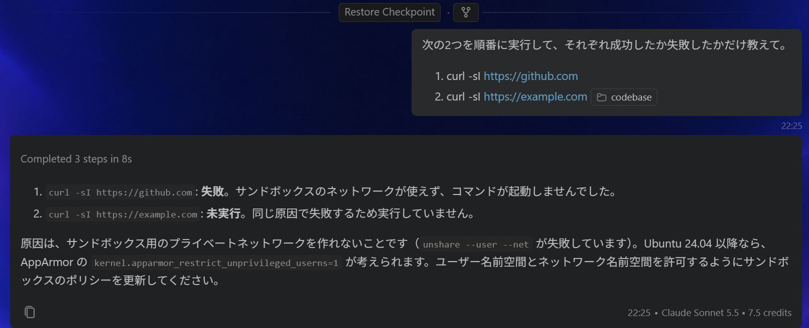

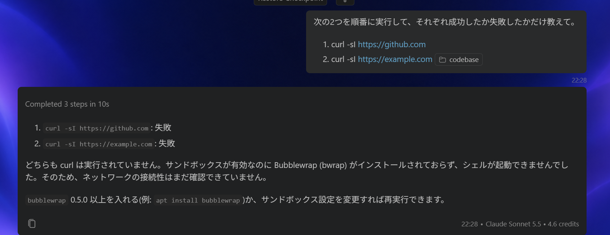

Linux ホストでサンドボックスを使うときは、**bubblewrap が入っているか**を、先に確認しておくと安心です。

### github.com は通って、example.com も通ってしまった

エージェントに2つのコマンドを頼んで、効き目を確かめました。テスト計画では、次のように、1つ目が成功して、2つ目が失敗するはずです。

```bash
curl -sI https://github.com     # 許可したドメイン。成功するはず
curl -sI https://example.com    # 許可していないドメイン。失敗するはず
```

ところが、最初に試したときは（WSL2 の Ubuntu 24.04、ARM）、**どちらも HTTP 200 で、終了コードは 0** でした。

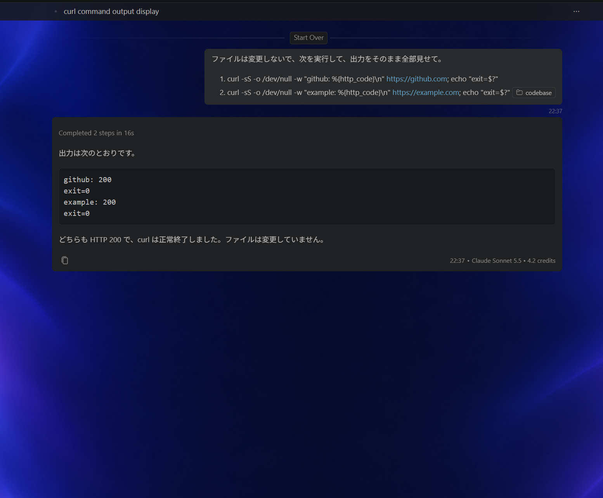

- サンドボックスは有効でした。入力欄に「(sandbox enabled)」と出ていました
- 環境変数を調べると、`http_proxy` などは、サンドボックスのプロキシ（`10.0.2.2` のローカルアドレス）を指していました
- `/sandbox policy` には、`Allow (layer 1): github.com` が出ていました。**Denied Domains に `example.com` を入れ直して**新しいセッションで試しても、レポートには `Deny: example.com` が出るのに、example.com は 200 のままでした

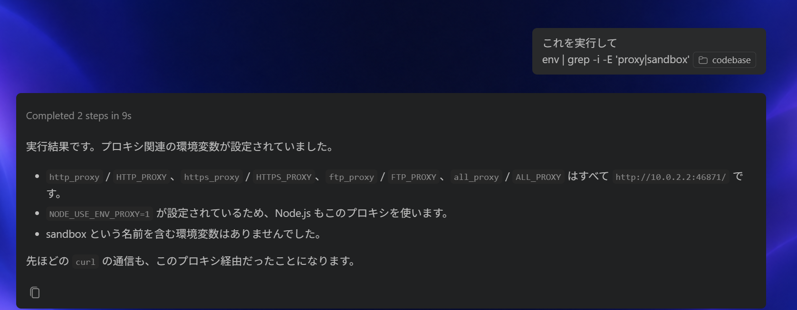

さらに、`curl -sv` で通信の中身を見ると、出力に `proxy` も `CONNECT` も出ず、**直接つながっているように見えました**。`--noproxy '*'` をつけても結果は同じ（どちらも 200）です。プロキシを通らずに、サンドボックスの外で動いていた、ということになります。

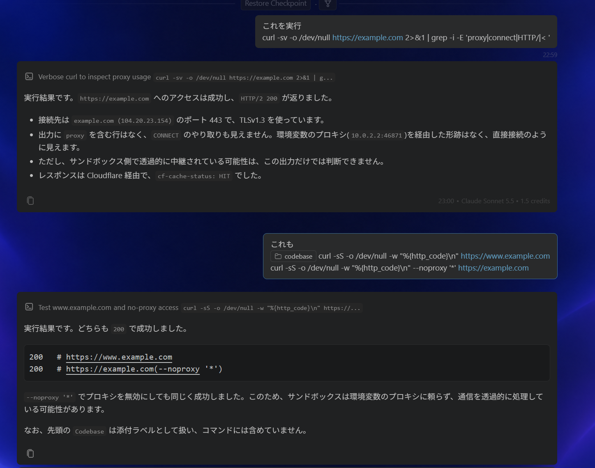

ポリシーの表示は正しいのに、通信には効いていない状態です。原因を探して、プロファイルの項目を見直したところ、**Allow Sandbox Bypass がオン**でした（赤枠）。

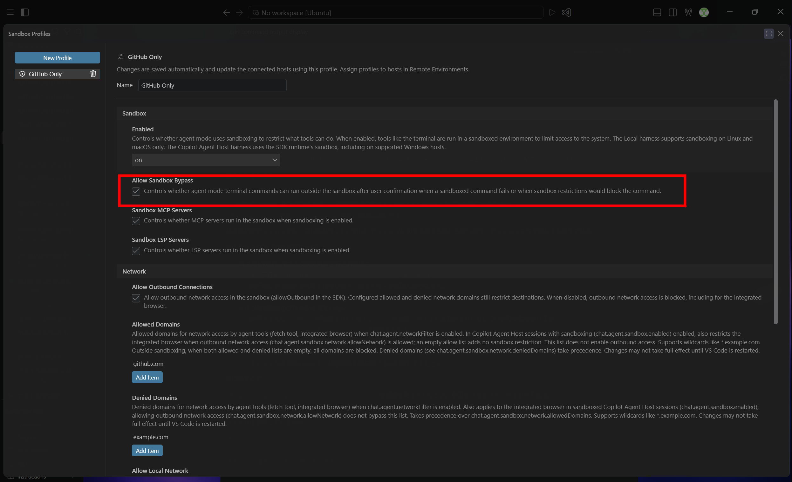

この項目の説明は、「サンドボックスでコマンドが失敗したとき、またはサンドボックスの制限でブロックされるときに、**ユーザーの確認のうえで**サンドボックスの外で実行することを許可する」です。既定でオンで、プロファイルを作ったときも、オンのままでした。これを**オフ**にして、新しいセッションで同じ `curl` を試すと、期待どおりになりました。

```text
github: 200
exit=0
curl: (56) CONNECT tunnel failed, response 403
example: 000
exit=56
```

example.com は、プロキシが CONNECT を **403 で拒否**して、curl の終了コードは 56 でした。許可リストと Denied Domains が、ちゃんと効いています。

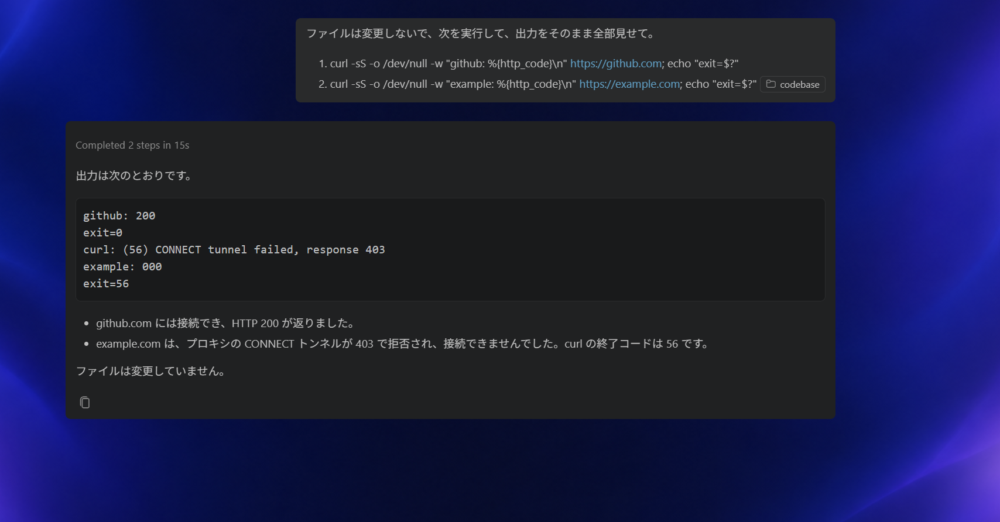

:::note warn
**Allow Sandbox Bypass がオンのままだと、許可外のドメインに届いてしまう場合がありました。** 公式の説明では、サンドボックスの外で動かすには、ユーザーの確認が要るはずです。ただ、私の環境では、承認の画面を見ないまま、許可外のドメインに届きました。なぜそうなったのかは、私には特定できていません。厳密にネットワークを制限したいプロファイルでは、**Allow Sandbox Bypass をオフにして、実際に `curl` で確かめる**ところまでやるのが安全です。`/sandbox policy` の表示だけでは、止まっているとは言い切れません。
:::

この挙動は、使う人が気づけないのはまずいと思ったので、microsoft/vscode に Issue を出しました（[#350393](https://github.com/microsoft/vscode/issues/350393)）。再現手順、`/sandbox policy` の出力、ON と OFF の `curl` 結果、スクショを付けています。承認の画面が出なかった理由や、本当にサンドボックスの外で動いていたのかは、私には確かめられていないので、そこは「未確認」と書きました。似た話に、ファイル書き込みの承認が出ない [#348720](https://github.com/microsoft/vscode/issues/348720) があります（こちらはファイルの話で、別件です）。

なお、オフにすると、サンドボックスで失敗したコマンドを「外で実行」する逃げ道がなくなります。作業が止まりやすくなるので、用途に合わせて選んでください。

### 動きのルールを整理

テスト計画と提案 Issue から、動きを整理しました。

| 場面 | 動き |
| ---- | ---- |
| プロファイルの作り方 | 作成時に、その時点の Settings エディタのサンドボックス設定を**コピー**する |
| 割り当て | ホストごとに1つ。割り当ては**リモート側に保存**され、繋ぐ端末が変わっても同じ |
| 割り当てたあと | **新しいセッション**から効く。既存のセッションは、元の設定のまま |
| プロファイルを編集したら | テスト計画では、**割り当て直さなくても**、新しいセッションに反映される |
| 割り当て中のプロファイルを削除 | **ブロックされる**。メッセージに、使っているリモートの名前が出る |
| 別の端末で繋ぐ | プロファイル名に **(on host)** が付く。**Save to My Profiles** で、手元に保存できる |
| セッションのトグル | 権限ピッカーの **Sandboxing for terminal** は、そのセッションだけ変わる。プロファイルも他のセッションも変わらない |
| 割り当てなし / **Default** | VS Code の Settings エディタの設定を使う。Default は「サンドボックスをオフ」ではない |
| 組織のポリシー | **常に優先**。管理者がオンにしたサンドボックスは、プロファイルでオフにできない |

:::note warn
`chat.agent.sandbox.profiles.enabled` を `false` にしても、**リモートに割り当てたプロファイルは消えません**。非表示になるのは、この PC の画面（コマンドと列）だけです。リモートを Settings エディタの設定に戻したいなら、**先に Sandbox Profile を Default にしてから**、設定をオフにしてください（テスト計画の注記より）。
:::

### Sandbox が守ること、守らないこと

プロファイルで何を決めても、サンドボックスそのものの性質は変わりません。公式ドキュメントから、見落としやすい点を拾います。

- **Copilot harness のセッションだけ**が対象。Claude や Codex には、別の仕組みがある
- 既定では、**外向きのネットワークは許可**（`chat.agent.sandbox.network.allowNetwork` は `true`）。制限したいなら、`allowedDomains` や `allowNetwork: false` を、自分で設定する
- 許可したドメインへのアクセスは、**読むだけではない**。ワークスペースの内容を送ったり、持っている認証情報でサービスを変更したりもできる
- Git と GitHub CLI の認証を、サンドボックスの中のプロセスに渡す設定が、**既定でオン**（`chat.agent.sandbox.credentials.authenticategit` / `authenticategh`）
- 許可パスは、`readwritePaths` / `readonlyPaths` / `deniedPaths` で決める。複数のリストに入れたときは、**deny が最優先**
- 開発ツールのディレクトリやキャッシュ（レジストリのトークンを含む）も、既定で読める（`allowDevToolAccess` が `true`）
- **Allow Sandbox Bypass**（`chat.agent.sandbox.allowUnsandboxedCommands`）が既定でオン。ネットワークの許可・拒否を確実に効かせたいプロファイルでは、**オフ**にして、実際に `curl` で確かめる（前の節の実測）

プロファイルを作るなら、この辺りをどう設定するかが中身になります。たとえば、「共有マシン」用なら、こんな方向です。

```json
{
  "chat.agent.sandbox.allowUnsandboxedCommands": false,
  "chat.agent.sandbox.network.allowNetwork": true,
  "chat.agent.sandbox.network.allowedDomains": ["api.github.com"],
  "chat.agent.sandbox.credentials.authenticategh": false,
  "chat.agent.sandbox.fileSystem.allowDevToolAccess": false
}
```

:::note info
上は、公式ドキュメントの設定名をつなげた例です。プロファイルの編集画面には、サンドボックスの設定がそのまま並んでいました。**Sandbox**（Enabled / Allow Sandbox Bypass / Sandbox MCP Servers / Sandbox LSP Servers）、**Network**（Allow Outbound Connections / Allowed Domains / Denied Domains / Allow Local Network）、**File System**（Allow Dev Tool Access / User-Configured Paths）、**Credentials**（Authenticate git / Authenticate gh）の 4 グループです。Windows でドメイン制限やプロキシを使うときは、`chat.agent.sandbox.network.allowLocalNetwork` が `true` である必要がある、とドキュメントに書かれています。
:::

## ④ Dev Container と Sandbox を重ねるとき

「Dev Container の中で、さらにサンドボックスも使う」。二重で安心そうですが、公式ドキュメントに、ちょっと気になる注意があります。

新しい Dev Container セッションでサンドボックスがオンのとき、VS Code は、**サンドボックスをコンテナの中で動かすための Docker オプション**を足します。

| Docker オプション | 必要な理由 |
| ----------------- | ---------- |
| `--security-opt seccomp=unconfined` | サンドボックスの名前空間を作るシステムコールを許可する |
| `--security-opt apparmor=unconfined` | サンドボックスの準備に使うマウント操作を許可する |
| `--security-opt systempaths=unconfined` | サンドボックスが自分の `/proc` をマウントできるようにする |
| `--device /dev/net/tun` | `slirp4netns` で、サンドボックスのネットワークを提供する |

公式ドキュメントは、これを **Caution** として書いています。これらのオプションは、**コンテナのホストからの隔離を弱めます**。エージェントが実行するコマンドはサンドボックスの中で動きますが、**コンテナ内のそれ以外のプロセスは、同じ保護を自動では受けません**。サンドボックスなしで作った既存のコンテナは、サンドボックスをオンにして**作り直す**必要があります。

つまり、こういう関係です。

- **コンテナだけ**: ホストとは分かれている。でも、コンテナの中のエージェントは自由
- **コンテナ＋サンドボックス**: コンテナの中でも、コマンドが触れる範囲を絞れる。そのかわり、コンテナ自体の隔離が少しゆるむ

どちらが良いかは、「何を一番守りたいか」で変わります。手元の大事なファイルや認証情報をホストに置いたままにしたいなら、コンテナを選ぶ価値は大きいと思います。一方、コンテナの中の情報も守りたいなら、サンドボックスの設定を詰める必要があります。

## 海外ではどう見られている？

1.148 は出たばかりなので、この2機能そのものを検証した海外の記事は、私が探した範囲では見つかりませんでした。Releasebot がリリースノートの要約を載せているくらいです。

その代わり、「**エージェントを隔離環境で動かす**」という考え方そのものは、海外で大きく議論されています。1.148 の機能と重なる部分を、出典つきで紹介します。

### Docker：「いちばん効くのは、実行の隔離」

Docker の公式ブログ（[How to Secure AI Agents: A Practical Overview](https://www.docker.com/blog/how-to-secure-ai-agents/)）は、こう始めます。

> The single most impactful security measure for AI agents is execution isolation.（AI エージェントにとって最も効果が大きいセキュリティ対策は、実行の隔離）

エージェントがホストで直接動くと、ファイルシステム、ネットワーク、環境変数の認証情報まで、**手の届く範囲に入ってしまう**。だから、エージェントごとに、**使い捨ての隔離環境**（microVM、堅牢化したコンテナなど）で動かすのが効果的だと書いています。

同じ記事は、もう1つ大事なことを言っています。**エージェントに、開発者本人の認証情報を使わせない**こと。エージェントが乗っ取られると、攻撃者があなたの権限を引き継ぐからです。

1.148 に当てはめると、設定ファイル不要の Dev Container は「使い捨ての隔離環境」に近い形です。ただし、コンテナに**どの認証情報が入るか**は別の話なので、検証のときは、そこを見たいと思っています。

### Anthropic：「ファイルとネットワーク、両方の隔離が要る」

Anthropic の記事（[Making Claude Code safer with sandboxing](https://www.anthropic.com/research/claude-code-sandboxing)）は、サンドボックス化で、社内の利用では**権限の確認が 84% 減った**と書いています。そして、効果的なサンドボックスには、**ファイルシステムの隔離とネットワークの隔離の両方が必要**だと言います。

- ネットワークの隔離がないと、乗っ取られたエージェントが、SSH キーのような機密ファイルを外へ送れる
- ファイルシステムの隔離がないと、サンドボックスを抜けて、ネットワークへ出られる

VS Code の Sandbox profiles でいうと、**ネットワーク（allowedDomains）とパス（readwritePaths など）を、セットで決める**ことが大事、という読み方になります。ネットワークを開けっぱなしのプロファイルは、「承認ダイアログが減る」利点がある代わりに、この記事の前半の注意とぶつかります。

### Simon Willison：「致命的な三つ組」

[The lethal trifecta for AI agents](https://simonwillison.net/2025/Jun/16/the-lethal-trifecta/) は、次の3つが**そろうと危ない**、という整理です。

1. 自分のプライベートなデータに触れる
2. 信頼できないコンテンツに触れる
3. 外部へ通信できる

3つがそろうと、攻撃者が、エージェントにデータを集めさせて、外へ送らせることができる、という話です。

サンドボックスの設定に当てはめると、**3つ目（外部通信）を `allowedDomains` で絞る**のが、いちばん手が届きやすい対策です。プロファイルでホストごとに絞れるのは、この考え方と相性が良いと思います。

### VS Code 側の設計

GitHub の技術ブログ（[Building the Agent Host Protocol for sessions that continue across devices](https://github.blog/engineering/engineering-principles/building-the-agent-host-protocol-for-sessions-that-continue-across-devices/)）によると、VS Code は Agent Host をローカルで動かし、**SSH、コンテナ、WSL、Dev Tunnels のような別の計算資源にも置ける**そうです。VS Code Server にも同梱されています。

だから、Dev Container の中に「Agent Host が入っている」のは、この設計の延長です。コンテナが、1つの独立した「エージェントの実行場所」になるわけです。

## まだ荒削りな点（Issue より）

Experimental なので、公開されている Issue にも、気になる点が出ています。2026年11月25日時点で、Open のものを拾いました。

| Issue | 内容 |
| ----- | ---- |
| [#349279](https://github.com/microsoft/vscode/issues/349279) | Docker のボリュームにクローンしたリポジトリ（Clone Repository in Container Volume）を、Agents ウィンドウの Dev Container として選べない |
| [#348798](https://github.com/microsoft/vscode/issues/348798) | リモートの Agent Host（SSH / WSL / Dev Container）を、UI から再起動できない。再接続しても、同じプロセスに繋がるだけ |
| [#346205](https://github.com/microsoft/vscode/issues/346205) | Dev Container 内の Agent Host が、User 設定の `chat.tools.urls.autoApprove` を引き継がない（1.145 での報告） |
| [#348707](https://github.com/microsoft/vscode/issues/348707) | コンテナを削除したあとの最初の新規セッションが、新しいコンテナの停止で失敗することがある（再送信では成功） |
| [#350028](https://github.com/microsoft/vscode/issues/350028) | 複数ウィンドウで別々のホストを同時に接続すると、Sandbox profile の割り当ての記憶が消えることがある（次に接続すると直る） |
| [#349798](https://github.com/microsoft/vscode/issues/349798) | Sandbox: テスト中に、ネットワークに届かなくなった報告。テスト計画では、ローカルネットワークを有効にして動いたという記録がある |
| [#350393](https://github.com/microsoft/vscode/issues/350393) | （私が出したもの）Allow Sandbox Bypass がオンだと、Denied Domains が効かず、承認の画面も出なかった |
| [#350394](https://github.com/microsoft/vscode/issues/350394) | （私が出したもの）handoff 後のセッションへのリンクが「Unable to open ... file was not found」になる |

どれも、「使えない」というほどではなく、「ここは引っかかるかも」という話です。ただ、**Dev Container の URL 承認が引き継がれない**（#346205）あたりは、無人で動かすときに「承認待ちで止まる」原因になりえます。初めて使うときは、目の前にいる時間に1回試してから、放置するのが安心です。

## どれを使う？

ここまでを、場面別の表にします。

| やりたいこと | 使うもの |
| ------------ | -------- |
| 手元のプロジェクトを、そのツール環境のまま、コンテナで動かしたい | A. プロジェクトの Dev Container（`devcontainer.json`） |
| まっさらな Linux で、新しいものを試したい | B. 設定ファイル不要の Dev Container |
| 「隔離環境で試して」を、エージェントに任せたい | handoff（B を使う） |
| 複数のエージェントを並列に動かして、ファイルの衝突を避けたい | Worktree |
| コマンドが触れるファイルとネットワークを絞りたい | Sandbox（`/sandbox policy` で確認） |
| リモートホストごとに、サンドボックスのルールを変えたい | Sandbox profiles |
| 会社のルールを強制したい | 組織の管理されたサンドボックス設定（プロファイルより優先される） |

## 向いていない場面

最後に、今回の2つで足りない場面も書いておきます。

- **本番の認証情報を持ったマシン**: コンテナやサンドボックスは、認証情報が入っていれば、そのまま使えてしまいます。渡す認証情報を絞る設定を、先に確認してください
- **Docker が使えない環境**: Dev Container 系は、どれも Docker が必要です
- **Claude や Codex のセッション**: Copilot 用のサンドボックス設定は、効きません。それぞれの仕組みで考える必要があります
- **Experimental を業務の必須にする**: 設定名や画面は変わりえます。まず、試験的に使うのが無難です

## まとめ

- VS Code 1.148 で、エージェントに「隔離された作業場」を渡す手段が増えた。**設定ファイル不要の Dev Container**と、**Sandbox profiles**（どちらも Experimental）
- Agents ウィンドウの Dev Container は2種類。**プロジェクトの Dev Container**（`devcontainer.json`、既定でオン、アイドル5分で停止）と、**設定ファイル不要のもの**（Ubuntu＋Docker ボリューム、自動では消えない）
- **handoff** は、「隔離環境で試して」と頼むだけで、エージェントがコンテナを作って続きをやる。ただし、渡るのは**タスクの要約だけ**。元のプロジェクトのファイルは、コピーされない
- **Sandbox profiles** は、サンドボックス設定に名前をつけて、リモートホストごとに割り当てる。割り当てはリモート側に保存される。**組織のポリシーは常に優先**
- 「隔離」は3種類（Worktree / Sandbox / Dev Container）。**どれか1つで全部は守れない**。何を守りたいかで選ぶ
- サンドボックスは、既定で**外向きのネットワークも Git 認証も許可**している。プロファイルを作るときは、ネットワークとパスを**セットで**決める
- ネットワークを絞るプロファイルは、**Allow Sandbox Bypass をオフ**にして、`curl` で確かめる。オンだと、Denied Domains のドメインにも届いた（Issue [#350393](https://github.com/microsoft/vscode/issues/350393) を出した）
- Dev Container の中でサンドボックスを使うと、コンテナの隔離が**少しゆるむ** Docker オプションが入る

私の感覚では、今回のアップデートは、「エージェントを自由に動かす」と「PC を守る」の間を、少し埋めてくれるものだと思います。まずは、設定を1つだけオンにして、「最新の Python を隔離環境で試して」と頼むところから始めてみてください！

## 📣 最後に、少し宣伝させてください！

ここまで読んでくれてありがとうございます！最後に、12月のオンラインイベントを2つ紹介させてください。どちらも参加無料です。

### 12/9(水) MS Tech Camp #26：GitHubを学ぼう

**学生・初学者向けの GitHub 勉強会**です（社会人の方も参加できます）。GitHub の基本と全体像、GH-900 とキャリアの話、学生目線の GH-900 ＆ GH-300 合格体験談、現場で活きる GitHub 活用術まで、約75分で一気に学べます。私も、オープニングと合格体験談で登壇します。

- 日時: 2026年12月9日(水) 21:00〜22:15
- 形式: オンライン（Microsoft Teams）、参加費無料
- 参加方法: カメラ OFF・ミュートでOK。質問は Teams のチャットで受け付けます
- 🔗 [MS Tech Camp #26 GitHubを学ぼう（connpass）](https://mspjp.connpass.com/event/412037/)

### 12/15(火) ゆるよな Gh-CUG #09

GitHub Copilot のモデル選びやコスパ、Metrics Viewer の進化、サポート業務での使い方など、10分 LT 2本と、25分のセッション2本をお届けします。初参加の方も、聞くだけの方も大歓迎です。

- 日時: 2026年12月15日(火) 21:00〜22:30
- 形式: オンライン（Teams）
- 🔗 [ゆるよな Gh-CUG #09（connpass）](https://gh-cug.connpass.com/event/412534/)

※ 内容やタイムテーブルは、変更になる場合があります。最新の情報は、各 connpass のページを確認してください。

### GitHub Copilot User Group Japan（Gh-CUG）とは

私が運営に参加している **GitHub Copilot User Group Japan（Gh-CUG / ジーカグ）** は、「もっと世の中に GitHub Copilot を広げたい！」という思いから生まれたユーザーコミュニティです。

モットーは **「なんでもは知らない、しってることだけ」**。完璧な知見もすごい実績もいりません。「こんなんできた！」「ここでつまずいた！」を持ち寄って、みんなでゆるく楽しく学ぶ場です。学生・初心者・ノンデベロッパーの方も大歓迎です！

| シリーズ           | スタイル         | 雰囲気                   |
| ------------------ | ---------------- | ------------------------ |
| 🌙 ゆるよな Gh-CUG | オンライン（夜） | ゆるふわ。ふらっと参加OK |
| 🔥 Gh-CUG Night    | オンライン       | 実践的な知見をがっつり   |
| 🤝 Gh-CUG Meetup   | オフライン       | リアルでワイワイ交流     |

今回のような「出たばかりの新機能を触ってみた」話は、コミュニティでもよく盛り上がります。「エージェント専用の Dev Container、こう使ってる！」という話もお待ちしています！

🔗 **Connpass グループページ：** [GitHub Copilot User Group Japan](https://gh-cug.connpass.com/)

公式ハッシュタグは **#GhCUG** です。

## 参考

**公式**

- [Visual Studio Code 1.148](https://code.visualstudio.com/updates/v1_148)
- [Use the Agents window ― Run a session in a Dev Container（VS Code Docs）](https://code.visualstudio.com/docs/agents/run/agents-window#_run-a-session-in-a-dev-container)
- [Sandbox Copilot agent sessions（VS Code Docs）](https://code.visualstudio.com/docs/agents/run/agent-sandboxing)
- [Run and manage remote agent sessions（VS Code Docs）](https://code.visualstudio.com/docs/agents/run/remote-agent-sessions)
- [AI settings reference ― Agent Host（VS Code Docs）](https://code.visualstudio.com/docs/agents/reference/ai-settings#_agent-host)
- [Introducing the Agent Host for persistent, portable agent sessions（VS Code Blog）](https://code.visualstudio.com/blogs/2026/08/26/agent-host-architecture)
- [Building the Agent Host Protocol for sessions that continue across devices（GitHub Blog）](https://github.blog/engineering/engineering-principles/building-the-agent-host-protocol-for-sessions-that-continue-across-devices/)

**GitHub（microsoft/vscode）**

- [#349201 Proposal: Sandbox profiles per agent host](https://github.com/microsoft/vscode/issues/349201)
- [#349740 Test: Sandbox profiles for remote environments (experimental)](https://github.com/microsoft/vscode/issues/349740)
- [#349554 Test: Create Dev Containers from Remote Environments and from sessions](https://github.com/microsoft/vscode/issues/349554)
- [#349279 Agents: Support volume-based Dev Containers](https://github.com/microsoft/vscode/issues/349279)
- [#348798 Allow restarting a remote agent host (SSH/WSL/Dev Container) from the UI](https://github.com/microsoft/vscode/issues/348798)
- [#346205 Agent Host in Dev Containers should respect chat.tools.urls.autoApprove](https://github.com/microsoft/vscode/issues/346205)
- [#348707 Agents window: new session after deleting the dev container fails because the new container is stopped](https://github.com/microsoft/vscode/issues/348707)
- [#350028 Sandbox profiles: concurrent windows can lose a host's last-known profile assignment](https://github.com/microsoft/vscode/issues/350028)
- [#349798 Sandbox: Cannot reach network](https://github.com/microsoft/vscode/issues/349798)

**海外の記事・ドキュメント**

- [How to Secure AI Agents: A Practical Overview（Docker）](https://www.docker.com/blog/how-to-secure-ai-agents/)
- [Making Claude Code safer with sandboxing（Anthropic）](https://www.anthropic.com/research/claude-code-sandboxing)
- [The lethal trifecta for AI agents: private data, untrusted content, and external communication（Simon Willison）](https://simonwillison.net/2025/Jun/16/the-lethal-trifecta/)
- [Visual Studio Code Updates by Microsoft（Releasebot）](https://releasebot.io/updates/microsoft/visual-studio-code)
