## はじめに

こんにちは！VSCode/GitHubオタクのMicrosoft Student Ambassador/Github Copilot User Group Japan運営のロホマン シャヒンです

:::note
この記事が少しでも参考になったら、**ぜひいいね・共有**をお願いします。
間違っている箇所や「ここが分かりにくかった」という指摘は、やさしくコメントいただけると助かります！
:::

最近、周りから「VS Code、重くない？」と言われることが増えました。エージェントや拡張機能を足していくほど、起動もスクロールも重くなりがちです。

そこで海外の最近の記事と公式の手順を読み比べてみたら、言っていることはかなり揃っていました。**設定をいじる前に、まず測る。そのうえで、効く順に削る。** これに尽きます！

この記事では、その順番どおりに「軽くする方法」をコンパクトにまとめます。しかも、自分の WSL 環境で **Extension Bisect を実際に回して、メモリを測った結果**つきです！

## 海外で話題になっていること

2026年11月時点で、目についた情報は次の4つです。

- **MakeUseOf（2026-11-16）**: 「VS Code から乗り換えようか迷ったけど、設定で救えた」という体験記。Minimap・CodeLens・Search on Type をオフ、使っていない拡張機能の削除、`node_modules` を Explorer から隠す、が柱です（[出典](https://www.makeuseof.com/speed-up-vs-code-settings/)）
- **Urhoba の Performance Tuning（2026-07）**: 「まず測る」から始めて、`files.watcherExclude` と拡張機能の整理が効果の大半、と順位をつけて書いています。見た目の設定は新しいマシンではほぼ差が出ない、とはっきり書いているのも特徴です（[出典](https://www.urhoba.net/en/post/vs-code-performance-tuning)）
- **Moncef Ajmani の大規模プロジェクト向け記事（2026-04）**: 120パッケージのモノレポで、除外設定と Dev Container により読み込みが 45 秒から 8 秒になった事例です（[出典](https://ajmani.dev/optimize-vs-code-for-large-projects/)）
- **VS Code チームの TypeScript 7 の記事（2026-06）**: VS Code 本体のリポジトリで、型チェックが 7 倍以上速くなり、エディタがプロジェクトを読み込む時間も約1分から約10秒になったそうです（[出典](https://code.visualstudio.com/blogs/2026/06/26/iterating-faster-with-ts-7)）

ちなみに公式の [Performance Issues Wiki](https://github.com/microsoft/vscode/wiki/Performance-Issues) も、CPU が高いときの第一歩は「拡張機能を疑う」と書いています。海外記事も公式も、結局同じ場所を見ているんですよね。

## 手順0: まず「何が重いか」を測る

設定を片っ端から変える前に、犯人を特定します。使うのは標準機能だけです。

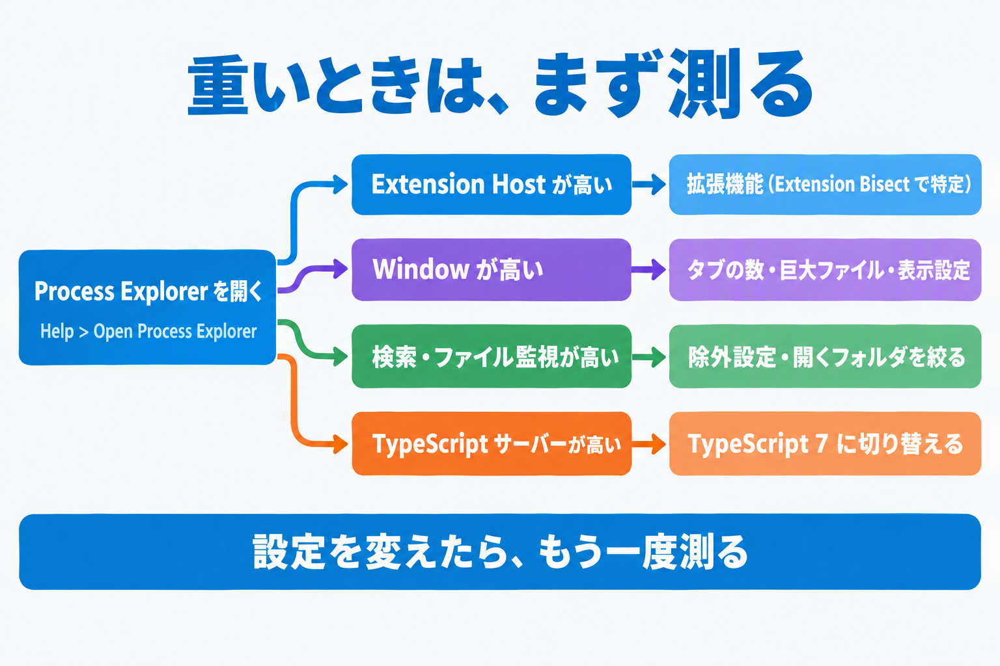

| 見る場所 | 開き方 | 分かること |
| --- | --- | --- |
| Process Explorer | `Help` > `Open Process Explorer` | プロセスごとの CPU とメモリ。`extension-host` が高ければ拡張機能が怪しい |
| Running Extensions | `Developer: Show Running Extensions` | 拡張機能ごとの起動時間。重いものが一目で分かる |
| Startup Performance | `Developer: Startup Performance` | 起動の各段階にかかった時間 |

コマンドラインから見ることもできます。

```bash
# 動作中の VS Code のプロセスとワークスペースの情報をまとめて出す
code --status

# 拡張機能をすべて無効にして起動（これで軽くなるなら拡張機能が原因）
code --disable-extensions
```

`Help` > `Open Process Explorer` から開けます。

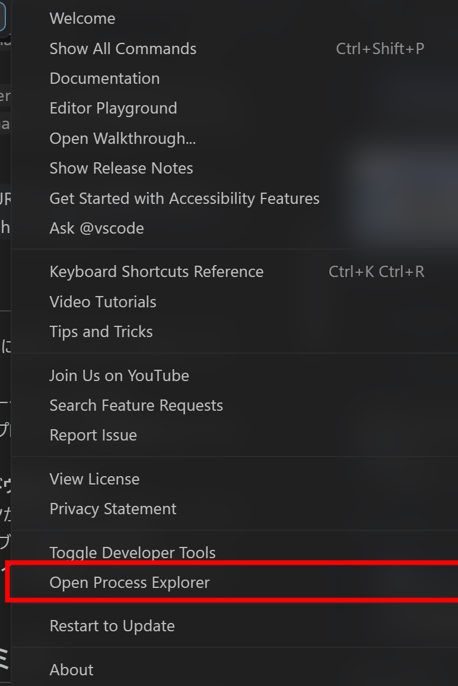

私の環境（WSL: Ubuntu でワークスペースを開いた状態）では、操作に重さは感じていなかったのに、WSL 側の `extension-host` が **724 MB** ありました。この数字を、あとで比べるための基準値（Baseline）にします。

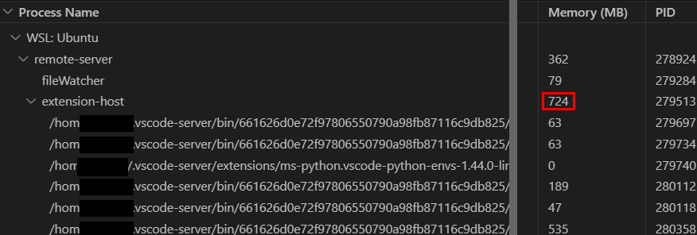

`Developer: Show Running Extensions` では、拡張機能ごとの起動時間（Activation）が見られます。

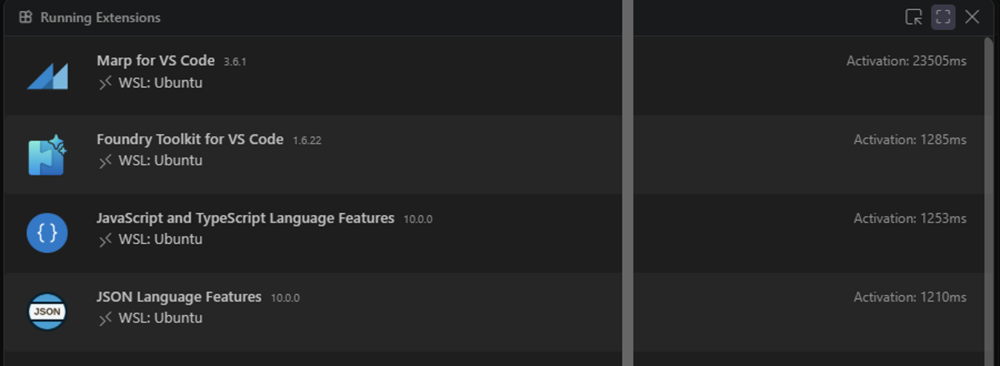

ちなみに、起動時間の1位は Marp for VS Code（23505ms）で、メモリで効いていた拡張機能とは別でした。**起動時間とメモリは別の話**なので、気になるほうを測る必要があります（Marp の数字は、初回の準備などが含まれている可能性があります）。

どのプロセスが重いかで、次に見る場所が変わります。

| 重いプロセス | 疑うところ |
| --- | --- |
| Extension Host | 拡張機能（次の節へ） |
| Window（レンダラー） | タブの開きすぎ、巨大ファイル、表示系の設定 |
| `rg`（検索）やファイル監視 | 除外設定と、開いているフォルダ |
| TypeScript のサーバー | プロジェクトの大きさ、TypeScript 7 |

## 拡張機能を整理する

どの記事でも最初に挙がるのが拡張機能です。Wiki によると、CPU が高い原因は拡張機能であることが多いそうです。

### Extension Bisect で犯人を二分探索する

「どれが重いか分からない」ときは、`Help: Start Extension Bisect` が地味に便利です。拡張機能の半分を無効にしてリロードし、「まだ問題が出る？」と聞かれるので答えていくと、二分探索で原因を1つに絞ってくれます。


実際にやってみます。Bisect は本来「問題が再現するか」で答える機能ですが、今回は操作の不具合ではなかったので、**WSL 側 `extension-host` のメモリが Baseline（724 MB）に近いか**を判断基準にしました。

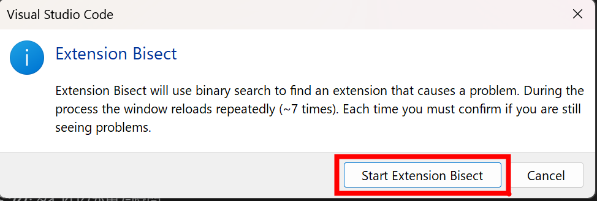

無効化された拡張機能が減っていく途中で、Process Explorer を見ながら答えます。

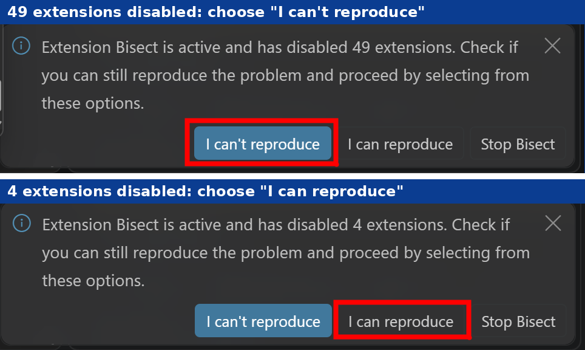

観測した値はこうなりました。

| 無効化された拡張機能数 | WSL `extension-host` | 回答 |
| ---: | ---: | --- |
| 0（Baseline） | 724 MB | 基準 |
| 49 | 394 MB | I can't reproduce |
| 25 | 504 MB | I can't reproduce |
| 13 | 614 MB | I can't reproduce |
| 7 | 598 MB | I can't reproduce |
| 4 | 693 MB | **I can reproduce** |
| 1 | 646 MB | I can't reproduce |
| 1（別パターン） | 630 MB | I can't reproduce |

49個を無効にすると 394 MB まで下がり、戻していくと Baseline に近い 693 MB のところで「再現した」と答えました。最終的に、こう出ました。

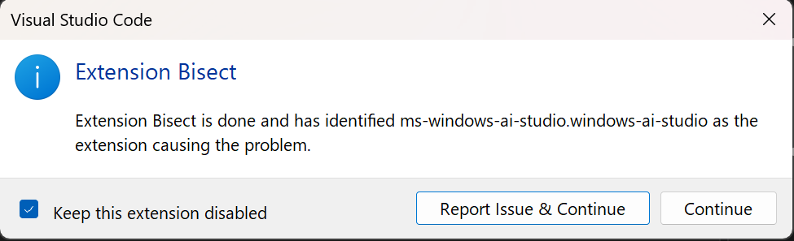

`ms-windows-ai-studio.windows-ai-studio`、つまり **Foundry Toolkit for VS Code** です。

### 「犯人」と決めつける前に、単体で ON/OFF を比べる

Bisect が出したのは、あくまで候補です。本当に差が出るのか、Foundry Toolkit だけを ON/OFF して測り直しました（Extensions ビューの `Enable` / `Disable` ボタンで切り替え）。

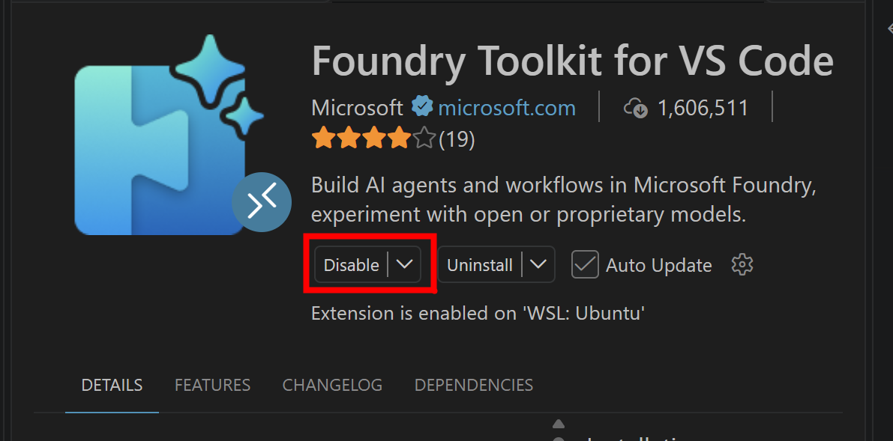

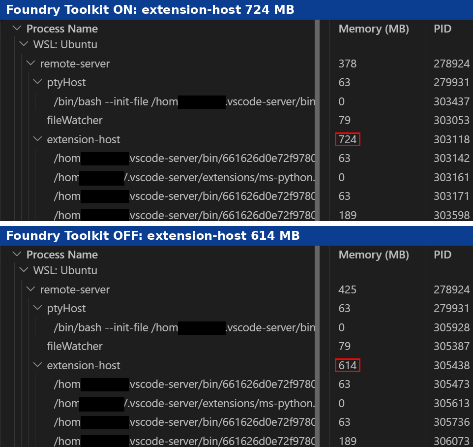

| Foundry Toolkit | 1回目 | 2回目 | 平均 |
| --- | ---: | ---: | ---: |
| ON | 724 MB | 740 MB | **732 MB** |
| OFF | 614 MB | 630 MB | **622 MB** |

平均の差は **約110 MB（約15%）** でした。

ここで気をつけたいのは、**「Foundry Toolkit は常に約110 MB 使う」とは言えない**ことです。この検証には、次の限界があります。

- **回数が少ない**: ON/OFF は各2回です。ただ、ON は 724・740 MB、OFF は 614・630 MB で、2回の振れ幅（16 MB）より差（約110 MB）のほうが大きく、範囲も重なっていません
- **Bisect の回答基準が手作り**: Bisect はメモリを測る機能ではなく、今回は私が「Baseline に近いか」で回答しています。693 MB を「再現した」とするラインは、感覚で決めました
- **測ったのは WSL 側の Extension Host だけ**: ローカル（Windows 側）の Extension Host や、起動時間、体感の速さは見ていません
- **メモリは揺れる**: ワークスペース、他の拡張機能、言語サーバー、WSL の状態、測定タイミング、GC などで変わります

なので、結果は「**今回の環境で ON/OFF を切り替えたら、WSL の Extension Host のメモリに約15%の差が出た**」という範囲で受け取ってください。「VS Code が速くなった」と言える検証ではありません。

とはいえ、**測る → Bisect で候補を出す → 単体で ON/OFF して確かめる**という流れは、そのまま真似できます。見つかった拡張機能は、使うときだけ有効にする（`Disable (Workspace)` や、プロファイルで分ける）のが現実的です。無効にするとその拡張機能の機能は使えなくなるので、必要なものは残してください。

### プロファイルとワークスペース単位の無効化

- **プロファイル**: `File` > `Preferences` > `Profiles` で、用途別に拡張機能のセットを分けられます。「Web 開発」「執筆用」「Python」のように分けておくと、使わない拡張機能が起動しません（[公式ドキュメント](https://code.visualstudio.com/docs/configure/profiles)）
- **ワークスペース単位で無効化**: 拡張機能の歯車から `Disable (Workspace)`。TypeScript のプロジェクトで Python や Go の拡張機能を止める、といった使い方です

Urhoba の記事では、GitLens（履歴スキャン）、ESLint（保存のたびに全体を見る）、Docker（常にコンテナへ問い合わせる）、テストランナー（自動検出）が重くなりやすい例として挙がっていました。

## ファイル監視と検索の範囲を絞る

Urhoba の記事が「最も見落とされやすく、最も効く」と書いていたのが、ファイル監視（`files.watcherExclude`）です。VS Code は開いたフォルダ内の変更をずっと監視しているので、ビルド成果物や仮想環境が大量にあると、それだけで CPU を使います。

`settings.json` に、プロジェクトに合わせて足してみてください。`.git/objects` や `node_modules` などの一部は既定で除外されているので、足すのは既定にないものだけで大丈夫です。

```json
{
  "files.watcherExclude": {
    "**/.venv/**": true,
    "**/dist/**": true,
    "**/build/**": true,
    "**/.next/**": true,
    "**/target/**": true
  },
  "search.exclude": {
    "**/dist": true,
    "**/build": true,
    "**/*.min.js": true,
    "**/*.map": true
  }
}
```

注意点が1つ。除外しすぎると、あとで「検索に出てこない」と悩むことになります。Ajmani さんも、生成コードを除外して型定義が検索できなくなる例を、過剰な除外の落とし穴として挙げていました。

もう1つ、設定より効くかもしれないのが**開くフォルダを絞る**ことです。親ディレクトリごと開かず、作業するプロジェクトのフォルダだけを開きます。ファイル数が減るので、監視・検索・言語サーバーの全部が軽くなります（MakeUseOf も「設定より効く習慣」として紹介）。

実際に私の `settings.json`（User）へ追加しました。

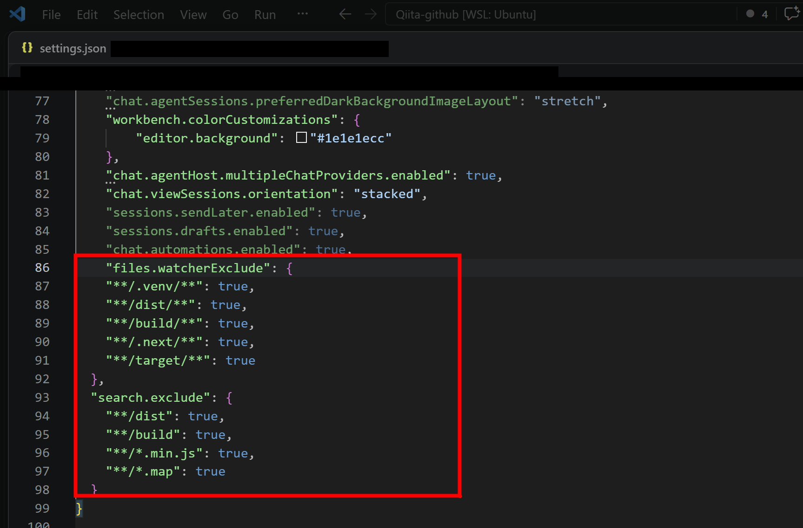

追加後の WSL `extension-host` は **646 MB** で、Foundry Toolkit を OFF にしたときの 614〜630 MB と、はっきりした違いは出ませんでした。

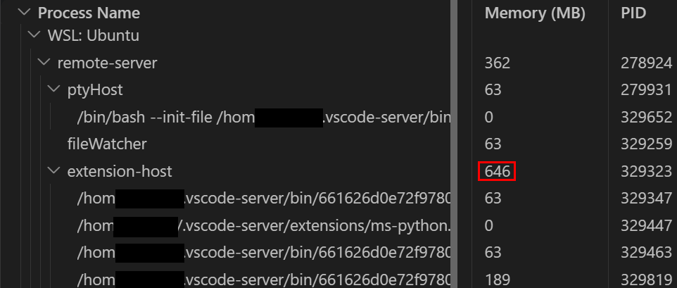

私の測り方はメモリだけで、CPU や検索の速さは見ていません。そもそも監視対象のファイルが少ない小さなリポジトリなので、この設定が本領を発揮するのは、ビルド成果物や仮想環境が大量にあるような大きなプロジェクトなのかもしれません。

## 表示まわりの設定（古めのマシン向け）

MakeUseOf が最初に挙げていた3つです。使っていなければ、オフにして困りません。

```json
{
  "editor.minimap.enabled": false,
  "editor.codeLens": false,
  "search.searchOnType": false
}
```

- **Minimap**: ファイル全体の縮小版を描画し続けるので、その分の負荷があります
- **CodeLens**: 参照数などを計算し続けます。必要なときは `Shift + F12`（Find All References）で同じ情報が見られます
- **Search on Type**: 1文字ごとに全体検索が走るのを、Enter を押したときだけにします

ただし、Urhoba の記事は「**新しいマシンではほとんど差が出ない**。古いPC、リモートデスクトップ、VM で効く」とも書いています。ここは期待しすぎず、手順0で測ってから入れるのがおすすめです。

## TypeScript が重いなら TypeScript 7 を試す

JavaScript / TypeScript のプロジェクトでは、言語サーバーがメモリを一番使いがちです。ここは2026年に大きく動きました。

VS Code チームの記事によると、TypeScript 7 は Go で書き直された実装で、VS Code 本体のリポジトリでは次のように変わったそうです（出典: [Iterating faster with TypeScript 7](https://code.visualstudio.com/blogs/2026/06/26/iterating-faster-with-ts-7)）。

| 項目 | TypeScript 6 | TypeScript 7 |
| --- | --- | --- |
| 型チェック | 基準 | 7倍以上速い |
| `npm run watch` の完了 | 約80秒 | 約20秒 |
| エディタでのプロジェクト読み込み | 1分近く | 約10秒 |

試すには、マーケットプレースの拡張機能 [TypeScript 7](https://marketplace.visualstudio.com/items?itemName=TypeScriptTeam.native-preview)（`TypeScriptTeam.native-preview`）を入れて、`TypeScript: Enable TypeScript 7` を実行します。組み込みの JS/TS 機能が、新しい言語サーバーに切り替わります。

従来のサーバーを使い続ける場合は、メモリ上限と自動インポートの走査を見直します。

```json
{
  "typescript.tsserver.maxTsServerMemory": 4096,
  "typescript.preferences.includePackageJsonAutoImports": "off"
}
```

`includePackageJsonAutoImports` を `off` にすると、大きなモノレポで全パッケージの export を走査しなくなります。`tsconfig.json` 側でも `exclude` に `node_modules` や `dist` を入れ、`skipLibCheck: true` を付けると型チェックが短くなります。

## 2026年ならではの注意: Copilot / エージェント周りの重さ

今年ならではの話が、エージェントまわりです。VS Code の GitHub では、こんな報告が上がっていました。

- **セッションが溜まりすぎて Extension Host が止まる**（[#348461](https://github.com/microsoft/vscode/issues/348461)）: 保存されたセッションが約2,260個（約3.7 GB）あり、Copilot のセッション一覧の処理で Extension Host が約13秒応答しなくなった報告です。アーカイブしてもフォルダが残り、処理対象になっていたのが原因とされ、1.148.0 のマイルストーンで Closed になっています
- **ツールの繰り返し呼び出しで CPU/メモリが増え続ける**（[#334421](https://github.com/microsoft/vscode/issues/334421)）: Copilot Chat 0.64.1 の Autopilot で報告された事例で、2026-11-25 時点では Open です
- **ツールを大量に登録する拡張機能で UI が固まる**（[#349450](https://github.com/microsoft/vscode/issues/349450)）: 1.147.0 で、約230個のツールを登録する拡張機能があると、数秒フリーズする報告です。こちらも 2026-11-25 時点で Open です

どれも「自分の環境で必ず起きる」わけではなく、条件がそろったときの話です。ただ、**重いときに Show Running Extensions と Process Explorer を見る**という基本は、Copilot 周りでもそのまま使えます。Issue で報告されている回避策は次のとおりです。

1. `Developer: Reload Window` で、肥大した Extension Host を作り直す
2. 重くなった長いセッションは再開せず、新しいセッションを始める
3. 古いセッションを整理する（#348461 では、アーカイブ済みのフォルダを `~/.copilot/session-state` の外へ移す回避策が書かれていました。消さずに移すだけにして、自己責任でお願いします）

ちなみに Process Explorer では、Agents ウィンドウが `window [1] (Agents)` として、Extension Host とは別のプロセスで見えます。私の環境では 500 MB 前後で、画面を開いて操作しているときは 953 MB まで増えていました。重いと感じたら、ここも見る価値があります。

![Agents ウィンドウと Process Explorer を並べた画面。window [1] (Agents) は 953 MB](https://raw.githubusercontent.com/shahin99991/Qiita-github/main/vscode-performance-tips/images/demo-11-agents-window.png)

## 結局、どの順番でやる？

海外の記事や公式の手順の見立てで、効果が大きい順に並べるとこうなります（私の環境で確かめられたのは、1と2の流れだけです）。

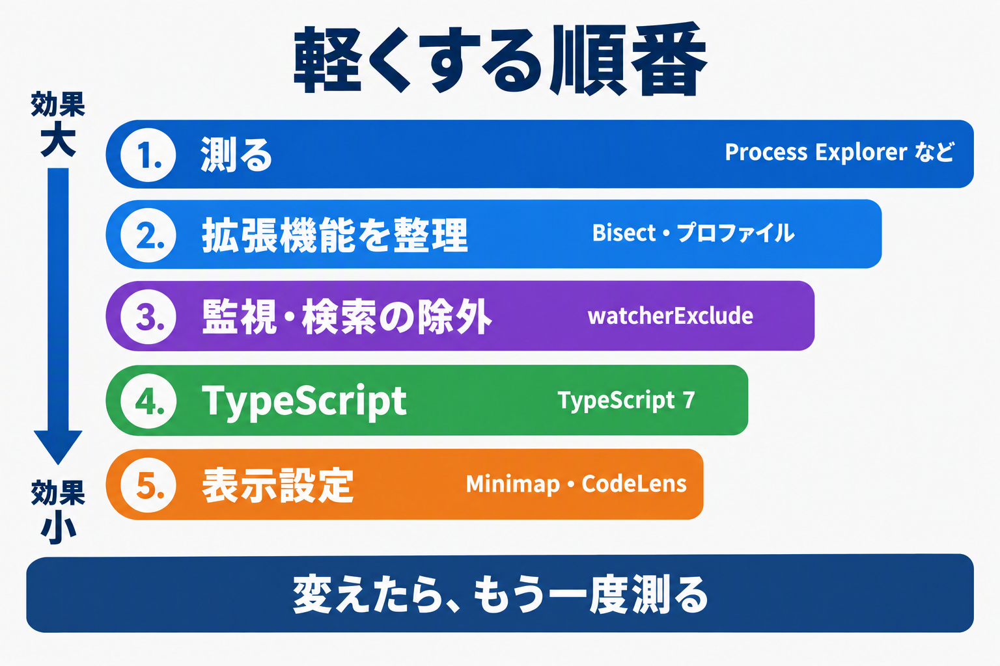

| 順番 | やること | 目安 |
| --- | --- | --- |
| 1 | Process Explorer などで測る | 5分 |
| 2 | Extension Bisect、プロファイル分け | 10分 |
| 3 | `watcherExclude` / `search.exclude`、開くフォルダを絞る | 5分 |
| 4 | TypeScript 7 を試す / `tsserver` の設定 | 10分 |
| 5 | Minimap・CodeLens などの表示設定 | 2分 |

設定を変えたら、**もう一度測る**のを忘れずに。変更前後で比べないと、何が効いたのか分からなくなります。

## まとめ

- 「重い」ときは、設定より先に **Process Explorer / Running Extensions / Startup Performance で測る**
- 効果が大きいのは、**拡張機能の整理**と**ファイル監視・検索の除外**。Extension Bisect とプロファイルが頼りになる
- 私の WSL 環境では、Bisect が Foundry Toolkit を候補に挙げ、単体で ON/OFF したら **Extension Host が平均 732 MB → 622 MB（約110 MB、約15%）** 下がった。ただし環境しだいで、固定の数字ではない
- Bisect が出すのは「候補」。**単体で ON/OFF して確かめる**ところまでやる
- Minimap や CodeLens などの表示設定は、**古いマシンやリモート環境向け**。新しいマシンでは差が出にくい
- TypeScript のプロジェクトは、**TypeScript 7** を試す価値あり（VS Code 本体の事例で、型チェック7倍以上、読み込み約1分から約10秒）
- Copilot / エージェント周りの重さも、報告が出始めている。**セッションの溜めすぎ**には注意

「重い＝VS Code が悪い」と決める前にまず測ってみると、意外と1つの拡張機能が効いていたりします（今回の私は、操作に重さを感じていなかったのに、です）。周りで「VS Code 重い」と言っている人がいたら、この記事を渡してもらえると嬉しいです！

## 最後に、少しだけ宣伝させてください

12月に、GitHub と GitHub Copilot の勉強会が2つあります。どちらもオンラインで、カメラOFF・聞くだけで参加できます！

- **MS Tech Camp #26 GitHubを学ぼう**（12/9 水 21:00〜22:15・無料）: 学生・初学者向けの GitHub 勉強会です。社会人も参加できます。私は学生目線の GH-900 / GH-300 合格体験談を話します。 https://mspjp.connpass.com/event/412037/
- **ゆるよな Gh-CUG #09**（12/15 火 21:00〜22:30）: GitHub Copilot のモデル選びやコスパ、Metrics Viewer などを、登壇4名でお届けします。初参加も歓迎です。 https://gh-cug.connpass.com/event/412534/

登壇内容は変わることがあるので、最新の情報は各 connpass のページで確認してください。気になったら、ぜひ遊びに来てください！

## 参考

- [Performance Issues · microsoft/vscode Wiki](https://github.com/microsoft/vscode/wiki/Performance-Issues)
- [Profiles in Visual Studio Code](https://code.visualstudio.com/docs/configure/profiles)
- [Iterating faster with TypeScript 7 | VS Code Blog](https://code.visualstudio.com/blogs/2026/06/26/iterating-faster-with-ts-7)
- [TypeScript 7 - Visual Studio Marketplace](https://marketplace.visualstudio.com/items?itemName=TypeScriptTeam.native-preview)
- [I almost ditched VS Code for being slow, but these settings saved it | MakeUseOf](https://www.makeuseof.com/speed-up-vs-code-settings/)
- [VS Code Performance Tuning | Urhoba](https://www.urhoba.net/en/post/vs-code-performance-tuning)
- [How to Optimize VS Code for Large Projects | ajmani.dev](https://ajmani.dev/optimize-vs-code-for-large-projects/)
- [microsoft/vscode#348461](https://github.com/microsoft/vscode/issues/348461) / [#334421](https://github.com/microsoft/vscode/issues/334421) / [#349450](https://github.com/microsoft/vscode/issues/349450)
