<!--
【タイトル候補】
1. VS Code 1.147：エージェントへの依頼を「いま送らない」で管理する。Send Later と Drafts を整理した
2. 「10 分後に確認して」が通る。VS Code 1.147 の Send Later は、PC がスリープしたらどうなる？
3. 寝る前に予約、朝に結果を見る？ Send Later と Drafts で変わるエージェントの頼み方

【画像について】
- img-00 〜 img-06 は GPT Image 2.5 で生成した解説画像（作り直す場合は generate_images.py、OPENAI_API_KEY が必要。img-06 は 1.148 追記用で、スクリプトには未登録）
- demo-01, 02(3枚), 03, 12 は実機スクリーンショット（2026/11/19 撮影、VS Code 1.147）
- 画像の URL は https://raw.githubusercontent.com/shahin99991/Qiita-github/main/vscode-1-147-send-later-drafts/images/<ファイル名> で統一。push して main に入るまで 404 になる
- 後から差し替えるときは、同名で images/ に上書きして push すれば記事側の URL 変更は不要

【公開前 TODO】
- demo-12 のスクショにリポジトリのコミット内容（コミットメッセージ）が写っている。公開してよい内容か確認
- この HTML コメントを削除
-->

## はじめに

こんにちは！エージェントへの依頼を、思いついた瞬間に送ってしまいがちなMicrosoft Student Ambassador/Github Copilot User Group Japan運営のロホマン シャヒンです！

:::note
この記事が少しでも参考になったら、**ぜひいいね・共有**をお願いします。
間違っている箇所や「ここが分かりにくかった」という指摘は、やさしくコメントいただけると助かります！
:::

2026年11月18日に **VS Code 1.147** がリリースされました。リリースノートの冒頭は、こんな書き出しです。

> Have a task in mind but not ready to send it? This week, save requests as drafts or schedule them for later.
>
> （出典: [Visual Studio Code 1.147](https://code.visualstudio.com/updates/v1_147)）

「頼みたいことはあるけど、まだ送れない」。エージェントを毎日使っていると、これ、地味によくあります。ビルドが終わってから確認させたい、朝イチでレビューの返信を片付けさせたい、プロンプトを書きかけのまま別の作業に呼ばれた、とか。

1.147 では、この「いま送らない」を扱う機能が2つ入りました。

- **Send Later**: 依頼を送る日時を決めて予約する
- **Drafts**: 送っていない依頼を、設定ごと複数保存しておく

どちらも **Experimental** で、Agents ウィンドウでしか使えません。この記事では、公式ドキュメントと microsoft/vscode の Issue、海外の記事・ドキュメントを読んで条件を整理し、Send Later の予約から実行までは実機でも確かめています。「PC がスリープしたらどうなるの？」という、いちばん気になるところは、後半でじっくり扱います。

対象読者は、VS Code の Agents ウィンドウをすでに触っている方です。Experimental なので、設定名や挙動は今後変わる可能性があります。

:::note info
**2026年11月25日の追記**: 同日に **VS Code 1.148** が Stable でリリースされました。この記事の前半で「まだ入っていない」と書いていた、**エージェントが作業している間はスリープさせない機能（`sessions.keepAwakeWhileWorking`、Preview）** が入っています。ただし、これで Send Later の「スリープ問題」がすべて片付くわけではありません。どこまで効いて、どこから効かないのかは、後半の「1.148 で入った keep-awake は、どこまで効く？」にまとめました。
:::

## TL;DR

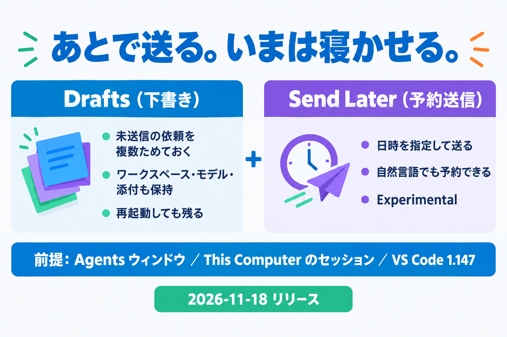

**何が起きた？**
VS Code 1.147（2026/11/18）の Agents ウィンドウで、依頼の予約送信（**Send Later**）と、未送信の依頼の保存（**Drafts**）が使えるようになりました。どちらも Experimental で、既定ではオフです。

**押さえておきたいポイント**

| 項目             | 内容                                                                                                                      |
| ---------------- | ------------------------------------------------------------------------------------------------------------------------- |
| Send Later の設定 | ⚠️ `sessions.sendLater.enabled`（既定オフ）。`chat.automations.enabled` もオンのままにしておく                            |
| Drafts の設定    | ⚠️ `sessions.drafts.enabled`（既定オフ）                                                                                  |
| 予約の入れ方     | ✅ 送信ボタンの Send Later メニュー、または自然言語（例: `Check the build in 10 minutes.`）                              |
| 届く条件         | ⚠️ ローカルの Agent Host が起動している必要あり。**スリープ中の PC は起こさない**。逃した依頼は復帰後に1回だけ処理       |
| 1.148 の追加     | ✅ `sessions.keepAwakeWhileWorking`（Preview）で、**エージェントが作業中の間**はスリープを抑止。ただし「予約時刻を待っているだけの間」を守るとは、公式に書かれていない |
| 対象外           | ❌ This Computer 以外（リモート / Cloud セッション）。繰り返しの実行は Send Later ではなく Automations                    |
| Drafts の中身    | ✅ テキスト・添付・インライン参照・ワークスペース・エージェント・モデル・設定。再起動しても残る                           |

**対象**: VS Code 1.147 以降の Agents ウィンドウ（keep-awake は 1.148 以降）。Copilot のプランによる制限は公式ドキュメントに書かれていませんが、組織ポリシーで Automations が無効だと使えない可能性があるので、確認してください。

## 「いま送らない」には2つの状態がある

Send Later と Drafts は似て見えますが、解決している困りごとが違います。

- **まだ送る準備ができていない** → Drafts。書きかけのまま別のセッションに移っても、内容が消えない
- **準備はできたけど、送るのは後にしたい** → Send Later。日時を決めて、あとはホストに任せる

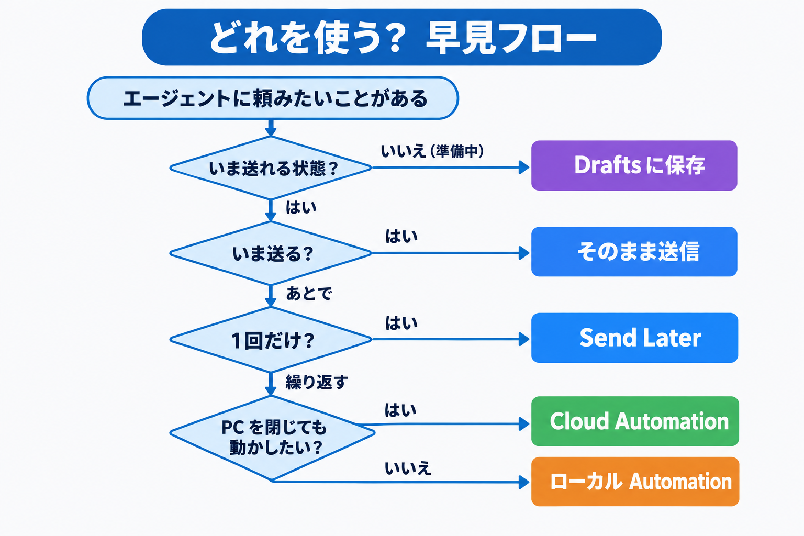

実は両者はつながっています。Send Later で**新しいセッション**に予約すると、その依頼はサイドバーの Drafts に並びます（詳しくは後述）。公式ドキュメントも、繰り返す作業は Automations、1回きりなら Send Later、という切り分けです。

## 有効化する

どちらも既定でオフです。`settings.json` に次を追加します。

```json
{
  "sessions.sendLater.enabled": true,
  "sessions.drafts.enabled": true,
  "chat.automations.enabled": true
}
```

`chat.automations.enabled` は Automations 側の設定で、公式ドキュメントによると既定でオンです。Send Later は内部的に、ホストが持つ1回限りの Automation として予約を保持しているので（[microsoft/vscode#348045](https://github.com/microsoft/vscode/issues/348045)）、これをオフにしていると使えません。

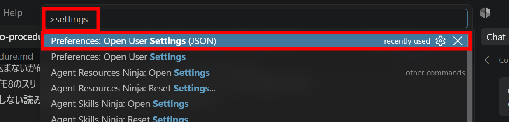
*コマンドパレット（`Ctrl+Shift+P`）で `Preferences: Open User Settings (JSON)` を開くと、上のコードをそのまま貼れます*

Agents ウィンドウは、VS Code のタイトルバーの Open in Agents、またはコマンドパレットの `Chat: Open Agents window` から開けます。ターミナルなら `code --agents` です。

## Send Later：日時を決めて予約する

### メニューから予約する

新しいセッションでも既存のチャットでも、依頼を書いたあと、送信ボタンの横のドロップダウン（下向きの矢印）から Send Later を選びます。

私の環境（1.147）では、入力欄に「ファイルは変更しないで、このリポジトリの直近5件のコミットを要約して。」と書いてから試しました。画面下の設定バーは、実行先が **This Computer**、モードが Agent、権限が Manual permissions です。

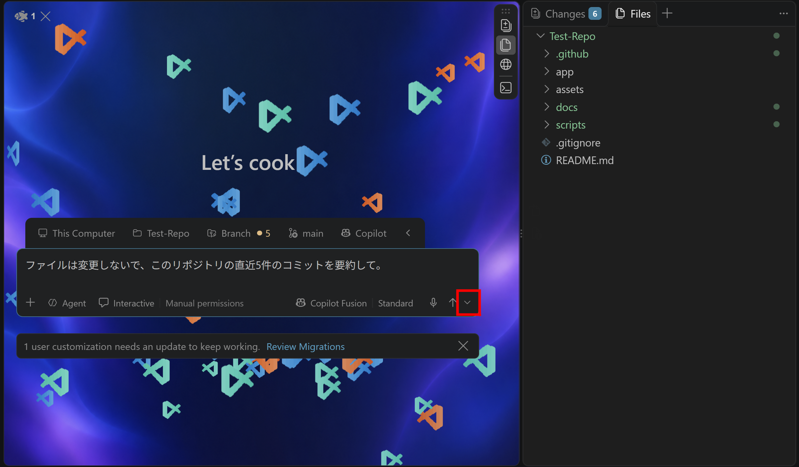

矢印を開くと、メニューは **Send Later...** の1項目だけでした。

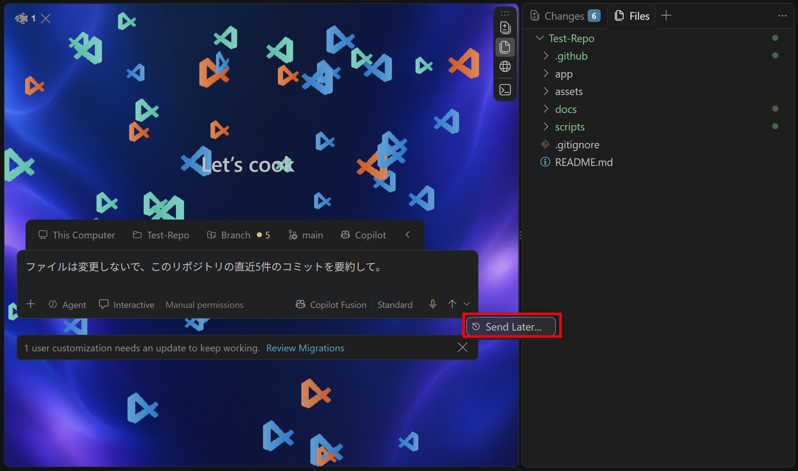

選ぶと、「Choose when to send.」の入力欄つきの一覧が開きます。

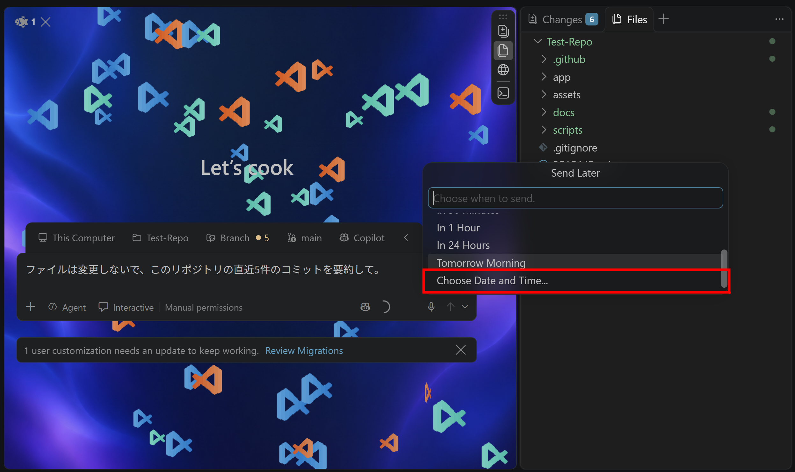

公式ドキュメントによると、選べるのは次のとおりです。

- **プリセット**: In 5 Minutes、Tomorrow Morning（翌日 9 時）など。各プリセットには、実際の送信時刻が添えて表示される（上のスクショは、一覧を少しスクロールした状態で、In 1 Hour / In 24 Hours / Tomorrow Morning が見えています）
- **Choose Date and Time**: カレンダーで日付、ドロップダウンで時刻を選んで Schedule。時刻は15分刻みで、Exact Time を選ぶと分まで指定できる

Choose Date and Time を選ぶと、カレンダーと時刻のドロップダウンが開きます。

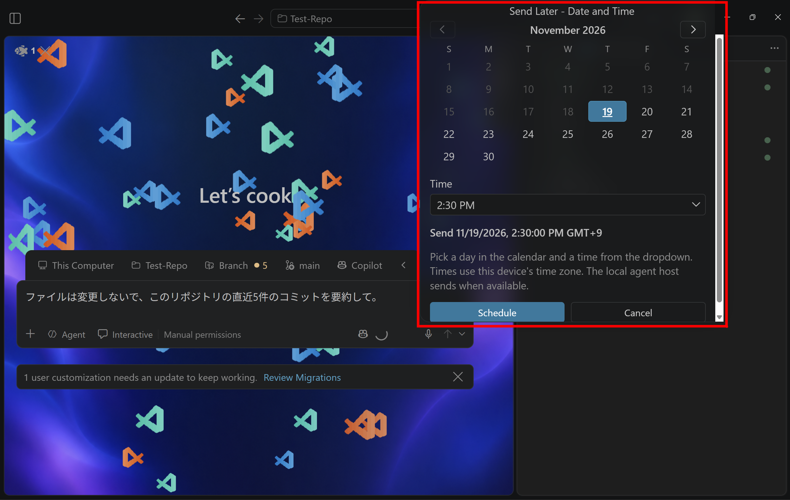

この画面で、地味に大事なことが2つ読み取れます。

- 選んだ日時が **`Send 11/19/2026, 2:30:00 PM GMT+9`** のように、タイムゾーンつきで確認できる。過去の日付はグレーアウトされて選べない
- 説明文に「**Times use this device's time zone. The local agent host sends when available.**」とある。**時刻は端末のタイムゾーン**で、送るのは**ローカルの Agent Host が使える状態のとき**、ということです

後者の「when available」が、このあとのスリープの話につながります。公式ドキュメントも「予約する前に日付・時刻・タイムゾーンを確認して」と書いています。

### 予約した依頼は、どこで待つ？

予約した場所によって、待ち場所が変わります。

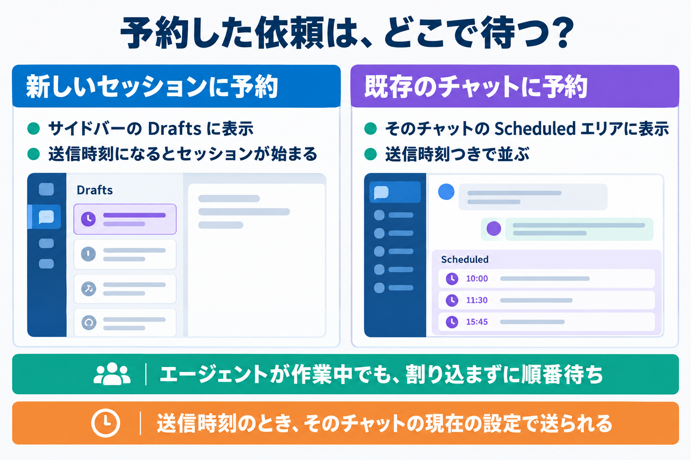

| 予約した場所       | 待ち場所                                       | 送信時刻になると                                                                                         |
| ------------------ | ---------------------------------------------- | -------------------------------------------------------------------------------------------------------- |
| 新しいセッション   | サイドバーの **Drafts** セクション（Preview でプロンプト・時刻・ワークスペース・モデルを確認できる） | セッションが始まる                                                                                       |
| 既存のチャット     | そのチャットの **Scheduled** エリア（送信時刻つき。ネストしたチャットの中でも同じ） | そのチャットに送られる。エージェントが作業中なら**割り込まず順番待ち**。現在のチャット設定で送られる |

「割り込まない」のは、地味に大事なところだと思います。作業の途中でいきなり別の指示が差し込まれると、エージェントの流れが乱れますよね。予約した依頼は、キューに入るだけです。「現在のチャット設定で送られる」も見落としやすくて、既存チャットへの予約のあとにモデルや権限を変えたら、**変えたあとの設定**で動きます（公式ドキュメントの "a follow-up uses that conversation's current configuration"）。

### 自然言語でも予約できる

メニューを開かなくても、エージェントに頼めば予約してくれます。公式の例はこれです。

```text
Check the build in 10 minutes.
```

エージェントは**1回限り・テキストのみ**の依頼を、いまのチャットに予約して、いつ送られるかを返事で教えてくれます。予約はメニューで入れたものと同じ Scheduled エリアに並びます。

ドキュメントには、もう1つ例があります。

```text
In 30 minutes, remind me in this chat to review the test results.
```

細かいルールがいくつかあります。

- 明示的な1回限りの依頼なら、「Create it」のような確認メッセージは要らない
- スケジュール用ツールの承認が出たら確認する。**予約したからといって、未来のツール実行まで承認されるわけではない**
- 対象は「呼び出したそのチャット」。新しいセッションに送りたいなら、そう明示する
- 予約の変更・キャンセル・いますぐ送信も、同じように頼める
- **添付つきの依頼はチャットの UI から**予約する（自然言語は text-only）

公式の例はどれも英語です。日本語で「10分後にビルド結果を確認して」と頼んで同じように通るかは、この記事では確認していません。使うときは、返事に出てくる**送信予定の時刻**を、必ず目で確かめてください。

### 予約を変更・キャンセルする

予約した依頼にホバーするか右クリックすると、次の操作が出ます（公式ドキュメント）。

| 操作                | できること                                                                                           |
| ------------------- | ---------------------------------------------------------------------------------------------------- |
| Reschedule          | 送信先はそのままで、送信時刻だけ変える                                                               |
| Send Now            | いますぐ送る。チャットが作業中ならキューに入る。元の時刻には**もう一度送られない**                  |
| Edit                | 既存チャットへの予約の、テキストと時刻を変えて Save                                                  |
| Cancel Schedule     | 配信をやめて、依頼の内容は残す。新しいセッションの場合、Drafts が有効なら通常の下書きとして残る     |
| Edit as Draft       | 新しいセッションへの予約を、予約を解除して入力欄に戻す                                               |

予約のあるセッションは、リストの時計マークや、セッションのフィルターの **Scheduled Only** で探せます。

予約の取り消しで迷いやすいのが、公式ドキュメントの次の一文です。「**Cancel Schedule が『結果が不確か』と出たら、同じ依頼をもう一度送る前に、Automations を確認する**」。二重に送らないための注意で、Send Later の予約が内部的には Automation として管理されていることが、ここからも分かります。

## Send Later が届く条件と、スリープの落とし穴

ここが、この記事でいちばん伝えたいところです。

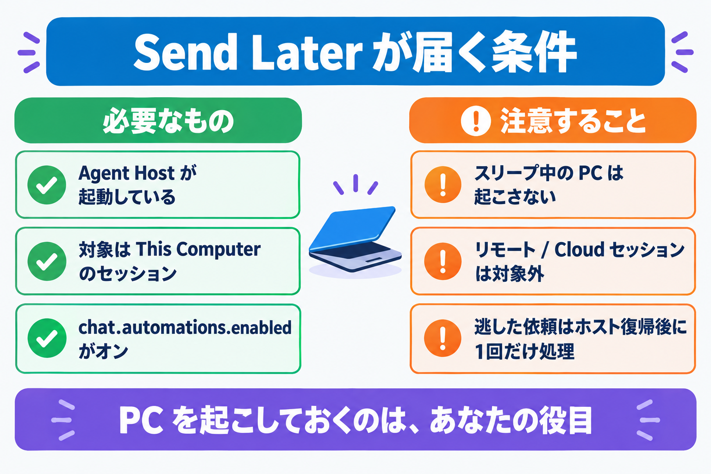

公式ドキュメントに書かれている条件を、そのまま整理するとこうなります。

**必要なもの**

- ローカルの **Agent Host が、予約時刻に起動している**
- 対象は **This Computer** のセッション
- `chat.automations.enabled` がオン

**注意すること**

- 予約は**スリープ中の PC を起こさない**。停止している Agent Host も起動しない
- 時刻ぴったりに届けたいなら、PC を起こしたまま、Agent Host を動かしておく
- ウィンドウをリロードしても、保留中の予約は残る
- 時刻を逃した依頼は、ホストが使える状態に戻ったときに**1回だけ**処理される
- リモートのエージェントセッションでは、いまのところ動かない

つまり、公式の説明どおりに読むと、「寝る前に予約して、朝に結果を見る」をそのままやろうとして、ノート PC が本当にスリープすると、**朝 PC を開くまで依頼は届きません**。（私も蓋を閉じて試しましたが、蓋を閉じている間に届いたのかは確認できていません。後述の「実際に予約して、実行してみた」を参照してください）

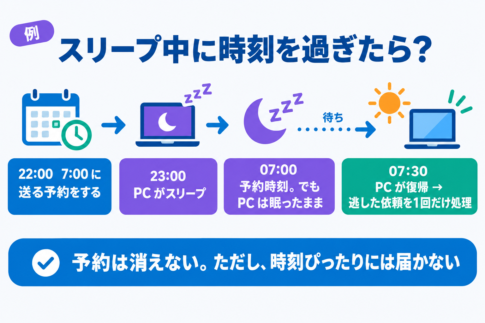

### 実際に予約して、実行してみた

ここまでの手順で、ファイルを変更しない依頼（直近5件のコミットの要約）を、Send Later の Choose Date and Time で予約しました（ピッカーで選んだのは `11/19/2026, 2:30 PM`）。そのあと、**PC の蓋を閉じたまま**時間を置いて、あとで PC を開くと、送信された依頼と返信が届いていました。その結果が、これです。

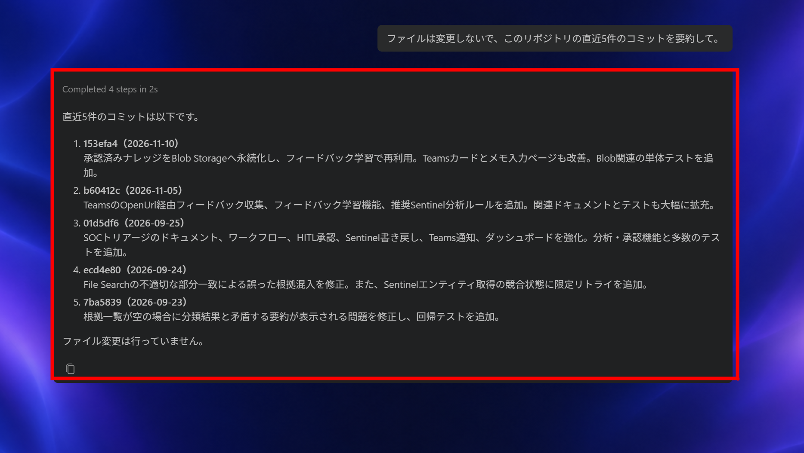

確認できたのは次のとおりです。

- PC を開いたあと、**予約した依頼は送信されて、実行まで終わっていた**
- 実行は「4 ステップ・2 秒」で完了し、直近5件のコミットを日付つきで要約して返した
- 「ファイルは変更しないで」という指示どおり、最後に「**ファイル変更は行っていません**」と報告している。無人で動く依頼を**読み取り専用に絞る**やり方は、そのまま機能する

一方で、**蓋を閉じている間に、予約時刻どおりに送信されたのかは、確認できていません**。振り返ると、蓋を閉じている間は届かず、PC を開いてから処理された可能性があります。この結果画面を撮ったのも、予約時刻（11/19 14:30）から半日ほど後でした。もしそうなら、公式ドキュメントの「スリープ中の PC は起こさない。逃した依頼は、ホストが使える状態に戻ったときに1回だけ処理される」と、そのまま一致します。

ただし、これは私の記録が足りないだけで、結論ではありません。

- **蓋を閉じる ＝ スリープ、とは限りません**。電源設定（「蓋を閉じたときの動作」）によっては、蓋を閉じても何も起きません
- ノート PC の「スリープ」には、バックグラウンド処理を続ける**モダンスタンバイ**の機種があります（機種と設定による）
- 私は、**送信された時刻**（チャットの履歴に残る時刻など）を、記録していません

つまり、「蓋を閉じても届く」とも「届かない」とも、この記事では言えません。**公式の説明どおり、スリープ中は届かないものとして扱ってください**。確かめたい方は、①電源メニューから明示的にスリープ、②予約時刻を過ぎてから復帰、③復帰してから届くまでの時間と、予約が1回だけ処理されたかを確認する、という手順で試すと、条件の線引きができます。

### 1.148 で入った keep-awake は、どこまで効く？

この問題は、VS Code チーム自身も認識していました。microsoft/vscode の Issue [#348891](https://github.com/microsoft/vscode/issues/348891) には、「PC がアイドルでスリープすると、Agents ウィンドウのエージェントは止まる。ユーザーに何も知らされず、戻ってきたら途中で止まっている」「Send Later や Automations のように、放置前提の使い方が増えるほど、これは問題になる」と書かれています。

この Issue を直す [PR #348889](https://github.com/microsoft/vscode/pull/348889) は、**2026年11月19日にマージ**されました。そして **1.148（2026/11/25、Stable）** のリリースノートに、次の機能として載っています。

> Avoid stalled unattended work when the machine running your agent would otherwise idle-sleep. A supported Agent Host can keep its machine awake during active turns, including after you close the window, and release the hold shortly after work ends.
>
> （出典: [Visual Studio Code 1.148](https://code.visualstudio.com/updates/v1_148)）

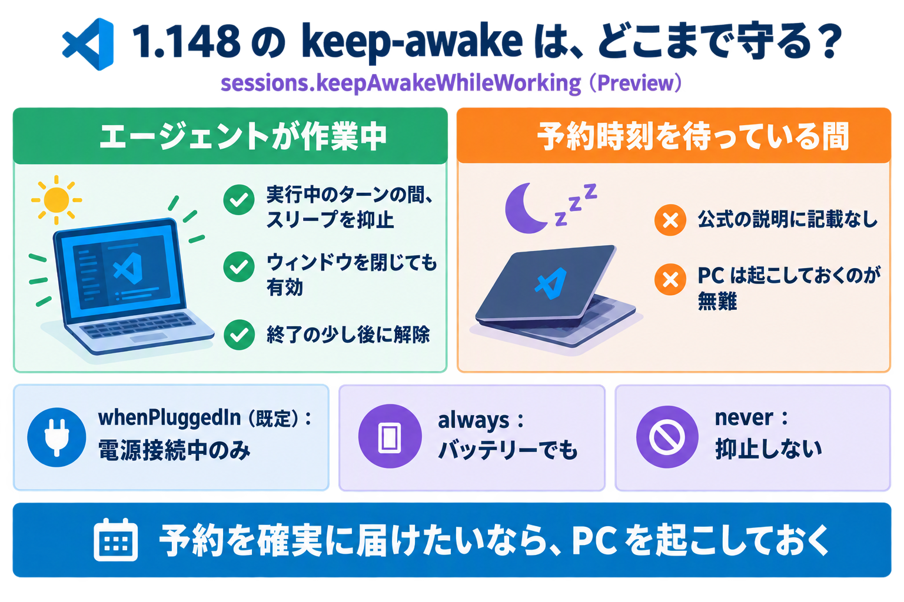

設定は `sessions.keepAwakeWhileWorking`（Preview）で、値は3つです。

| 値                         | 動き                                                       |
| -------------------------- | ---------------------------------------------------------- |
| `whenPluggedIn`（既定）    | ホストが**電源に接続されている間**、アイドルスリープを防ぐ |
| `always`                   | バッテリー駆動でも、エージェントの作業中は防ぐ             |
| `never`                    | 防がない                                                   |

PR の説明文から、押さえておきたい点を拾います。

- 保持するのは、**ホストの実行中のチャットがある間**。入力待ちで止まっているチャットは数えない。最後のチャットが止まって**2分後**に解除される
- **ウィンドウを閉じても**効く。リモートのホストなら、**ホスト側のマシン**がスリープしないようにする（つなぎに来たノート PC ではない）
- **Linux のデスクトップでは `whenPluggedIn` が効きにくい**。Electron が外部電源を確認できないので、このモードでは「アイドルスリープを許可」になる。Linux で使うなら `always` にする、とのこと
- 仕組みは OS ごとに違い、macOS は `caffeinate`、Linux は `systemd-inhibit`、Windows は PowerShell のネイティブ呼び出し。Linux は systemd/logind が前提で、ヘッドレス環境、コンテナ、WSL では物理ホストの抑止が保証されない
- PR 本文には「Windows と Linux の実機でのスリープ・バッテリー時の挙動は、まだプラットフォームごとの確認が必要」と書かれている（作者の環境は macOS）

つまり、**「エージェントが作業している最中に、PC が寝て止まる」問題は、1.148 で手当てされました**。長いタスクを放置して離れても、途中で止まりにくくなります。

ただし、Send Later の話に引きつけると、注意が3つあります。

1. 守られるのは「**作業中（active turns）**」です。公式の説明に、**予約時刻をただ待っている間**も起こしておく、とは書かれていません。「寝る前に7時で予約して、ノート PC を閉じて寝る」は、この機能だけでは解決すると言い切れません。ここは私の推測を含みますが、PC を起こしておくのが無難です
2. 既定の `whenPluggedIn` では、**バッテリー駆動のノート PC は守られません**。「夜はバッテリーで放置する」なら `always` が要ります
3. 公式ドキュメントの Send Later の節は、2026/11/25 時点でも「Keep your computer awake and the Agent Host running for on-time delivery（時刻どおりに届けたいなら、PC を起こして Agent Host を動かしておく）」のままです

ちなみに、PR 本文のコメントでは、設定の既定値が `always` だった時期もあります。リリースノートでは `whenPluggedIn` が既定なので、こちらに従いました。最終的な既定値は、お手元の設定画面で確認してください。

### SSH 先のホストは、また別の話

SSH で接続したリモートの Agent Host の場合は、事情が違います。Issue [#348946](https://github.com/microsoft/vscode/issues/348946) は、予約された Automation やメッセージが、**Agents ウィンドウが接続されている間しか動かない**という報告です。ノート PC がスリープして最後のウィンドウが切れると、サーバーが「アイドル」として終了してしまい、起動し直すまで予約は保留される、という内容です。回避策として、投稿した人は systemd の timer と Copilot CLI（`copilot -p`）の組み合わせを書いています。この Issue は、2026/11/25 時点でも **Open** です。

なお、公式ドキュメントでは、Send Later 自体は**ローカルのマシンに限定**されています。

## Drafts：書きかけの依頼をためておく

Send Later より先に使い始めやすいのは、こちらかもしれません。

これまでの新しいセッションの入力欄は、未送信の依頼を**1つ**しか持てませんでした。Drafts を有効にすると、複数の依頼を、それぞれ別のワークスペース・エージェント・設定のまま並べておけます。

### 保存と再開

公式ドキュメントの手順です。

1. `sessions.drafts.enabled` をオンにする
2. New Session を選んで、依頼を書く（添付やセッションのオプションも含めて）
3. **別の会話に移る**。新しいセッションの入力欄が見えなくなると、サイドバーの Drafts に保存される
4. Resume Draft か、通知の Open Draft で戻って、確認・編集してから送る

保存されるのは、テキスト、添付、インライン参照、ワークスペース、エージェント、モデル、その他の設定です。**再起動しても残ります**。

### 知っておくと迷わないこと

- **「入力欄を開いたまま再起動」では下書きにならない**。保存するには、先に入力欄から離れる
- 下書きは、**依頼が受け付けられてから**リストから消える。送信が失敗しても、書いた内容は失われない
- 下書きを破棄するときは Delete Draft
- `sessions.drafts.enabled` をオフにすると、Drafts は見えなくなりますが、**保存済みの下書きは消えません**。オンに戻せばまた見えます

「送信に失敗しても消えない」は、長いプロンプトを書いた後だと、ありがたい仕様です。

## Inbox の Acknowledged：「いまは見ない」のもう1つの形

「いま送らない」とは逆向きの話ですが、同じ 1.147 で、**いま見ない**を扱う機能も入っています。実験的な Inbox モード（`sessions.list.inboxEnabled`）の改善です。

- セッションの目のアイコンで **Acknowledged**（確認済み）にすると、Inbox から Acknowledged セクションへ移る。既読・完了・アーカイブとは別扱い
- そのセッションに新しい動きがあれば、Inbox に戻る
- 画面上部の**ワークスペース / 環境のピッカー**で、見るセッションを絞れる。ピン留めやアーカイブ済みも含めて絞り込まれ、再読み込みしても記憶される

1.148（Stable）では、`sessions.list.inboxAutoAdvance` が使えるようになりました（Experimental）。Inbox のセッションに返信したあと、どこへ移るかを選べます。

| 値             | 動き                                                                                   |
| -------------- | -------------------------------------------------------------------------------------- |
| `auto`（既定） | 次の Inbox の会話を開く。残っていなければ Inbox の見出しにフォーカス。スクリーンリーダー使用時は、いまの会話に留まる |
| `on`           | スクリーンリーダー使用時も含めて、常に次へ進む                                         |
| `off`          | いまの会話に留まる                                                                     |
| `newSession`   | 他の Inbox の会話が残っていても、入力欄にフォーカスした New Session を開く             |

Send Later の予約時刻が「Sends in 5 minutes」のような相対表示になる変更（[#348622](https://github.com/microsoft/vscode/issues/348622)）は、1.148 のマイルストーンで修正済みで、Insiders の更新履歴には載っていました。ただ、1.148 Stable のリリースノートには載っていないので、見え方はお手元の画面で確認してください。

## どれを使う？ Send Later と Automations の違い

「あとで動かす」仕組みは、VS Code に3つあります。

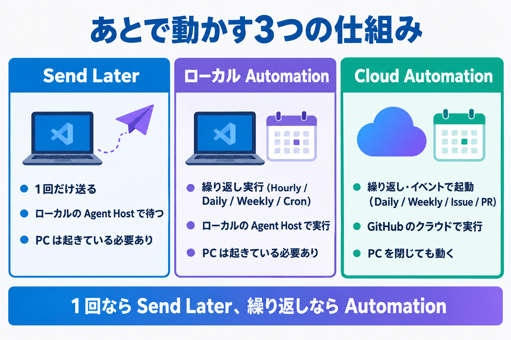

| 項目           | Send Later                           | ローカル Automation                                         | Cloud Automation                                      |
| -------------- | ------------------------------------ | ----------------------------------------------------------- | ----------------------------------------------------- |
| 実行回数       | **1回だけ**                          | 繰り返し（Hourly / Daily / Weekly / Cron）                  | 繰り返し、または Issue / PR のイベント                |
| 実行場所       | ローカルの Agent Host                | ローカルの Agent Host                                       | GitHub のクラウド                                     |
| PC を閉じたら  | 公式の説明では、スリープ中は復帰するまで届かない | 公式の説明では、スリープ中は復帰するまで動かない（取りこぼしは catch-up される場合あり） | **閉じても動く**                                      |
| 終了日         | なし（1回限り）                      | 設定できる（Days / Weeks / Months）                         | 設定できない（Disable か Delete で止める）            |
| 向いている場面 | 「10 分後にビルドを確認して」        | 「毎朝、昨日のコミットを要約して」                          | 「毎週、リポジトリの状態をまとめて」                  |

公式ドキュメントの切り分けは単純です。**1回なら Send Later、繰り返すなら Automation** です。さらに「手元のワークスペースや環境が必要なら**ローカル**、PC を落としても動かしたいなら**クラウド**」と選びます。

Cloud 側の話は、1.144 のときに別の記事にまとめています。[VS Code 1.144：PC を閉じてもエージェントが働く。Cloud セッションと Cloud Automations を試した](https://qiita.com/shahin0809/items/26e401dc28c1ca60d8c7)

1.147 では Automations にも手が入りました。エージェントと対話しながら作る **Create with Agent**、終了日の設定、セッション一覧での実行履歴フィルターです。「終了日つきの Automation」は、「2週間だけ毎朝要約して」のような期間限定の用途に合います。

ちなみに、Send Later で予約した依頼は、設定をオフにしても取り消されません。公式ドキュメントに「`sessions.sendLater.enabled` をオフにしても、受け付け済みの予約はキャンセルされない。Automations で管理する」とあります。予約した依頼が Automations ビューのどこに、どう並ぶかは、この記事では画面を確認していません。迷ったら、公式の指示どおり Automations を見てください。

## 放置する前に確認したいこと

予約は「送るタイミングを後ろにずらす」だけで、**権限は別の話**です。放っておく前に、次の4つを決めておくと安心です。

1. **何をさせる依頼か**: 無人で動く前提なら、読み取りや要約など、変更を伴わない依頼から始める。例: 「ファイルは変更しないで、直近のコミットを要約して」
2. **ツールの承認が出ないか**: 自然言語で予約するときの承認は、スケジュールのツールに対するものです。公式ドキュメントも「予約は、将来のツール実行を承認しない」と明記しています。時刻になって、承認待ちで止まっている可能性があります
3. **assisted permissions の変更**: 1.147 では、Automation や別のエージェントが送った依頼は、**ユーザーが書いたものとして扱われなくなりました**。以前は承認なしだった呼び出しが、承認を求められる場合があります（Send Later の予約にも当てはまるかは、公式に明記がありません）。許可レビュアーには `chat.permissions.assisted.instructions` で自分の基準を伝えられます
4. **PC の状態**: スリープ、ホストの停止、ネットワーク。時刻に届いてほしいなら、PC を起こしておく。1.148 の `sessions.keepAwakeWhileWorking` は、エージェントが**作業している間**を守る機能です。バッテリー駆動で放置するなら、既定の `whenPluggedIn` ではなく `always` が要ります

なお、前述の実行結果の画面では、権限は Manual permissions でした。無人で動いたときに承認ダイアログが出たかどうかは、この記事では記録していません。ツールを使う依頼（コマンドの実行など）を予約するときは、承認待ちで止まらないか、**目の前にいる時間に1回試して**から放置してください。

## 海外ではどう見られている？

リリースから1週間ほど経って、ニュースサイトの要約や解説は増えました。ただ、Send Later を実際に長く使った個人の検証レポートは、まだ多くありません。確認できた範囲を、出典つきで紹介します。

### 「スリープの注意」は、どこでも真っ先に指摘されている

- **Automater**（[VS Code 1.147 Lets Agents Route Between Models, Schedule Requests and Drive Your Browser](https://automater.ai/news/vscode-1-147-model-routers-send-later-browser-use-allowed-harnesses/)）は、Send Later の制限を「This Computer のみ」「`chat.automations.enabled` が必要」「ホストが起動している必要がある」と整理しています。そして、WindowsForum を引用して、「ノート PC が夜にスリープするなら、『朝に確認して』は PC が起きてから動く。無人で回すなら、常時起動のホストが必要」と書いています。記事全体も、「ほとんどが Experimental / Preview でオフが既定。**制限も機能と同じくらい大事**」という姿勢でした。同じ記事は、無人実行まわりの権限にも触れていて、「Automation や別のエージェントが送った依頼は、あなたが書いたものとして扱われなくなった」と注意しています（この記事の「放置する前に確認したいこと」で扱った点です）
- **Visual Studio Magazine**（[VS Code 1.147 Adds Scheduled AI Tasks, Browser Control and Model Routers](https://visualstudiomagazine.com/blogs/release-radar/2026/11/vs-code-1-147-adds-scheduled-ai-tasks-browser-control-and-model-routers.aspx)）は、「新しいセッションは Drafts に、既存の会話は Scheduled エリアに並ぶ」「編集・再スケジュール・キャンセル・即時送信ができる」「エージェントが作業中なら、割り込まず待つ」と、公式ドキュメントに沿ってまとめています（私の環境では、本文ではなく検索結果の要約のみ確認できました）
- **WindowsForum**（[VS Code 1.147 Stable: Copilot Agent Scheduling, Browser Use and Enterprise Harness Controls](https://windowsforum.com/news/vs-code-1-147-stable-copilot-agent-scheduling-browser-use-and-enterprise-harness-controls.453068/)）も同じ点を取り上げているようです（Automater の記事が引用しています。私の環境では本文を取得できなかったので、リンクだけ紹介します）

どの記事も、機能の紹介と、公式ドキュメントの制限の言い換えが中心です。「スリープしたら、実際にどうなったか」を実測した記事は、私が探した範囲では見つかりませんでした。

### Claude Code にも、同じ発想の機能がある

同じ「あとで動かす」でも、他のツールではどう設計されているか、Claude Code の公式ドキュメント（[Run prompts on a schedule](https://code.claude.com/docs/en/scheduled-tasks)）を読んで比べました。

| やりたいこと               | VS Code                          | Claude Code                                                                                  |
| -------------------------- | -------------------------------- | -------------------------------------------------------------------------------------------- |
| 1回だけ、あとで            | Send Later（メニュー / 自然言語） | 自然言語で頼む（セッション内の1回限りのリマインド）                                          |
| いまのセッションで繰り返す | （Send Later は1回限り）         | `/loop`（セッション内で動く。繰り返しは**作成から30日で自動的に期限切れ**。v2.1.330 より前は7日） |
| 手元のマシンで定期実行     | ローカル Automation              | Desktop scheduled tasks（マシンの電源は必要。セッションを開いておく必要はない）              |
| クラウドで定期実行         | Cloud Automation                 | Cloud の scheduled tasks（マシンは不要。最短の間隔は1時間）                                  |

面白かったのは、**どちらも「手元のマシンが起きていること」を前提にしている**点です。Claude Code の `/loop` は、「Claude Code が起動していて、アイドルのときだけ動く」「ターミナルを閉じるとセッションが止まって、発火しない」と書かれています。マシンが要らないのは、どちらもクラウド側だけです。

一方で、時刻を逃したときの扱いは、少し違います。

- VS Code の Send Later は、予約が**ホスト側に保持されて**、ウィンドウのリロードをまたいで残り、逃した分は**ホストが戻ったときに1回だけ**処理される
- Claude Code の `/loop` は、「逃した分の catch-up はしない」。長い処理で時刻を過ぎた場合は、手が空いたときに1回だけ発火する。`--resume` で再開したときは、**時刻を過ぎた1回限りのタスクは復元されない**（繰り返しのタスクも、止まっていた間の分は発火しない）

また、設計の分け方も違います。VS Code は、1回きり（Send Later）と繰り返し（Automation）を**別の機能**として分けています。Claude Code は、`/loop` と1回限りのリマインドを、同じセッション内のスケジュール機能として扱っています。

どちらが良い、という話ではなくて、「ローカルでの予約は、PC の電源とセッションの生存に左右される」というのが共通の前提のようです。「確実に動かしたいならクラウド」という切り分けも、同じでした。

### GitHub の Issue から見える、これからの課題

microsoft/vscode の Issue を眺めていると、使い始めた人が踏みそうなところも見えました。

- [#348946](https://github.com/microsoft/vscode/issues/348946)：前述の SSH 先ホストの問題。2026/11/25 時点でも Open です
- [#349935](https://github.com/microsoft/vscode/issues/349935)（11/23 クローズ）：**Copilot にサインインしていない状態**で、BYOK のモデル（推論レベルの設定つき）を使うと、新しいセッションへの Send Later が、時刻を過ぎても「Waiting to send」のまま動かなかった、という不具合。同じ種類の既存チャット側の不具合（[#348363](https://github.com/microsoft/vscode/issues/348363)）は、1.148 のマイルストーンで先に直されていました。「Send Now なら動く」ので、予約が動かないときの切り分けに使えます
- 1.148 のマイルストーンでは、Send Later 周りの細かい不具合が、まとめて直されています（下書きを開くと時刻が消える、カレンダーが画面の左上に飛ぶ、など。[PR #348610](https://github.com/microsoft/vscode/pull/348610)）。Experimental らしい動きの速さですね

「ローカルで予約して、PC を寝かせる」から「ホストが自分で起きて処理する」まで、道のりはまだ途中です。1.148 の keep-awake で「作業中に止まる」は減りましたが、「予約時刻まで待つ間」と「SSH 先ホストのアイドル終了」は、これからの課題のようです。

## ハマりそうなポイント

### Q: Send Later のメニューが出ない

**A**: 次を順に確認してください。

1. VS Code が 1.147 以降か
2. `sessions.sendLater.enabled` がオンか（既定はオフ）
3. `chat.automations.enabled` がオンか
4. **Agents ウィンドウ**で開いているか（通常のエディタウィンドウのチャットには出ません）
5. セッションが **This Computer** か（リモート / Cloud は対象外）

### Q: 予約した時刻を過ぎたのに届かない

**A**: 次を順に確認してください。

1. PC がスリープしていないか、Agent Host が動いているか。時刻を逃した依頼は、ホストが戻ったときに1回だけ処理されます。時刻ぴったりに届けたい場合は、PC を起こしておく必要があります
2. 予約の一覧が **Waiting to send** のまま止まっていないか。この状態なら、**Send Now** で送れるかを試す。送れるなら、予約まわりの不具合の可能性があります（Copilot にサインインしていない状態で BYOK のモデルを使うと起きた報告が、[#349935](https://github.com/microsoft/vscode/issues/349935) にあります。11/23 に修正済み）
3. SSH 先などのリモートホストに予約していないか（Send Later はローカルのみ）

### Q: 予約のメニューが「Send Later...」の1項目だけで、迷う

**A**: 1.147 では、送信ボタンのドロップダウンに **Send Later...** だけが出て、選ぶとプリセットの一覧が開きます（この記事のスクショのとおりです）。「1項目のメニューなら、時刻ピッカーを直接開いてほしい」という要望（[#348482](https://github.com/microsoft/vscode/issues/348482)）は、1.148 のマイルストーンで対応済みです。1.148 では挙動が違うかもしれません。

### Q: 新しいセッションに予約したのに、Drafts が見えない

**A**: まず `sessions.drafts.enabled` をオンにして、Scheduled Only のフィルターでも探してください。公式ドキュメントでは、新しいセッションへの予約は Drafts に表示される、と書かれています。ただし、Drafts の設定がオフのときに予約の表示がどうなるかは、明記がありません（この記事でも確認していません）。なお、Drafts が無効なときの Cancel Schedule は、内容を入力欄に戻す動きになります。

### Q: 下書きに保存したはずなのに、再起動したら消えた

**A**: 入力欄を開いたまま再起動しても、下書きには追加されません。公式ドキュメントにも「先に入力欄から離れる」と書かれています。

### Q: Send Later の設定を切ったのに、予約が動いている

**A**: 設定をオフにしても、受け付け済みの予約はキャンセルされません。Automations で管理してください。

## まとめ

- 1.147 の Agents ウィンドウに、**Send Later**（予約送信）と **Drafts**（未送信の依頼の保存）が Experimental として入った。どちらも既定でオフ
- Send Later は、公式の説明では、**ローカルの Agent Host が使える状態であること**が条件。**スリープ中の PC は起こさず**、逃した依頼は復帰後に1回だけ処理される
- 自然言語（`Check the build in 10 minutes.`）でも予約できる。1回限り・テキストのみで、添付つきはメニューから
- Drafts は、ワークスペースやモデルまで含めて複数保存でき、再起動しても残る。送信が失敗しても消えない
- **1回なら Send Later、繰り返しなら Automation、PC を閉じても動かしたいなら Cloud Automation**
- 予約は権限を承認してくれない。無人で動かす依頼は、変更を伴わないものから始める
- **1.148（11/25）で `sessions.keepAwakeWhileWorking`（Preview）が入った**。エージェントが作業している間のスリープを防ぐ。既定の `whenPluggedIn` は電源接続中のみで、Linux デスクトップでは `always` が要る。「予約時刻を待つだけの間」を守るとは、公式に書かれていない

実際に試して確認できたことは、次のとおりです。

- 1.147 の Agents ウィンドウで、Send Later の予約（Choose Date and Time）から実行までを通せた。ピッカーには、タイムゾーンつきの送信日時と、「ローカルの Agent Host が、使えるときに送る」という説明が表示される
- PC の蓋を閉じて時間を置いたあと、開いてみると、**予約した依頼は送信されて、返信まで届いていた**。ただし、**蓋を閉じている間に時刻どおり届いたのか、開いてから処理されたのかは、記録しておらず確認できていない**。結果画面を撮ったのは予約時刻の半日ほど後で、公式の説明（復帰後に1回だけ処理）とは矛盾しない。「スリープ中でも届く」とは言えない
- 「ファイルは変更しないで」と書いた読み取り専用の依頼は、指示どおり、変更なしで完了した

確認できていないことも、正直に書いておきます。蓋を閉じている間に届くのか、復帰後に何秒で届くのか、日本語の自然言語での予約、無人で動いたときの承認ダイアログ、Drafts の設定をオフにしたときの予約の見え方は、この記事では確かめていません。ここは、試した方の結果を、ぜひ #GhCUG で教えてください！

ローカルで予約する機能は、「PC が起きていること」を前提にしている限り、寝る前に予約して朝に結果を見る、という使い方には、まだ一工夫が要りそうです。ただ、keep-awake が入って、「作業中に止まる」問題は、1週間で手当てされました。次は「予約時刻まで待つ間」がどうなるか、動きがあったらまた記事にします！

---

## 📣 最後に、少し宣伝させてください！

ここまで読んでくれてありがとうございます！最後に、12月のオンラインイベントを2つ紹介させてください。どちらも参加無料です。

### 12/9(水) MS Tech Camp #26：GitHubを学ぼう

**学生・初学者向けの GitHub 勉強会**です（社会人の方も参加できます）。GitHub の基本と全体像、GH-900 とキャリアの話、学生目線の GH-900 ＆ GH-300 合格体験談、現場で活きる GitHub 活用術まで、約75分で一気に学べます。私も、オープニングと合格体験談で登壇します。

- 日時: 2026年12月9日(水) 21:00〜22:15
- 形式: オンライン（Microsoft Teams）、参加費無料
- 参加方法: カメラ OFF・ミュートでOK。質問は Teams のチャットで受け付けます
- 🔗 [MS Tech Camp #26 GitHubを学ぼう（connpass）](https://mspjp.connpass.com/event/412037/)

### 12/15(火) ゆるよな Gh-CUG #09

GitHub Copilot のモデル選びやコスパ、Metrics Viewer の進化、サポート業務での使い方など、10分 LT 2本と、25分のセッション2本をお届けします。初参加の方も、聞くだけの方も大歓迎です。

- 日時: 2026年12月15日(火) 21:00〜22:30
- 形式: オンライン（Teams）
- 🔗 [ゆるよな Gh-CUG #09（connpass）](https://gh-cug.connpass.com/event/412534/)

※ 内容やタイムテーブルは、変更になる場合があります。最新の情報は、各 connpass のページを確認してください。

### GitHub Copilot User Group Japan（Gh-CUG）とは

私が運営に参加している **GitHub Copilot User Group Japan（Gh-CUG / ジーカグ）** は、「もっと世の中に GitHub Copilot を広げたい！」という思いから生まれたユーザーコミュニティです。

モットーは **「なんでもは知らない、しってることだけ」**。完璧な知見もすごい実績もいりません。「こんなんできた！」「ここでつまずいた！」を持ち寄って、みんなでゆるく楽しく学ぶ場です。学生・初心者・ノンデベロッパーの方も大歓迎です！

| シリーズ           | スタイル         | 雰囲気                   |
| ------------------ | ---------------- | ------------------------ |
| 🌙 ゆるよな Gh-CUG | オンライン（夜） | ゆるふわ。ふらっと参加OK |
| 🔥 Gh-CUG Night    | オンライン       | 実践的な知見をがっつり   |
| 🤝 Gh-CUG Meetup   | オフライン       | リアルでワイワイ交流     |

今回のような「出たばかりの新機能を触ってみた」話は、コミュニティでもよく盛り上がります。「Send Later をこう使ってる！」「蓋を閉じたらこうなった！」という話もお待ちしています！

🔗 **Connpass グループページ：** [GitHub Copilot User Group Japan](https://gh-cug.connpass.com/)

公式ハッシュタグは **#GhCUG** です。

## 参考

**公式**

- [Visual Studio Code 1.147](https://code.visualstudio.com/updates/v1_147)
- [Visual Studio Code 1.148（2026/11/25 Stable。keep-awake）](https://code.visualstudio.com/updates/v1_148)
- [Use the Agents window ― Send a request later / Save and resume drafts（VS Code Docs）](https://code.visualstudio.com/docs/agents/run/agents-window)
- [Create and manage agent automations（VS Code Docs）](https://code.visualstudio.com/docs/agents/run/automations)

**GitHub（microsoft/vscode）**

- [#348045 Agents window: schedule chat requests with Send Later](https://github.com/microsoft/vscode/issues/348045)
- [#348891 Agents window: keep the computer awake while a local agent is working（クローズ。1.148 で対応）](https://github.com/microsoft/vscode/issues/348891)
- [#348889 Agent host: keep its machine awake while chats are working（PR・2026/11/19 マージ）](https://github.com/microsoft/vscode/pull/348889)
- [#348946 Agent Host: let scheduled automations and remote messages activate an idle-retired SSH agent host（Open）](https://github.com/microsoft/vscode/issues/348946)
- [#348610 sessions: improve Send Later scheduling and draft editing（PR・マージ済み）](https://github.com/microsoft/vscode/pull/348610)
- [#349935 Send Later new-session requests stay "Waiting to send" for signed-out BYOK models with a reasoning-effort setting（クローズ）](https://github.com/microsoft/vscode/issues/349935)
- [#348363 Send Later follow-ups stay pending past their time in signed-out BYOK chats（クローズ）](https://github.com/microsoft/vscode/issues/348363)
- [#348482 Single-entry menu: Send Later...（クローズ）](https://github.com/microsoft/vscode/issues/348482)
- [#348622 Send Later: Show relative time until scheduled messages are sent（クローズ）](https://github.com/microsoft/vscode/issues/348622)

**海外の記事・ドキュメント**

- [VS Code 1.147 Lets Agents Route Between Models, Schedule Requests and Drive Your Browser（Automater）](https://automater.ai/news/vscode-1-147-model-routers-send-later-browser-use-allowed-harnesses/)
- [VS Code 1.147 Adds Scheduled AI Tasks, Browser Control and Model Routers（Visual Studio Magazine）](https://visualstudiomagazine.com/blogs/release-radar/2026/11/vs-code-1-147-adds-scheduled-ai-tasks-browser-control-and-model-routers.aspx)
- [VS Code 1.147 Stable: Copilot Agent Scheduling, Browser Use and Enterprise Harness Controls（WindowsForum）](https://windowsforum.com/news/vs-code-1-147-stable-copilot-agent-scheduling-browser-use-and-enterprise-harness-controls.453068/)
- [Run prompts on a schedule（Claude Code Docs）](https://code.claude.com/docs/en/scheduled-tasks)
