# VS Code の Local harness は2027年2月に削除：Copilot harness へ移行する手順とつまずきポイント

> **レビュー用プレビュー**（Qiita 記法を通常の Markdown に変換。画像は `./images/` の相対パスで表示）
> 元原稿: [article-qiita.md](./article-qiita.md) ／ タグ: VSCode / GitHubCopilot / AIエージェント / MCP / 移行
> デモ手順・追試: [demo-procedure.md](./demo-procedure.md)

---


## はじめに

こんにちは！VSCode/GitHubオタクのMicrosoft Student Ambassador/GitHub Copilot User Group Japan運営のロホマン シャヒンです！

> 📝 **NOTE**
>
> この記事が少しでも参考になったら、**ぜひいいね・共有**をお願いします。
> 間違っている箇所や「ここが分かりにくかった」という指摘は、やさしくコメントいただけると助かります！

2026年11月11日にリリースされた **VS Code 1.146** のリリースノートに、こんな見出しがありました。

> Local harness deprecation: Move to the Copilot harness before the Local harness is removed in February 2027.

Local harness が非推奨になり、**2027年2月に削除される**という予告です。期限がはっきり決まっているので、「そのうち対応しよう」と放置すると、ある日突然カスタマイズが動かなくなるやつです。

この記事では、公式ドキュメントとリリースノート、GitHub Issues に出ている海外ユーザーの反応をまとめつつ、**デモ用のリポジトリで実際に移行してみた結果**を載せています。個人の開発者が今日からやる手順を中心に、組織の管理者向けの話は後半に分けました。

- 元のリリースノート: [Visual Studio Code 1.146](https://code.visualstudio.com/updates/v1_146)
- 移行ガイド: [Move from the Local to the Copilot harness](https://code.visualstudio.com/docs/agents/run/move-to-copilot)
- カスタマイズの移行: [Migrate customizations to the Copilot harness in VS Code](https://code.visualstudio.com/docs/agent-customization/migrate-customizations)

## TL;DR（ここだけ読めばOK）

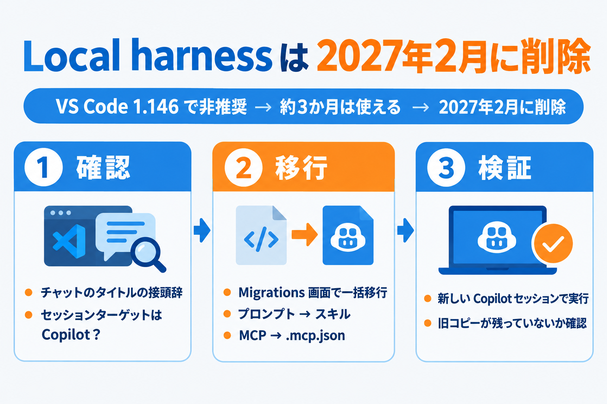

**何が起きた？**
VS Code 1.146 で Local harness が非推奨になり、2027年2月に削除されます。Copilot harness は 1.143 から新規セッションの既定なので、普通に使っていれば既に移行済みの人も多いはずです。ただし、`.vscode/mcp.json` や `.prompt.md` などの**古いカスタマイズは自動では移りません**。

**実際に試して分かったこと**

| 試したこと | 結果 |
| ---------- | ---- |
| 新規セッションの harness を確認 | ✅ チャットタイトルの接頭辞（`Local ·` / `Copilot ·`）と Session Target で判別できた |
| MCP サーバー2件を移行 | ✅ `.mcp.json` に移行。**`${workspaceFolder}` は絶対パスに解決**されて書かれた |
| パスワード入力つきの MCP サーバー | ⚠️ 自動移行されず **Needs manual review** に残った |
| プロンプトファイル2件をスキルに変換 | ✅ `.github/skills/` に変換。**元ファイルを削除するチェックが既定でオン**。`mode` / `model` / `tools` は消える |
| 探索場所（`.vscode/agents` など）のファイルを移行 | ✅ `.github/` へ移動し、元の設定もクリアされた |
| Local の会話を Copilot に引き継ぐ | ✅ **Continue In → Copilot** で続けられた（一方通行） |
| フック | 📖 自動変換なし。設定とスクリプトの**両方**を書き直す。**`preToolUse` はエラーで拒否に倒れる**（公式ドキュメントの内容。デモでは未検証） |
| ユーザープロファイルのエージェント・指示 | 未検証（デモ用のユーザーデータを用意していなかった） |
| 企業管理設定（Copilot harness の必須化など） | 未検証（個人アカウントのため） |

**対象**: VS Code 1.146、Copilot harness（Copilot SDK + Agent Host）。移行機能は Experimental 表記なので、画面の名称は今後変わる可能性があります。

## 1. 何が変わるのか

### harness って何？

ここで言う harness は、モデルに渡す文脈を準備して、ツール呼び出しと承認を取りまとめ、会話を進めていく**エージェントの実行基盤**のことです。公式ドキュメントでも、同じモデルを使っても harness が変わるとエージェントの動き方が変わりうる、と明記されています。

- **Local harness**: VS Code 組み込みの従来型。拡張機能ホストで動く。セッションはエディタのウィンドウに紐づく（ウィンドウを閉じると作業が止まる）
- **Copilot harness**: Copilot SDK ベース。Agent Host で動くので、ウィンドウを閉じてもバックグラウンドで続けられる。Agents ウィンドウとエディタの両方から同じセッションを触れる

harness はモデルや「コードがどこで動くか」とは別の話です。Claude のモデルを選んでも Claude harness に切り替わるわけではないですし、Copilot harness を選んでもファイルがクラウドに行くわけではありません。

### タイムライン

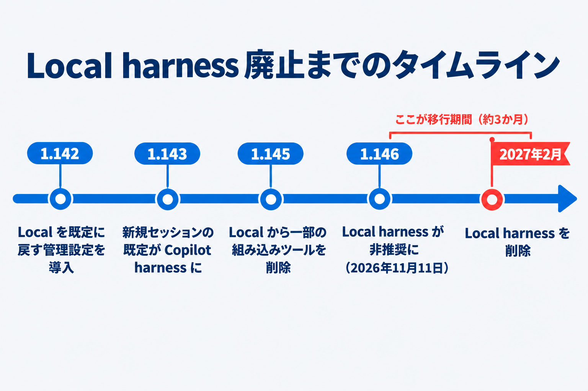

リリースノートによると、1.146 以降はこうなります。

- **今後3か月**: Local harness は使える。ただし機能は実質凍結で、新機能は Copilot harness 中心。Local でのサポートは保証されない
- **3か月後（2027年2月）**: Local harness が使えなくなる。企業向け管理設定の `vscode.temporaryDefaultToLocalHarness`（1.142 で導入）も一緒に削除される

ちなみに、1.145 の時点で Local harness からは `#installExtension` ツールが外れています。「廃止の前に、じわじわ削られている」感じです。

## 2. まず、自分がどっちを使っているか確認する

Copilot harness は 1.143 から新規セッションの既定なので、何も触っていなければ Copilot のはずです。確認方法は公式ドキュメントに3つ載っています。

- エディタのウィンドウ: チャットのタイトルに、使っている harness が**接頭辞**として出る
- Agents ウィンドウ: チャット入力欄のウォーターマークに harness 名が出る
- Agents ウィンドウ: セッション一覧の項目にホバーするとツールチップで harness が見える

エディタのチャットで試すと、Local のセッションは `Local ·`、Copilot のセッションは `Copilot ·` がタイトルの前に付いていました。

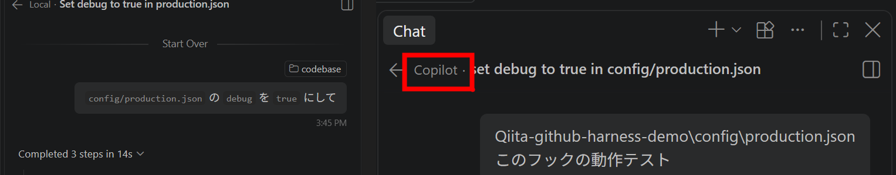

新しいセッションを始めるときは、チャット入力欄の下にある **Session Target** のピッカーで選びます。選択肢は Copilot / Local / Cloud / Claude / Codex の5つで、ホバーすると説明が出ます。Copilot は「Copilot SDK を使い、Agent Host で動くのでエディタのウィンドウとは独立してバックグラウンドで続けられる」という説明でした。

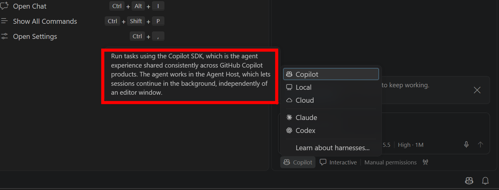

Local のほうは「VS Code の long-standing proprietary agent harness（昔からある独自のハーネス）で、拡張機能ホストで動く」という説明です。

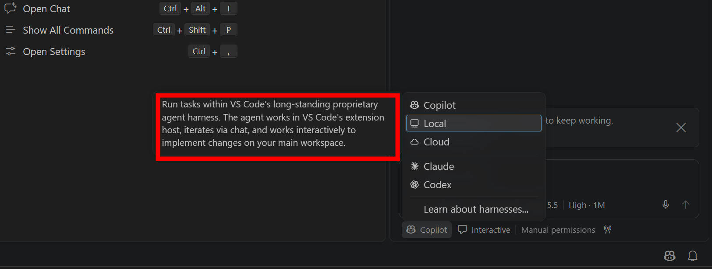

> ⚠️ **WARNING**
>
> モデルを変えたり、別のウィンドウ（Agents ウィンドウなど）でセッションを開き直したりしても、**セッションの harness は変わりません**。古い Local セッションは Local のままです。

## 3. カスタマイズを移行する

ここが本番です。Copilot harness を選ぶだけでは、過去のカスタマイズは自動では変換されません。

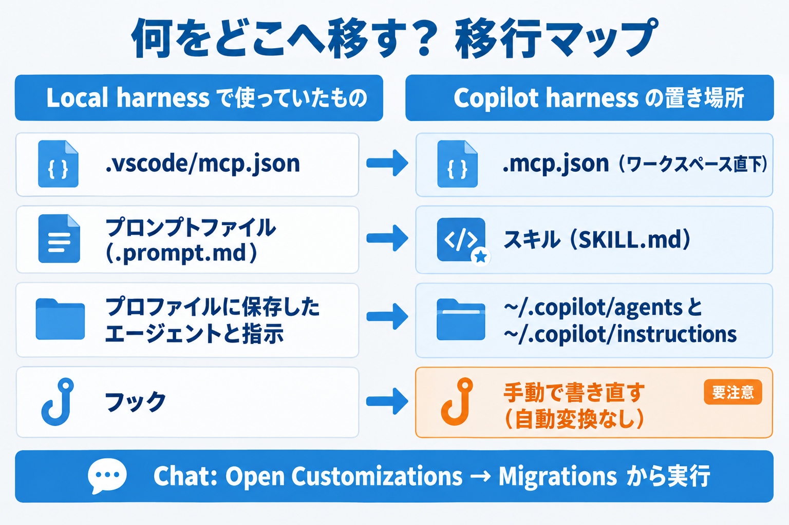

### 移行画面の開き方

公式ドキュメントでは、移行が必要なワークスペースだとチャットに通知が出て、**Review Migrations** から移行リストを開けると書かれています。私の環境では通知は確認できなかったので、自分で開きました。

1. Chat ビューの右上にある **Customizations** のアイコン（四角が4つ並んだアイコン）を押す。コマンドパレットの **Chat: Open Customizations** でも開ける
2. 左のメニューに **Migrations** が出る（件数のバッジ付き）

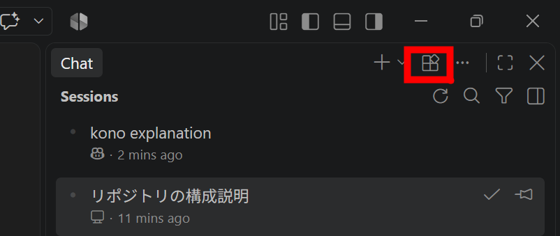

MCP Servers の一覧でも、移行できるサーバーには **Migration available**、移行できないサーバーには **Unsupported** と出ます。左下の **Migrations（9）** が移行リストです。

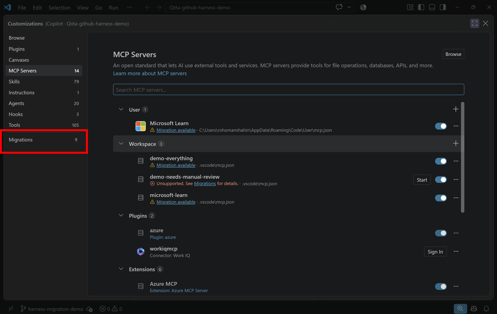

Migrations を開くと、**Keep your customizations working** という画面で、移行が必要なものがグループごとに並びます。デモ用リポジトリでは、次のグループが出ました。

- **Convert Prompt to Skills (Workspace)**: プロンプトファイル2件
- **MCP Servers (Workspace)**: `demo-everything` / `microsoft-learn`
- **MCP Servers (User)**: ユーザーの `mcp.json` にあった `microsoftdocs/mcp`
- **Custom location settings (Workspace)**: `.vscode/agents` と `.vscode/instructions` のファイル
- **Chat Participants (Extensions)**: 拡張機能が提供するチャット参加者（`@testing` / `@skill`）
- **Needs manual review**: 自動移行できないもの（1件）

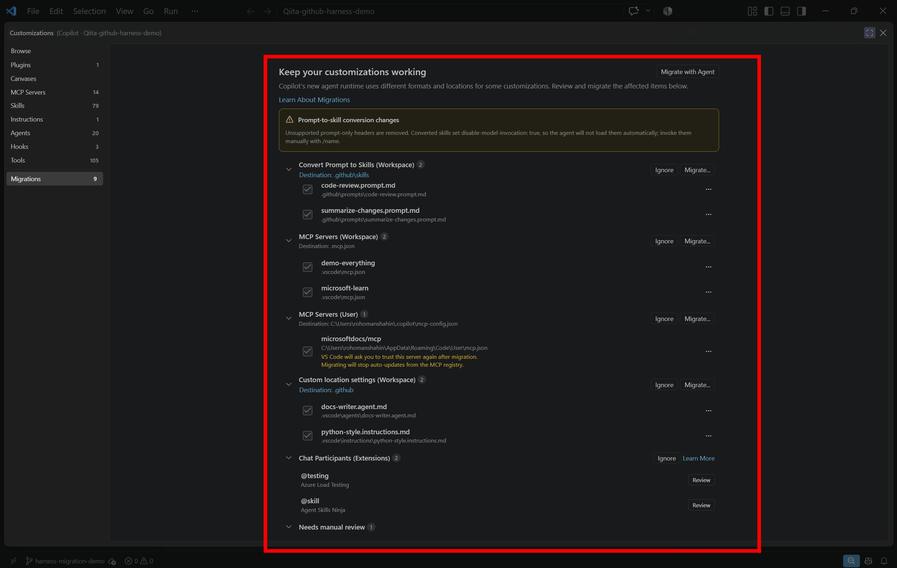

画面の上のほうには、プロンプトのスキル変換についての黄色い注意書きも出ていました。「サポートされないプロンプト専用のヘッダーは削除される。変換後のスキルは `disable-model-invocation: true` になるので、エージェントは自動では読み込まず、`/name` で手動で呼び出す」という内容です。

移行の方法は3種類あります。

| ボタン | 何をするか |
| ------ | ---------- |
| **Migrate** | 対応済みのファイル移動・変換を VS Code が実行する |
| **Migrate with Agent** | エージェントと会話しながら移行する。意味の変更が必要なものや、リポジトリ側の作業向け。**Copilot クレジットを消費**する。復旧用のバンドルを作り、元ファイルは既定で残す |
| **Review** | 自動移行できないもの（Needs manual review）の理由を見て、元の設定を直す |

> ⚠️ **WARNING**
>
> 移行する前に、ワークスペースのファイルとユーザー設定を**コミットかバックアップ**しておきましょう。後で書きますが、**元ファイルを削除するチェックが既定でオン**になっている移行があります。

### MCP サーバー

| 移行元 | 移行先 |
| ------ | ------ |
| ワークスペースの `.vscode/mcp.json` | ワークスペース直下の `.mcp.json` |
| VS Code プロファイルの `mcp.json` | `~/.copilot/mcp-config.json`（`COPILOT_HOME` 設定時はその配下） |

標準的な `command` / `args` / `env` / `url` / `headers` はそのまま移行され、`tools: ["*"]` が自動で付きます。つまり**そのサーバーの全ツールが使える状態**になるので、必要なツールだけに絞りたいなら移行後に書き換えます。

つまずきやすいのは環境変数の書き方です。デモ用リポジトリの `.vscode/mcp.json` には、こんなサーバーを置きました。

**.vscode/mcp.json（移行前）**

```json
{
  "servers": {
    "demo-everything": {
      "type": "stdio",
      "command": "npx",
      "args": ["-y", "@modelcontextprotocol/server-everything"],
      "env": {
        "DEMO_API_KEY": "${env:DEMO_API_KEY}",
        "DEMO_WORKSPACE": "${workspaceFolder}"
      }
    }
  }
}
```

`${env:NAME}` の形は、移行時に `${NAME}` に変換されます。値そのものを書き込まずに参照だけ保つ形なので、安心して使えます。移行後のイメージはこんな感じです（公式ドキュメントの説明をもとにした一例です）。

**.mcp.json（移行後のイメージ）**

```json
{
  "mcpServers": {
    "demo-everything": {
      "command": "npx",
      "args": ["-y", "@modelcontextprotocol/server-everything"],
      "env": {
        "DEMO_API_KEY": "${DEMO_API_KEY}",
        "DEMO_WORKSPACE": "（解決された絶対パス）"
      },
      "tools": ["*"]
    }
  }
}
```

実際に **Migrate** を押すと、確認ダイアログが出ます。「適格なエントリは `.mcp.json` に書き込んで検証したあと、`.vscode/mcp.json` から削除される。移行できないエントリはそのまま残る」という内容です。

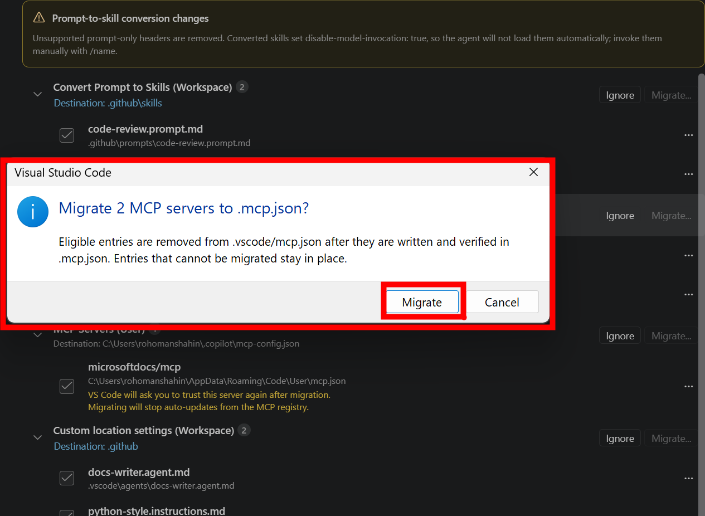

移行すると、画面の右下に **Migrated 2 MCP servers.** と出ます。`demo-everything` と `microsoft-learn` はリストから消えて、パスワード入力を使っている `demo-needs-manual-review` だけが **Needs manual review** に残りました。

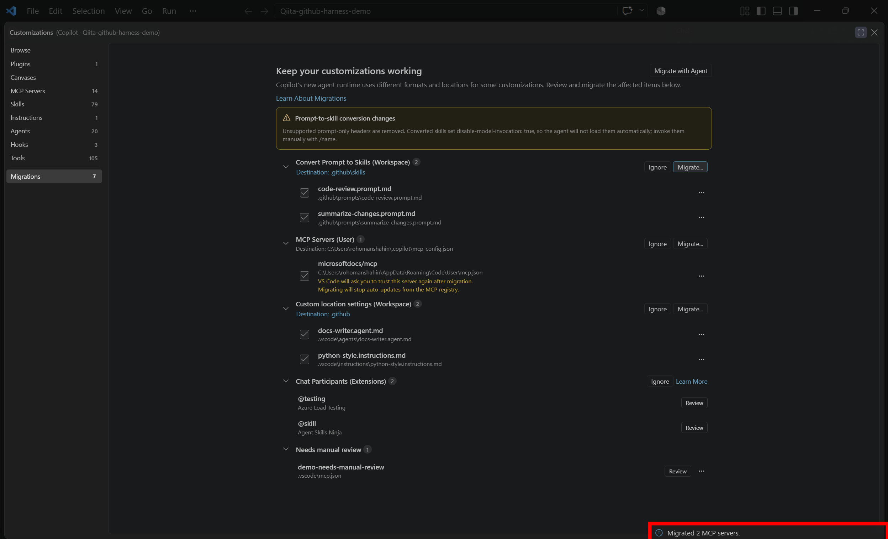

残ったサーバーの **Review** を開くと、**Not supported by Copilot** と理由が出ます。「入力変数（`${input:...}`）とコマンド変数は Copilot harness では使えない。具体的な値か、サーバー設定内で直接定義した環境変数に置き換える。パスワードとコマンドの入力は環境変数（`${env:...}`）を使う」という説明でした。

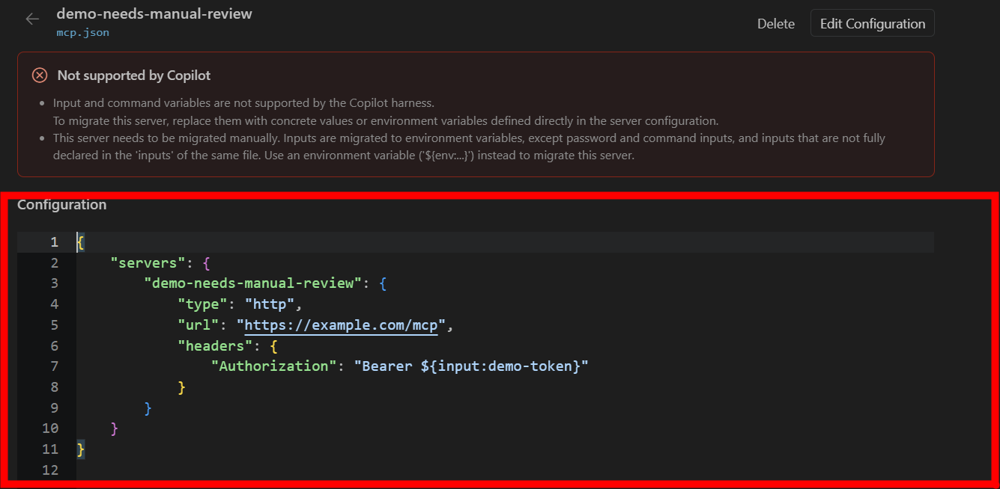

押さえておきたい注意点をまとめます。

- **`${workspaceFolder}` は、移行時に絶対パスに解決されて書き込まれる**。この後に書く `/code-review` で、Copilot 自身が「`.mcp.json` の `DEMO_WORKSPACE` に、ユーザー固有のパス（`C:\Users\...`）が入っていて、他の環境では動かない」と指摘していました。コミットする前に確認しましょう
- **パスワード入力（`password` 型の入力）や `${command:...}` は自動移行されない**。環境変数参照に置き換えるか、手動で対応する。シークレットの実値を `.mcp.json` に書かないこと
- **ユーザーの `mcp.json` のサーバーを移行すると、「VS Code が再度信頼を求める」「MCP レジストリからの自動更新が止まる」という警告が出る**（`microsoftdocs/mcp` の項目に表示されていました）
- `gallery` / `version` / `dev` / `sandboxEnabled` は移行時に**削除される**（警告が出る）
- **無効化（disabled）の状態は `.mcp.json` に保存されない**。ユーザースコープで無効にしていたサーバーは、他の Copilot クライアントや別のマシンで有効扱いになりうる
- 環境変数は、MCP サーバーを動かす（または接続する）ホスト側で定義する。リモートや Dev Container なら、そのホスト側で設定する。起動済みの Agent Host には、後から別ターミナルで設定した変数は反映されない

### プロンプトファイル → スキル

Copilot harness は `*.prompt.md` を読みません。再利用したいプロンプトは**スキル**に変換します（Local harness では、プロンプトファイルは引き続き使えます）。

デモ用リポジトリには、`mode: agent` と `model:` / `tools:` を指定したコードレビュー用の `code-review.prompt.md` と、`mode: ask` のシンプルな `summarize-changes.prompt.md` を置いていました。**Migrate...** を押すと、確認ダイアログが出ます。

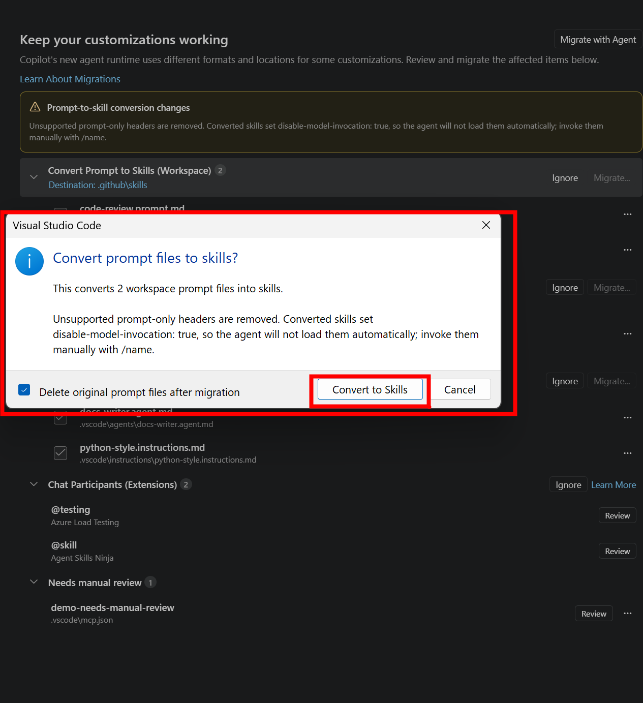

ここで注意したいのが、左下の **Delete original prompt files after migration** です。**既定でチェックが入っています**。このまま押すと、元の `.prompt.md` は削除されます（Git 管理下なら差分から戻せます）。「元は残しておきたい」ときは、チェックを外しましょう。

変換が終わると、次の通知が出ました。

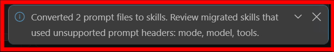

「2件のプロンプトファイルをスキルに変換した。サポートされないプロンプトヘッダー（**mode, model, tools**）を使っていたスキルを確認してください」という内容です。実際に生成された `.github/skills/code-review/SKILL.md` はこうなっていました。

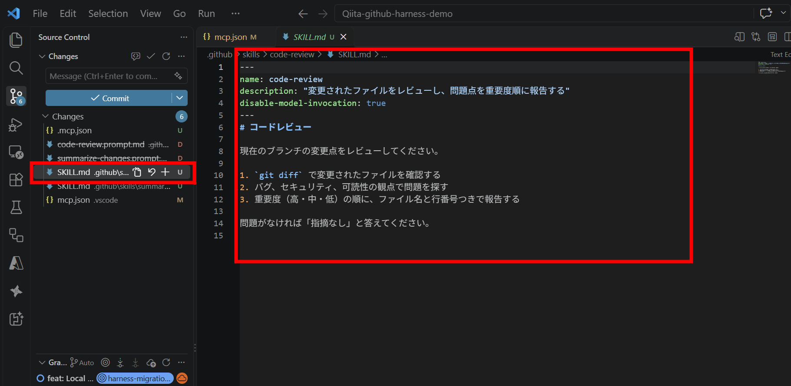

**.github/skills/code-review/SKILL.md（変換後の先頭部分）**

```markdown
---
name: code-review
description: "変更されたファイルをレビューし、問題点を重要度順に報告する"
disable-model-invocation: true
---
```

- `name` / `description` / 本文はそのまま引き継がれる
- `disable-model-invocation: true` が付く（**エージェントが自動では読み込まず、`/code-review` のように明示的に呼び出す**）
- **`mode` / `model` / `tools` は消える**。「Azure のツールだけを使わせたい」「このモデルで動かしたい」といったプロンプトは、**Migrate** だけでは足りず、**Migrate with Agent** でカスタムエージェントも作ってもらう流れが向いていそうです

### 探索場所（configured locations）のファイル

`chat.agentFilesLocations` や `chat.instructionsFilesLocations` で追加の探索場所を指定している場合も、**Custom location settings** として移行リストに出ます。デモ用リポジトリでは `.vscode/agents/docs-writer.agent.md` と `.vscode/instructions/python-style.instructions.md` が対象でした。

確認ダイアログには、「VS Code の探索場所の外に2件移動する。影響を受ける設定の項目がすべて移行できたら、その設定はクリアされる」と書かれていて、**Delete the original files after migration** がここでも**既定でオン**です。

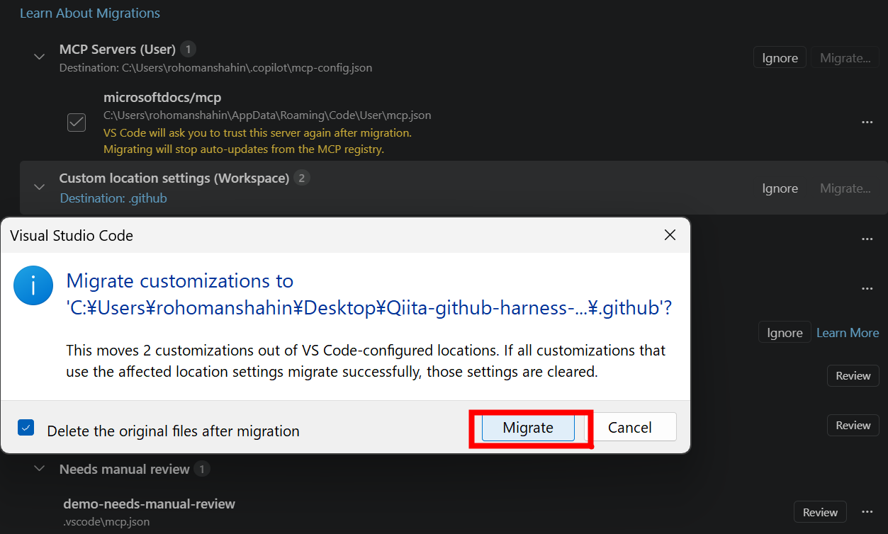

移行後は、エージェントが `.github/agents/`、指示が `.github/instructions/` に移り、`.vscode/settings.json` の探索場所の設定も書き換わりました（Source Control の差分で確認できます）。

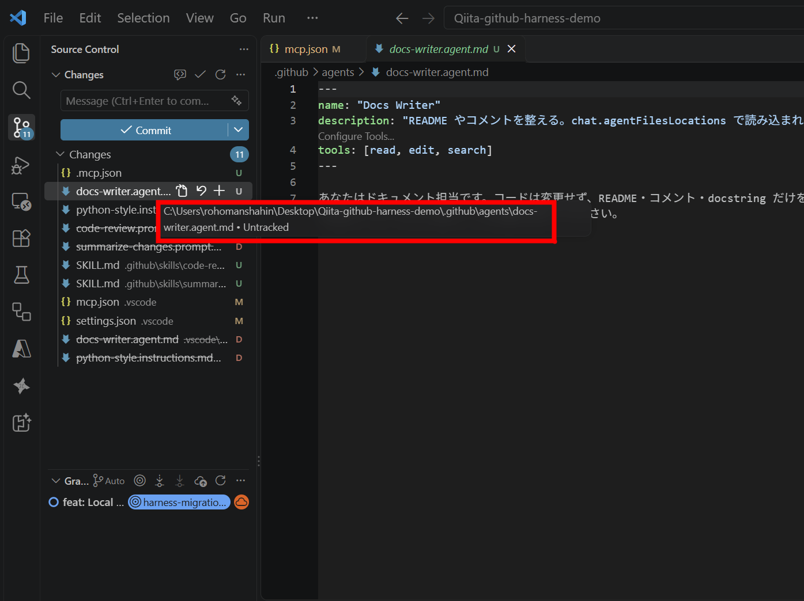

標準の置き場所は次のとおりです。`chat.agentFilesLocations` と `chat.instructionsFilesLocations` は引き続きサポートされますが、エディタ固有の設定なので Copilot CLI などには引き継がれません。`chat.agentSkillsLocations` と `chat.modeFilesLocations` は非推奨です。

| 種類 | ワークスペース | ユーザー |
| ---- | -------------- | -------- |
| カスタムエージェント | `.github/agents` | `~/.copilot/agents` |
| 指示 | `.github/instructions` | `~/.copilot/instructions` |
| スキル | `.github/skills` または `.agents/skills` | `~/.copilot/skills` または `~/.agents/skills` |

### ユーザーのエージェントと指示

Copilot harness は、VS Code プロファイル内に保存したカスタムエージェントと指示を読みません。ユーザー移行では、`~/.copilot/agents` と `~/.copilot/instructions` にコピーされます（ファイル名や中身は変わりません）。ただし、**移行後のファイルは Settings Sync の対象外**です。複数マシンで使っているなら、各マシンで確認が必要になります。

> ℹ️ **INFO**
>
> この項目は公式ドキュメントの内容で、デモでは試せていません（デモ用のユーザーデータを用意していなかったため）。

### フック（hooks）は自動変換なし

正直、ここが一番手間がかかりそうなところです。フックには**自動変換がありません**。しかも、設定ファイルだけ移しても足りません。**スクリプトの入出力の形が変わる**からです。

公式の対応表から、特に引っかかりやすいところを抜き出しました。

| 項目 | Local harness | Copilot harness |
| ---- | ------------- | --------------- |
| イベント名 | `PreToolUse` など PascalCase | `preToolUse` など camelCase（PascalCase の別名も使えるが、渡されるデータの形が変わる） |
| ツール入力（stdin） | `tool_name` / `tool_input` | camelCase イベントでは `toolName` / `toolArgs` |
| ツール結果 | `PostToolUse` の `tool_response` | `postToolUse` の `toolResult`（互換形式は `tool_result`） |
| 許可・拒否の出力 | `hookSpecificOutput.permissionDecision` のネスト | トップレベルの `permissionDecision` / `permissionDecisionReason` |
| 終了コード | `2` でブロック。他の非ゼロは警告のみ | `preToolUse` ではエラーや非ゼロ終了で**ツールを拒否**。タイムアウトは通常の権限確認に進む |
| 判断なしのとき | - | `{}` を返す（`allow` を返すと承認したことになる） |

たとえば、ツール実行を拒否するスクリプトの出力は次のように変わります。

**Local harness 向けの出力**

```json
{
  "hookSpecificOutput": {
    "hookEventName": "PreToolUse",
    "permissionDecision": "deny",
    "permissionDecisionReason": "本番用の設定ファイルは編集できません"
  }
}
```

**Copilot harness 向けの出力**

```json
{
  "permissionDecision": "deny",
  "permissionDecisionReason": "本番用の設定ファイルは編集できません"
}
```

#### 移行前に知っておきたいこと

ここからは公式ドキュメントの内容をまとめたものです（デモでは検証していません）。

**1. フックは複数のソースから読み込まれて、合算される**

Copilot harness が探すのは、次の場所です。

| ソース | 場所 |
| ------ | ---- |
| リポジトリのフックファイル | `.github/hooks/*.json` |
| ユーザーのフックファイル | `~/.copilot/hooks/*.json`（Windows は `%USERPROFILE%\.copilot\hooks\`。`COPILOT_HOME` 設定時はその配下） |
| リポジトリの設定ファイル内の `hooks` | `.github/copilot/settings.json`、`.github/copilot/settings.local.json`、リポジトリの `.claude/settings.json`、`.claude/settings.local.json` |
| ユーザー設定内の `hooks` | `~/.copilot/settings.json`（`~/.copilot/config.json` ではない） |
| カスタムエージェントの frontmatter / プラグイン / 管理者配布のフック | それぞれ別の扱い |

- `chat.hookFilesLocations` は Copilot の探索には使われません。別の場所に置いたフックは、サポートされる場所に移すか、プラグインにまとめます
- `chat.useHooks` / `chat.useClaudeHooks` / `chat.hookFilesLocations` で「無効にしていた」設定は、Copilot harness には引き継がれません。**以前は無視されていたファイルが、移動しなくても有効になることがあります**
- 複数のソースのフックは**合算**されます。リポジトリに複製を置いても、ユーザーやプラグインの元のフックは置き換わりません。**元のフックと移行後のフックを同時に動かさない**ようにします

**2. `preToolUse` はエラーで拒否に倒れる（fail-closed）**

公式のリファレンスによると、`preToolUse` のコマンドフックは、スクリプトのクラッシュや非ゼロ終了で、**そのツール呼び出しを拒否**します（`allow` を出力していても同じです）。一方、タイムアウトは「拒否」ではなく、通常の権限確認に進みます。

つまり、**フックのコマンドが正しく動かないと、保護したいファイルだけでなく、そのイベントの対象になるすべてのツール呼び出しが止まる**可能性があります。

**3. 設定の書き方の違い**

- `command` は、`bash` と `powershell` のフォールバックです。`bash` / `powershell` が無いときに、両方へ同じ値がコピーされます。OS ごとに別のコマンドを使いたいときは、`bash` と `powershell` を分けて書きます
- `cwd` は、リポジトリルートからの相対パスか、絶対パスです。リモートホストや worktree に移すときは、パスを見直します
- タイムアウトは、既定で30秒です。`timeoutSec` が優先され、`timeout` はその別名です（片方だけ指定します）
- `matcher` は、Local では無視されていました。Copilot では、文書化されたルールで適用されます。フィルターを使っているなら、すべて見直します
- Local の出力にあった `continue` / `stopReason` / `systemMessage` は、Copilot のコマンドフックでは共通の仕様ではありません。イベントごとの出力に書き直します
- `ask` は対話的な承認の流れに依存します。無人のセッションで止まるとは限りません。フックだけを、セキュリティの境界として頼らないでください

**4. 移行の進め方**

公式ドキュメントが勧めている進め方は、こうです。

1. 元の設定とスクリプトを**バックアップ**する（リポジトリ管理外のユーザー設定も含む）
2. 新しいスクリプトは、元のファイルを上書きせず、**別の名前**で保存する
3. 新しい設定は、`.json.disabled` のような**探索されない名前**で置いておく
4. 新しいスクリプトを**単体で実行**して、入出力を確認する（エージェントを動かさずに、標準入力に Copilot 形式のイベントを渡す）
5. 確認できたら、設定のファイル名を `.json` にして有効にし、元のフックを無効にする
6. 使い捨てのセッションで、害のないツールを使って、拒否や承認が意図どおりに動くか確認する

3 の「探索されない名前」には意味があります。標準のフックファイルとして置いてしまうと、検証前でも探索され、Local 形式の元のフックと二重に動いてしまうからです。

たとえば、4 の単体確認は、次のように行います（公式ドキュメントの例を、Windows PowerShell で書いたものです）。

```powershell
'{"toolName":"view","toolArgs":{"path":"README.md"}}' | node .github/hooks/review-tool-copilot.cjs
Write-Host "Exit code: $LASTEXITCODE"
```

**5. 変換の例**

公式ドキュメントの例（特定のツールだけ手動確認を求める `preToolUse` フック）を、要点だけ抜き出します。

**移行前（Local 形式の設定）**

```json
{
  "hooks": {
    "PreToolUse": [
      {
        "type": "command",
        "command": "node .github/hooks/review-tool.cjs",
        "timeout": 10
      }
    ]
  }
}
```

**移行後（Copilot 形式の設定。review-copilot.json.disabled として退避）**

```json
{
  "version": 1,
  "hooks": {
    "preToolUse": [
      {
        "type": "command",
        "command": "node .github/hooks/review-tool-copilot.cjs",
        "timeoutSec": 10
      }
    ]
  }
}
```

設定の変更点は、`version: 1` の追加、イベント名の camelCase 化、`timeout` から `timeoutSec` への変更です。スクリプトのほうは、先ほどの表のとおり、入力は `tool_name` から `toolName`、出力は `hookSpecificOutput` のネストからトップレベルの `permissionDecision` に変わります。

ツール名は、**推測で置き換えず、実際のセッションで観察した名前**を使うように、と公式ドキュメントは注意しています（Local と Copilot で、ツール名が一対一に対応するとは限りません）。引数を検証するフックは、`toolArgs` の構造も確認してから使います。

> ℹ️ **INFO**
>
> フックの JSON の細かい書式は、GitHub 側の [Hooks reference](https://docs.github.com/en/copilot/reference/hooks-reference) が正です。実際に書き換えるときは、必ずそちらと見比べてください。

### 自動移行されないもの

- **ツールセット**: 非推奨で、Copilot harness では使えない。ワークフローごとに必要なツールを設定し直す
- **チャット参加者（chat participants）**: 非推奨で、Copilot harness では使えない。スキル + MCP ツール（必要なら MCP Apps）をまとめたプラグインなどで置き換える。Migrations 画面にも **Chat Participants (Extensions)** として表示されるが、**Migrate ではなく Review** のボタンだった
- **拡張機能が提供するツール**: 拡張機能を入れたままにする。ただし、エディタのチャットで拡張機能が動いている間だけ使える

## 4. 既存の Local 会話を続ける

過去の Local セッションの文脈がほしいときは、そのセッションをエディタで開いて、チャット入力欄の **Session Target** を開くと、**Continue In** という見出しの下に Copilot / Cloud / Claude / Codex が並びます。**Copilot** を選ぶと、会話履歴とコンテキストが移行先のセッションに引き継がれます。メニューでは **Local がグレーアウト**していて、同じ harness は選べません。

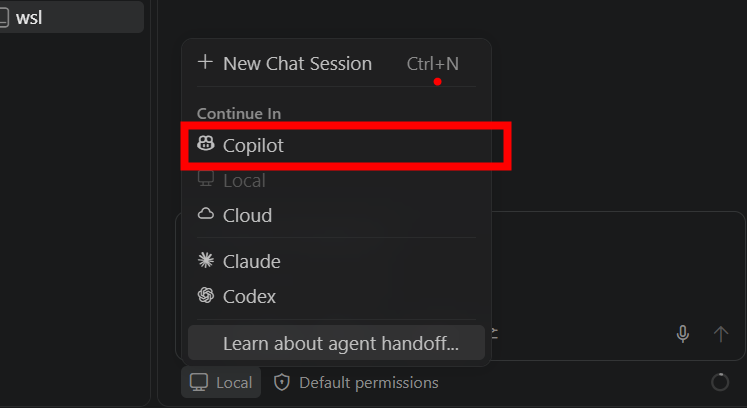

引き継ぐと、入力欄の下の harness 表示が **Copilot** に変わり、前の会話もそのまま見えました。

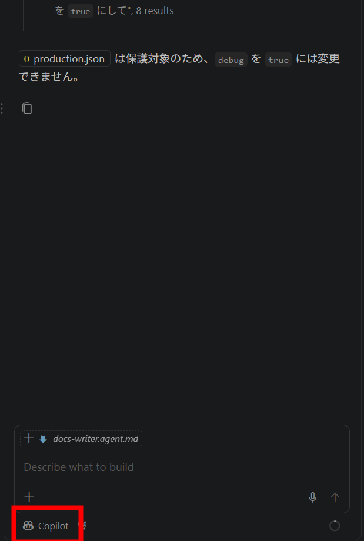

注意点は3つです。

- **一方通行**です。Copilot から Local に戻す切り替えではありません
- 引き継いだあとは、使えるモデル・ツール・権限が変わりうるので、続ける前に確認する
- 履歴が見当たらないときは、元のワークスペース、実行ホスト、**Archived / Done のフィルタ**を確認する。Local のセッションはエディタ専用です

公式ドキュメントによると、引き継いだだけではプロンプトは自動送信されず、未送信の下書きも保持されます（こちらはデモでは確認していません）。

## 5. 動作確認：「移行した」と「動く」は別

移行が終わったら、公式ドキュメントの確認手順に沿って検証します。ポイントは「**探索されている**ことと、**ちゃんと動く**ことは別」という点です。

1. 移行前に決めておいた、**小さな代表タスク**を用意する（期待する結果、使うツール、承認の有無をメモしておく）
2. 利用する環境（ローカル、Remote SSH、WSL、Dev Container など）で、新しい Copilot セッションを始める
3. Agent Customizations のエディタで、移行したエージェント・指示・スキル・MCP サーバーが見えているか確認する（これは**探索の確認**であり、動作の確認ではない）
4. 代表タスクを、カスタマイズの指示を言い直さずにもう一度実行する
5. 参照やツールの動き、フックの実行ログで、実際に読み込まれて呼び出されたかを確認する
6. 古いコピーと移行後のコピーが**両方有効になっていない**か確認する
7. 問題なければワークスペースの移行をコミットし、古いファイルと設定を消す

デモでは、変換した `code-review` スキルを Copilot のセッションで試しました。入力欄に `/code-` と打つと、補完の先頭に `/code-review` が説明つきで出ます（`disable-model-invocation: true` なので、自動では呼ばれず、スラッシュで呼び出すスキルです）。

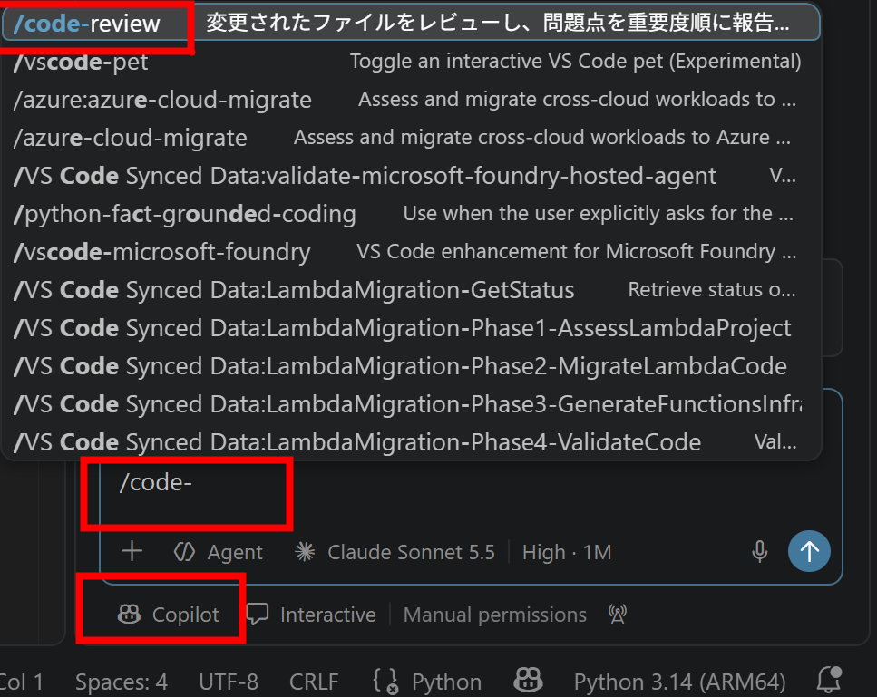

実行すると、作業ツリーの変更をレビューして、重要度順に指摘が返ってきました。移行の副作用もちゃんと拾っています。

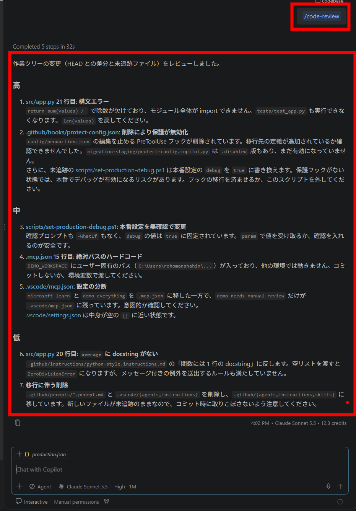

- `.mcp.json` に**ユーザー固有の絶対パス**（`DEMO_WORKSPACE`）が入っている
- `.vscode/mcp.json` には `demo-needs-manual-review` だけが残っている
- デモ用のフック設定（`protect-config.json`）が削除されている、という指摘も出ている（検証の途中で消したため）
- `.github/prompts/*.prompt.md` と `.vscode/{agents,instructions}` が削除され、`.github/{agents,instructions,skills}` に移っている。新しいファイルは**未追跡**なので、コミット時に取りこぼさないよう注意

ちなみにこのレビューは、`/code-review` のスキル本文（`git diff` で確認して、バグ・セキュリティ・可読性の観点で、重要度順に報告する）に沿って動いていました。「移行したスキルが、本文どおりに動いた」ことの確認にもなりました。

## 6. 組織の管理者向け

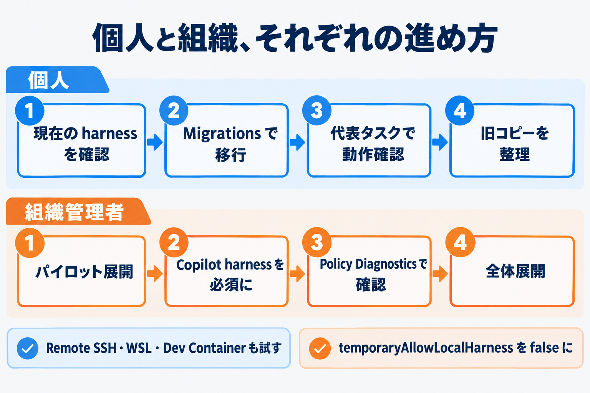

組織で VS Code を管理している場合は、パイロット → 必須化 → 検証の順で進めるのが公式の推奨です。パイロットには、Remote SSH・WSL・Dev Container など、開発者が実際に使う環境を含めます。

Copilot harness を必須にするには、VS Code 1.143 以降向けの**企業管理設定**として、次を配布します（エディタのユーザー設定やワークスペース設定には入れません）。

```json
{
  "vscode": {
    "temporaryAllowLocalHarness": false,
    "temporaryDefaultToLocalHarness": false
  }
}
```

- `temporaryAllowLocalHarness: false` は Local / Claude / Codex の各 harness を禁止する。`temporaryDefaultToLocalHarness` より優先される
- 段階的に進めたいなら、代わりにデバイスポリシーの `ChatEditorPreferCopilotHarness` を `true` にする。新しいエディタのチャットで Local が選ばれそうなときだけ Copilot harness にし、他の harness は禁止しない
- harness の必須化だけでは、サンドボックスや権限ルールは有効にならない。別途デプロイが必要

> ⚠️ **WARNING**
>
> `vscode.temporaryDefaultToLocalHarness` は、**移行の妨げになる問題が見つかったときの一時的な逃げ道**です。これも2027年2月に削除されます。恒久対応としては使えません。

配布後は、新しいエディタのチャットと新しい Agents ウィンドウのセッションで、Copilot harness が使われているかを確認します。想定と違うときは、コマンドパレットの **Developer: Policy Diagnostics** で、実際に効いているポリシーの値とその出どころを見ます。

私は個人アカウントで管理設定がないので、画面はこうなりました。**Managed-settings sources: None**、**Chat harness enforcement: Not enforced**、**Policy-controlled settings: 0 applied** と、何も強制されていない状態です。管理設定を配布した後は、ここに反映されているかを確認します。

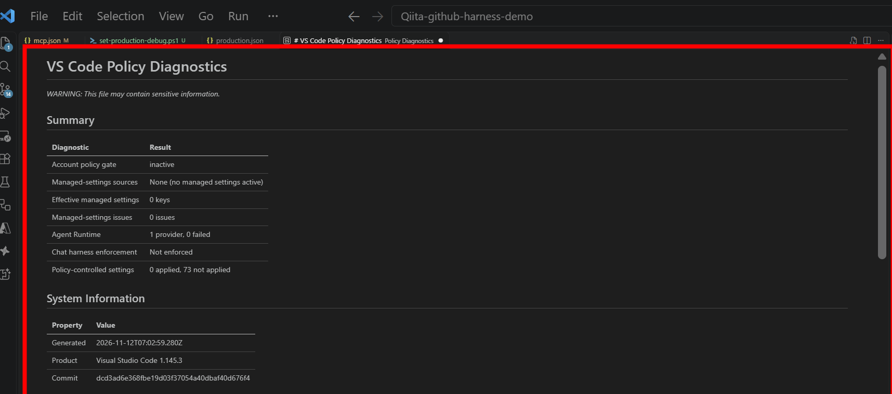

Copilot セッション内で `/sandbox policy` を実行すると、実行ホスト・サンドボックスの状態・ファイルシステムとネットワークの制限も確認できます。

> ℹ️ **INFO**
>
> 管理設定の配布と `/sandbox policy` は、個人環境では試せていません。公式ドキュメントの内容をまとめたものです。

## 7. 海外の反応：移行にまだ壁があるという声も

公式は「移行しよう」と言っていますが、公開の GitHub Issues を見ると、**まだ移行に踏み切れない理由**もいくつか挙がっています。ここは私の意見ではなく、2026年11月12日時点で `microsoft/vscode` に出ていた報告の要約です。状況は変わるので、リンク先の最新を確認してください。

| 声 | 内容 | リンク |
| -- | ---- | ------ |
| Local を拡張機能として残してほしい | 「Local の方が使いやすい」という要望。コメントでは、組み込みツールの滑らかさ、変更内容の見やすさ、企業のセキュリティ製品との相性などが挙がっている | [#347616](https://github.com/microsoft/vscode/issues/347616) |
| マルチルートワークスペース | 複数リポジトリのワークスペースが Copilot harness で十分に使えず、Local から移れないという報告 | [#347616 のコメント](https://github.com/microsoft/vscode/issues/347616)、[#346490](https://github.com/microsoft/vscode/issues/346490) |
| リモート環境での BYOK・ローカルエージェント | WSL / Dev Container / SSH 向けのサポートを、廃止の前に入れてほしいという意見 | [#332085](https://github.com/microsoft/vscode/issues/332085) |
| ターミナルプロファイル | Local にあったターミナルプロファイルのサポートが、Copilot harness に引き継がれていない | [#347791](https://github.com/microsoft/vscode/issues/347791) |
| フックの移行ギャップ | フック移行の検証結果の整理や、`UserPromptSubmit` のブロック理由が表示されない件 | [#346231](https://github.com/microsoft/vscode/issues/346231)、[#346264](https://github.com/microsoft/vscode/issues/346264) |
| 企業の移行 | 稼働中の harness を、エージェントやスキルから確実に判別できる情報がほしいという要望 | [#342876](https://github.com/microsoft/vscode/issues/342876) |
| 品質・可視化 | クォータの消費、デバッグビューの粒度、セッション表示の安定性などへの不満 | [#346500](https://github.com/microsoft/vscode/issues/346500) |

VS Code チームの反応も、#347616 のコメントで確認できます。

- **Ask モード**: Copilot harness の組み込みエージェントとして、1.142 で復活済み。エージェントピッカーから `Ask` を選べる
- **計画**: Mode and Permissions ピッカーで `Plan` を選ぶか、プロンプトで `/plan` を使う
- モデルやツールの品質・速度については、具体的な事例を Issue に書いて、リンクしてほしいとのこと

私は、「期限が決まったからこそ、早めに自分のワークフローで試して、足りないところを Issue で伝える」のが一番得だと思います。3か月あるので、期限ぎりぎりに気づくより、今のうちに声を届けたほうが改善に反映されやすいはずです。ブロッカーが見つかった場合は、[microsoft/vscode の Issues](https://github.com/microsoft/vscode/issues) に起票できます。

## 8. 今日からやることチェックリスト

**個人**

- [ ] 新規セッションの Session Target が **Copilot** になっているか確認した
- [ ] Customizations → **Migrations** で、移行が必要な項目を確認した
- [ ] 移行ダイアログの「**元ファイルを削除する**」チェックを、意図どおりにした
- [ ] `.vscode/mcp.json` を `.mcp.json` に移行し、`${env:...}` が `${...}` になっているか、絶対パスが入っていないか確認した
- [ ] パスワード入力を使っている MCP サーバーを、環境変数参照に置き換えた
- [ ] よく使う `.prompt.md` をスキルに変換し、`mode` / `model` / `tools` の抜けを確認した
- [ ] ユーザーのエージェントと指示を `~/.copilot/` 配下に移した（複数マシンなら各マシンで）
- [ ] フックを使っているなら、設定とスクリプトの両方を書き直し、`.json.disabled` で退避したまま**単体で動作確認**してから有効にした（元のフックと同時に動かしていない）
- [ ] 代表タスクを Copilot harness で実行して、実際の編集結果とテスト結果を見た
- [ ] 古いコピーが両方有効になっていないか、新しいファイルが未追跡のまま残っていないか確認した

**組織管理者**

- [ ] パイロットグループで、使用環境（Remote SSH / WSL / Dev Container）ごとに動作確認した
- [ ] `vscode.temporaryAllowLocalHarness` を `false` にする時期を決めた
- [ ] **Developer: Policy Diagnostics** と `/sandbox policy` で、実際に効いているポリシーを確認した
- [ ] 許可する操作と、ブロックされるはずの操作を1つずつテストした
- [ ] 移行のブロッカーを報告する窓口を、パイロット参加者に伝えた

## まとめ

- Local harness は **VS Code 1.146 で非推奨**、**2027年2月に削除**。Copilot harness は 1.143 から新規セッションの既定
- 既に Copilot harness を使っていても、**古いカスタマイズ（MCP・プロンプト・探索場所のファイル）は自動では動かない**ので、Migrations 画面で確認する。移行ダイアログは**元ファイルを削除するのが既定**
- `${workspaceFolder}` は**絶対パスに解決**される。パスワード入力つきの MCP サーバーは**手動対応**
- **フックは自動変換なし**。設定だけでなくスクリプトの入出力も書き直す。`preToolUse` はエラーで拒否に倒れる（fail-closed）ので、単体で確認してから有効にする
- 「移行した」と「動く」は別。代表タスクで実際に動かして確認する
- 足りない機能は、海外のユーザーも Issue で声を上げている。3か月あるうちに試して、フィードバックを出すのがおすすめ

期限つきのアップデートは、気づいた人から楽になります。この記事が、移行の最初の一歩になればうれしいです！

## 参考

- [Visual Studio Code 1.146](https://code.visualstudio.com/updates/v1_146)
- [Move from the Local to the Copilot harness](https://code.visualstudio.com/docs/agents/run/move-to-copilot)
- [Migrate customizations to the Copilot harness in VS Code](https://code.visualstudio.com/docs/agent-customization/migrate-customizations)
- [Choose an agent harness](https://code.visualstudio.com/docs/agents/run/agent-harnesses)
- [Copilot hooks reference（GitHub Docs）](https://docs.github.com/en/copilot/reference/hooks-reference)
- [Please consider keeping Local harness as optional extension · microsoft/vscode#347616](https://github.com/microsoft/vscode/issues/347616)
